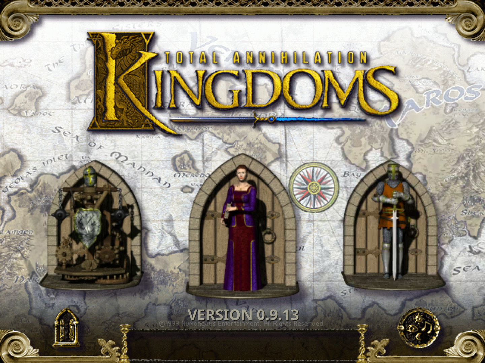
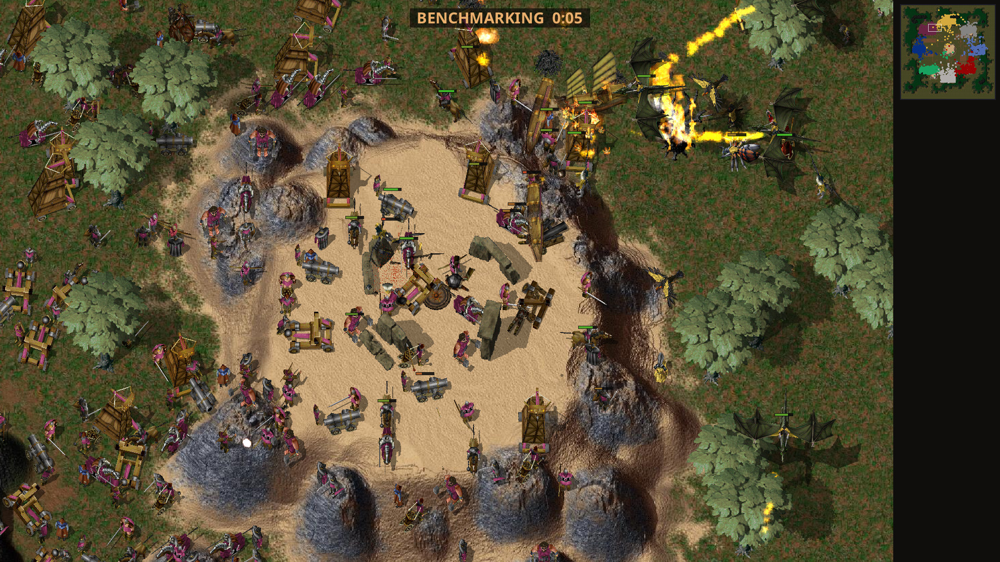
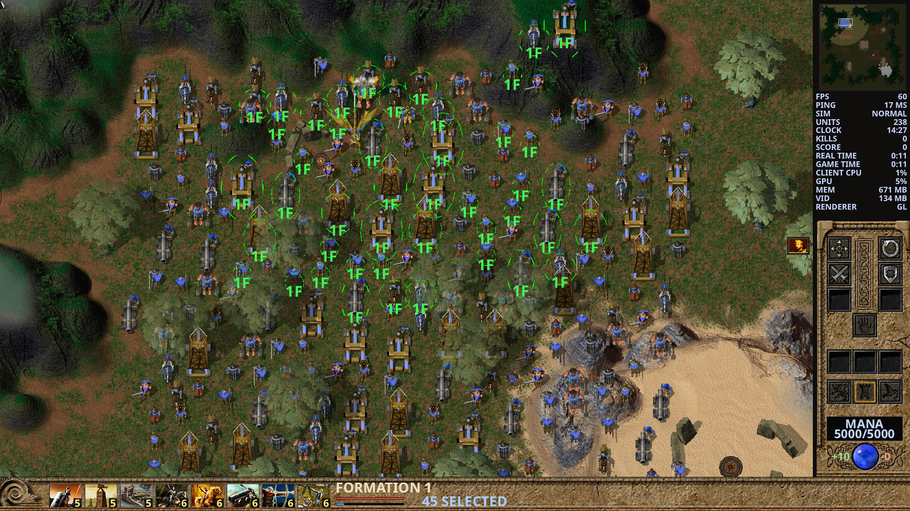
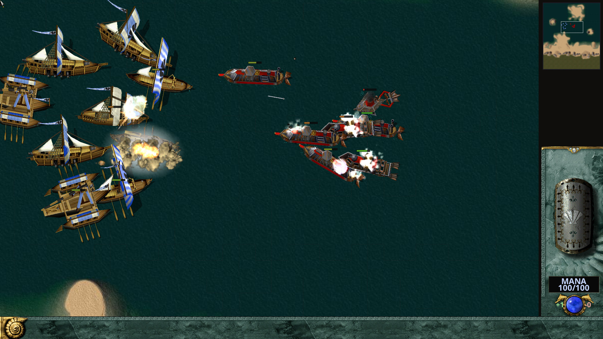
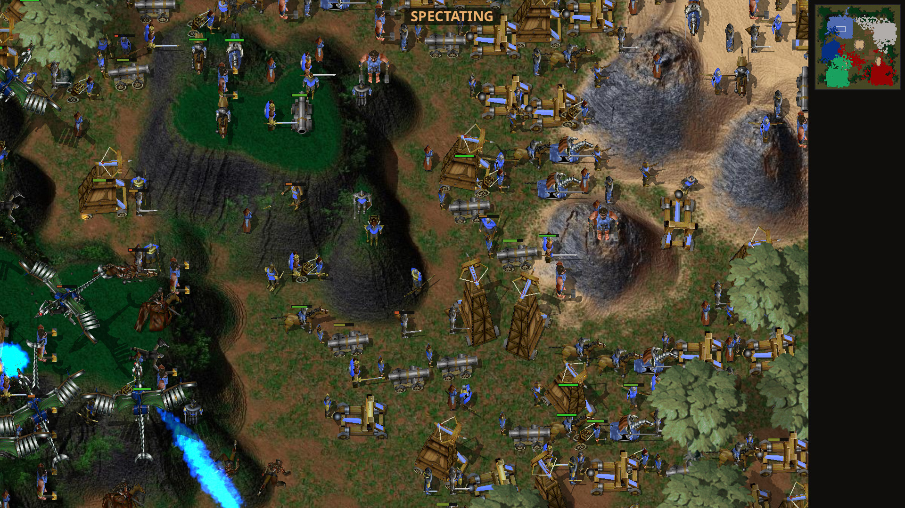
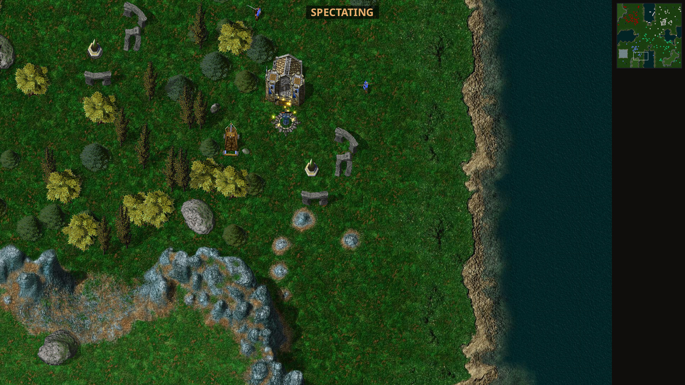
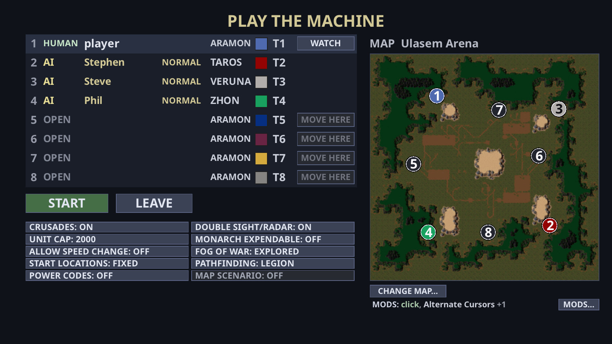
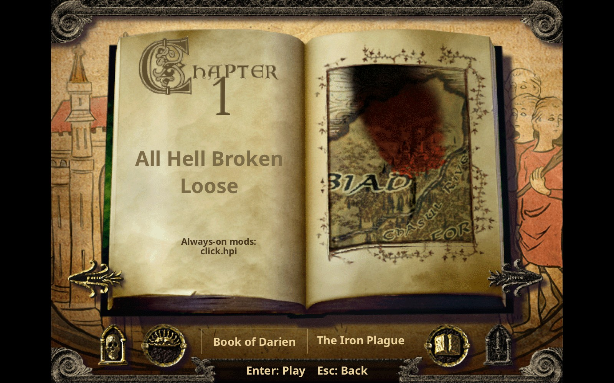
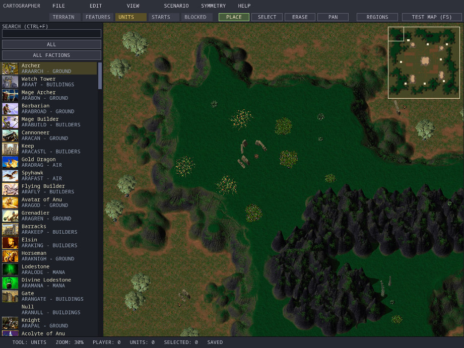
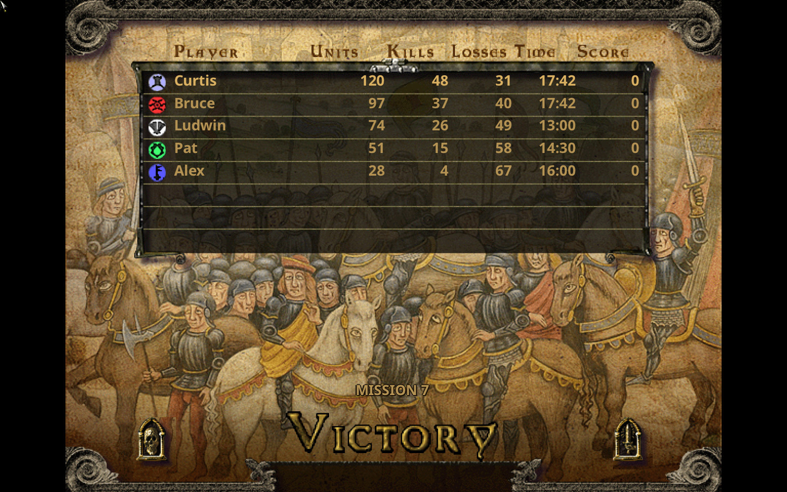

# TAK Engine

**Play Total Annihilation: Kingdoms on modern systems.**

A clean-room C++20 / SDL2 recreation of Cavedog's 1999 fantasy RTS.

[Download](https://github.com/pocketgeek/tak-engine/releases/latest) · [Getting started](#getting-started) · [Quick start](docs/quick-start.md) · [User guide](docs/user-guide.md) · [Map editor guide](docs/cartographer-guide.md) · [Changelog](CHANGELOG.md) · [Build from source](docs/development.md)

Command Aramon, Taros, Veruna, Zhon or Creon in skirmishes, campaigns and
multiplayer. TAK Engine reads your original game's maps, models, scripts,
interface art and sound straight from its installation folder.

> **You need your own copy of Total Annihilation: Kingdoms.** No game assets are
> included. An installation of *Kingdoms + The Iron Plague*, such as the GOG
> edition, supplies everything. Without *The Iron Plague* you have the four
> original sides and the base campaign: the Creon side and its campaign need the
> `IP*.hpi` archives.

## TAK Engine 1.0.3

- The original game on Windows, macOS and Linux: skirmish, both campaigns and
  multiplayer, read from your own installation.
- A game room where the host picks the map, an installed one or a random one,
  and the rules; online games get a name and an optional password when created.
- Retail pathfinding and the Retail AI ported from the original, beside Legion
  pathfinding for large armies and seven AI levels of TAK Engine's own.
- Simulation threads spread a big battle over your processor's cores
  (**Settings → Game → Performance**).
- Random maps, the Cartographer editor, mods, replays, voice chat, YouTube
  streaming and a Benchmark.

New in 1.0.3: units no longer keep attacking what they can never hurt: they move to a clear
shot, back out of their minimum range or give up, landed flyers on Hold Position take off
to fight, and the computer picks weapons that work.

Network protocol 325, replay format 15 (1.0.3 does not play with 1.0.2). Details in the
[CHANGELOG](CHANGELOG.md).

## Features

- **Skirmish** on up to eight slots with all five sides, teams, Retail or
  Crusades balance and eight computer-player levels, including **RETAIL**, the
  original game's own AI ([AI difficulty](docs/user-guide.md#ai-difficulty)).
- **Random maps** in five themed layouts and three classic ones, from 8×8 to
  64×64 sections, width and height set separately
  ([random maps](docs/user-guide.md#random-maps)).
- **Two pathfinding modes:** Retail, as in 1999 (the default), and
  Legion for large armies ([Legion](docs/user-guide.md#legion)).
- **Power codes:** the original cheat codes, when a game allows them
  ([power codes](docs/user-guide.md#power-codes)).
- **Multiplayer** through a server, with accounts, password-locked games,
  spectators, a disconnect wait with computer takeover, voice chat and
  automatic map and mod transfer, or on your own network with **LOCAL SERVER**
  ([multiplayer](docs/user-guide.md#multiplayer)).
- **Campaigns:** *The Book of Darien* (48 missions) and *The Iron Plague* (25,
  with its alternate ending) ([campaigns](docs/user-guide.md#campaigns)).
- **Replays** of every game you play or watch ([replays](docs/user-guide.md#replays)).
- **Mods** for art and sound, or for units and rules
  ([mods](docs/user-guide.md#mods)).
- **Cartographer**, a map and scenario editor
  ([map editor guide](docs/cartographer-guide.md)).
- **YouTube streaming** built in ([streaming](docs/streaming.md)), and a
  repeatable **Benchmark** whose results save as a JPG
  ([benchmark](docs/user-guide.md#benchmark)).
- **Simulation threads**: large battles use several processor threads; the
  number, and whether they are pinned to cores, are set under
  **Settings → Game** ([performance](docs/user-guide.md#performance)).

<table>
  <tr>
    <td colspan="2"> An eight-AI Benchmark battle on Ulasem Arena</td>
  </tr>
  <tr>
    <td width="50%"> A mixed selection: one portrait per unit type</td>
    <td width="50%"> Veruna's fleet against Creon ships</td>
  </tr>
  <tr>
    <td width="50%"> Creon Neo Dragons strike an Aramon siege column</td>
    <td width="50%"> A generated map with Scattered Mana
    </td>
  </tr>
  <tr>
    <td width="50%"> A game room: seats, start positions and mods
    </td>
    <td width="50%"> The campaign book
    </td>
  </tr>
  <tr>
    <td width="50%"> Cartographer, the map editor</td>
    <td width="50%"> Post-game statistics
    </td>
  </tr>
</table>

Some views are staged scenes; the <a href="docs/img/README.md">capture notes</a> say how each picture was made.

## Download

Get the current version from the
[latest release](https://github.com/pocketgeek/tak-engine/releases/latest).
Each file name starts with `tak-engine-<version>-` (Linux packages, Windows
installer, DMGs) or `takclient-<version>-` (ZIPs), followed by:

| System | File |
| --- | --- |
| Windows x64 | `windows-x64-setup.exe` installer, or `windows-x64.zip` |
| Windows 11 on ARM | `windows-arm64.zip` |
| macOS 14 or later, Apple Silicon | `macos-arm64.dmg`, or `macos-arm64.zip` |
| macOS 14 or later, Intel | `macos-x64.dmg`, or `macos-x64.zip` |
| Ubuntu 22.04 / 24.04 / 26.04 | `ubuntu<version>-amd64.deb` or `-arm64.deb` |
| Debian 12 / 13 | `debian<version>-amd64.deb` or `-arm64.deb` |
| Fedora 44 / 45 | `fedora<version>-x86_64.rpm` or `-aarch64.rpm` |
| openSUSE Leap 16.0 | `opensuse-leap16.0-x86_64.rpm` or `-aarch64.rpm` |
| openSUSE Tumbleweed | `opensuse-tumbleweed-x86_64.rpm` or `-aarch64.rpm` |
| RHEL, Rocky Linux, AlmaLinux 9 / 10 | `el<version>-x86_64.rpm` or `-aarch64.rpm` |
| Arch Linux (x64) | `1-x86_64.pkg.tar.zst` |
| Slackware64 15.0 | `x86_64-1_slack15.0.txz` |
| Any other Linux, Steam Deck | `x86_64.AppImage` or `aarch64.AppImage` |

The `-debug` downloads are for diagnosing problems, not for playing. The macOS
app and DMG are signed and notarized by Apple; the Windows installer and
executables are signed. Libraries the game needs are bundled: your system
provides only graphics, sound and windowing.

## Install

- **Windows:** run the installer, which adds the Start menu shortcuts
  **Total Annihilation - Kingdoms** and **TAK Cartographer**. Or unpack the
  ZIP anywhere and run `takclient.exe`.
- **macOS:** open the DMG and drag **Total Annihilation - Kingdoms** (and
  **TAK Cartographer**, if you want the editor) to Applications. From the ZIP,
  launch the `.app`, not the program files beside it.
- **Linux:** install the package as administrator:
  `apt install ./tak-engine-….deb`, `dnf install ./tak-engine-….rpm`,
  `zypper install ./tak-engine-….rpm`, `pacman -U ./tak-engine-….pkg.tar.zst`
  or `upgradepkg --install-new ./tak-engine-….txz`. The application menu then
  shows **Total Annihilation: Kingdoms** and **Cartographer**. Or, on any
  distribution or a Steam Deck, make the AppImage executable and run it: it starts
  the game, and `cartographer` or `takserver` as its first argument starts those.
  On a Wayland desktop the game and Cartographer open native Wayland windows,
  sharp at any display scale (GNOME without the libdecor library keeps X11);
  **Settings → Graphics → Native Wayland** changes this.

Every package holds the game, the Cartographer map editor and the dedicated
server `takserver`. No server shortcut is added and no server starts by itself.
Updating? Install the new version over the old one;
[Updating](docs/user-guide.md#updating) says what carries over.

## Getting started

1. Launch **Total Annihilation: Kingdoms**.
2. When asked, choose your original game's installation folder: the one that
   holds `data.hpi`, `terrain.hpi`, `sections.hpi` and `maps.hpi`. Nothing
   needs extracting. The game remembers the folder; change it later under
   **Settings → Game → Data folder**.
3. Pick a door on the main menu: **single player** for a skirmish,
   **multiplayer** to join a server, or **campaign** for the missions.

The [quick start](docs/quick-start.md) walks you through a first skirmish, an
online game and a campaign mission, and lists the controls on one page. If the
game turns your folder down, see [Game data](docs/user-guide.md#game-data).

From the command line, the game accepts `--data <folder>`, `--play-map
<map.kmp>` (with `--game-mod <pack>`), `--version` and `--help`; see
[Command line](docs/user-guide.md#command-line).

## Playing

- **Single player:** choose a map, your side and computer opponents, then
  start. Your first game step by step:
  [Your first skirmish](docs/user-guide.md#your-first-skirmish).
- **Multiplayer:** choose a server, sign in (an unused name registers itself on
  first sign-in), then join a game, or **CREATE** one with a name and, to lock
  it, a password. Only the server needs an open network port. See
  [Multiplayer](docs/user-guide.md#multiplayer).
- **Campaigns:** every chapter of both campaigns can be played in any order.
  See [Campaigns](docs/user-guide.md#campaigns).
- **Replays:** every game you play or watch is recorded; open one from **Settings → Load
  Replay**. See [Replays](docs/user-guide.md#replays).
- **Map editor:** Cartographer makes maps and scenarios and tests them in the
  game with **F5**. See the [map editor guide](docs/cartographer-guide.md).

## Mods

Mods go in your install folder's `mods/`, one folder per pack, as loose game
files or `.hpi`, `.ufo` and `.kmp` archives:

| Folder | What it does |
| --- | --- |
| `mods/cosmetic/<pack>/` | Art and sound only. Each player ticks their own in the room; never sent to anyone. |
| `mods/cosmetic/always_enabled/<pack>/` | Cosmetic packs that are always on, in every game, campaigns and replays included. |
| `mods/game/<pack>/` | Units, rules, anything. The host ticks them in the room and they are sent to every player. |
| `mods/game/always_enabled/<pack>/` | Game packs applied in every game you host. Never in campaigns. |

Files placed directly in `mods/`, `mods/cosmetic/`, `mods/game/` or an
`always_enabled/` folder are never loaded. Load order, limits and AI profiles in
mods: [Mods](docs/user-guide.md#mods).

## Hosting a server

You only need a server of your own to host games for other people; single
player starts a private one by itself. The Linux packages include a systemd
service (not enabled) and templates for automatic Let's Encrypt certificates;
on Windows and macOS you run `takserver` directly. The
[server guide](docs/public-server.md) starts with the quick setup for the Linux
package and covers certificates, limits, status queries and
[the service in detail](docs/public-server.md#linux-service-setup).

## Project status

TAK Engine 1.0.3 is complete: skirmish, both campaigns, multiplayer with its own
server, replays, the Benchmark and the Cartographer editor are all in place and
supported. It aims to behave as the original game did; that is not a claim that
every mission, animation or interaction is identical or fully verified.

- Selected movement, combat, transport, scripting and animation routines are checked
  against the original executable by emulating them headlessly. Retail
  pathfinding is a port of the original's.
- The **RETAIL** AI level is the original game's own AI, ported routine by
  routine and checked by emulation. The seven other levels (Passive to Absurdly
  Defensive) are TAK Engine's own.

The evidence and the remaining gaps: [retail engine notes](docs/retail-engine.md),
[Retail pathfinding port](docs/pathfinding-port.md),
[Legion pathfinding](docs/legion-pathfinding.md),
[Retail AI port](docs/classic-ai-plan.md) and
[campaign implementation](docs/campaign-design.md).

## Building from source

Source builds use C++20, CMake and bundled static dependencies. The
[development guide](docs/development.md) covers dependencies, every platform,
tests, developer launch modes and packaging. After changing the simulation, the
AI or networking, rebuild all targets so the client and server stay in step.

## Reporting bugs

Bug reports are most useful with the engine version, platform, map, balance
setting, steps to reproduce, and a replay or screenshot where relevant.
Do not attach retail game archives or executables.

## License

The engine is **GPL-3.0-or-later**; see [LICENSE](LICENSE).
The original game's code, data and art remain their owners' property, and this
repository distributes engine source, not game content. TAK Engine is a fan
project with no connection to the game's rights holders.
