# Cartographer user guide

[Back to the README](../README.md) · [Game user guide](user-guide.md) · [Scenario reference (technical)](crt-triggers.md)

**Cartographer** is TAK Engine's map and scenario editor. You use it to build
maps for *Total Annihilation: Kingdoms* out of the original game's terrain
pieces, trees, rocks and buildings, to set up start positions, and to add
scripted scenarios with placed units, named areas and trigger rules. It comes
with every TAK Engine package, next to the game.

This guide is for players and mapmakers. It explains what you see on screen and
what each control does, from a first map to sharing a finished one.

This guide describes Cartographer in TAK Engine 0.9.12; changes by version are in
the [CHANGELOG](../CHANGELOG.md).

Every picture in this guide is a real Cartographer screen (the Test Map lobby is
the game's), using the original game's art. Some put two moments side by side,
and the first one has numbered markers added. The maps shown are shipped maps
(*Ulasem Arena*, *King of the Hill*) or maps made in the editor for the guide.

## Contents

1. [What Cartographer does](#what-cartographer-does)
2. [Getting started](#getting-started)
3. [Walkthrough: your first 2-player map](#walkthrough-your-first-2-player-map)
4. [Quick how-tos](#quick-how-tos): [a scenario map](#make-a-scenario-map-in-6-steps), [an AI mod](#make-an-ai-mod-in-5-steps)
5. [The editor window](#the-editor-window)
6. [Moving around the map](#moving-around-the-map)
7. [Tools, modes and layers](#tools-modes-and-layers)
8. [Terrain](#terrain)
9. [Features: trees, rocks, mana and ruins](#features-trees-rocks-mana-and-ruins)
10. [Blocked cells](#blocked-cells)
11. [Units](#units)
12. [Start positions](#start-positions)
13. [Selecting, copying and undo](#selecting-copying-and-undo)
14. [Symmetry](#symmetry)
15. [Generating a random map](#generating-a-random-map)
16. [Scenario maps](#scenario-maps)
17. [AI profiles](#ai-profiles)
18. [Checking your map](#checking-your-map)
19. [Testing a map in the game](#testing-a-map-in-the-game)
20. [Saving, opening and sharing](#saving-opening-and-sharing)
21. [Preferences](#preferences)
22. [Keyboard and mouse reference](#keyboard-and-mouse-reference)
23. [Troubleshooting and FAQ](#troubleshooting-and-faq)
24. [Known limits](#known-limits)

---

## What Cartographer does

A *Total Annihilation: Kingdoms* map has several layers, and Cartographer edits
all of them:

| Layer | What it is | Where in this guide |
| --- | --- | --- |
| **Terrain** | The ground: its painted art and its heights. It is built from the game's prefab terrain **sections** (cliffs, coasts, rivers, hills, plazas and so on). | [Terrain](#terrain) |
| **Features** | Trees, rocks, mana deposits, ruins, walls and other map objects. | [Features](#features-trees-rocks-mana-and-ruins) |
| **Start positions** | Where each player's Monarch begins, numbered 1 to 8. | [Start positions](#start-positions) |
| **Scenario** | Placed units, named regions, trigger rules and a list of allowed units. | [Units](#units), [Scenario maps](#scenario-maps) |

Cartographer saves a map as one **`.kmp`** file in your game's `Maps` folder.
The game finds it there and lists it with the other maps for skirmish and
multiplayer games.

> **Scenario content plays when a game asks for it.** Placed units, trigger
> rules and the Use Only unit list run when you open the map with **Test Map
> (F5)** or the game's `--play-map` option, and in any skirmish or multiplayer
> game created with **MAP SCENARIO** turned on. That button sits under the map
> preview and can be turned on when the map's scenario has placed units or
> rules. It starts off: chosen with it off, your `.kmp` plays as a normal
> skirmish map (its terrain, features and start positions, a Monarch for every
> player). The test copy that Test Map and `--play-map` leave in the map list
> (with a fingerprint in brackets after its name) always plays the scenario of a
> map that has one. See [When scenarios run](#when-scenarios-run).

---

## Getting started

### Starting Cartographer

Every TAK Engine package installs Cartographer beside the game:

| System | How to start it |
| --- | --- |
| Windows | **TAK Cartographer** in the Start menu (installer), or `cartographer.exe` in the same folder as `takclient.exe` (portable ZIP). |
| macOS | **TAK Cartographer.app**, which the disk image places next to **Total Annihilation - Kingdoms.app**. Keep both apps in the same folder, for example Applications. |
| Linux | **Cartographer** (Map Editor) in your application menu, or `cartographer` in a terminal. |

Test Map starts the game from the folder Cartographer runs from (on macOS, the
folder holding TAK Cartographer.app), so keep the two programs installed together.

### The game data folder

Cartographer reads the same retail installation as the game, and it uses the
**same setting**: change the folder in either program and both use the new one.
When it starts, Cartographer picks the folder in this order:

1. A folder given with `--data` on the command line.
2. The folder it was started from, if that folder is a game installation.
3. The folder saved in the game's settings (chosen in the game's
   **Options → Data folder**, or in Cartographer's [Preferences](#preferences)).
4. Otherwise it asks, with a folder picker titled **Select your Total
   Annihilation: Kingdoms install folder**.

The folder must contain `data.hpi`, `terrain.hpi`, `sections.hpi` and
`maps.hpi` (and a `Maps` folder for your own maps). If you pick another folder,
a **Not a game folder** message says what is missing and the picker opens again.
Cancelling the picker closes Cartographer. On Linux the picker needs `kdialog`
or `zenity`.

### The first screen

Started from its shortcut, Cartographer opens an empty window with no map: the
title bar reads just **Cartographer**, the status bar **NO MAP OPEN**, and the
middle shows **NO MAP OPEN** with a short hint (*File > New map (Ctrl+N) or Open
map (Ctrl+O). AI mods: File > New AI mod or Open AI mod.*). The toolbar, browser
and minimap stay empty and do nothing until a map is open. Start from the
**File** menu:

- **File → New map** (**Ctrl+N** or **N**) opens the **New Map** dialog. Fill
  it in and click **CREATE** (or **RANDOM** for a generated map; see
  [Generating a random map](#generating-a-random-map)).
- **File → Open map** (**Ctrl+O**) edits an existing map. See
  [Opening a map](#opening-a-map).
- **File → New AI mod...** (**Ctrl+Shift+N**) and **Open AI mod...**
  (**Ctrl+Shift+O**) edit a game mod's AI files, which need no map. See
  [Making an AI mod without a map](#making-an-ai-mod-without-a-map).

Until then only these File commands, **Exit**, the UI size under **View**,
**View → Preferences** and **Help** are available; everything else is greyed
out. Cancelling either dialog returns to the empty window. There is nothing to
save, so closing Cartographer straight away (**File → Exit**, the window's
close button or **Esc**) asks nothing; holding **Esc** down after closing a
dialog does not quit. A map named when Cartographer
starts that cannot be opened shows **OPEN FAILED** and then the same empty
window.


*The empty window that a bare launch opens. Nothing is drawn until a map is open.*

### The New Map dialog

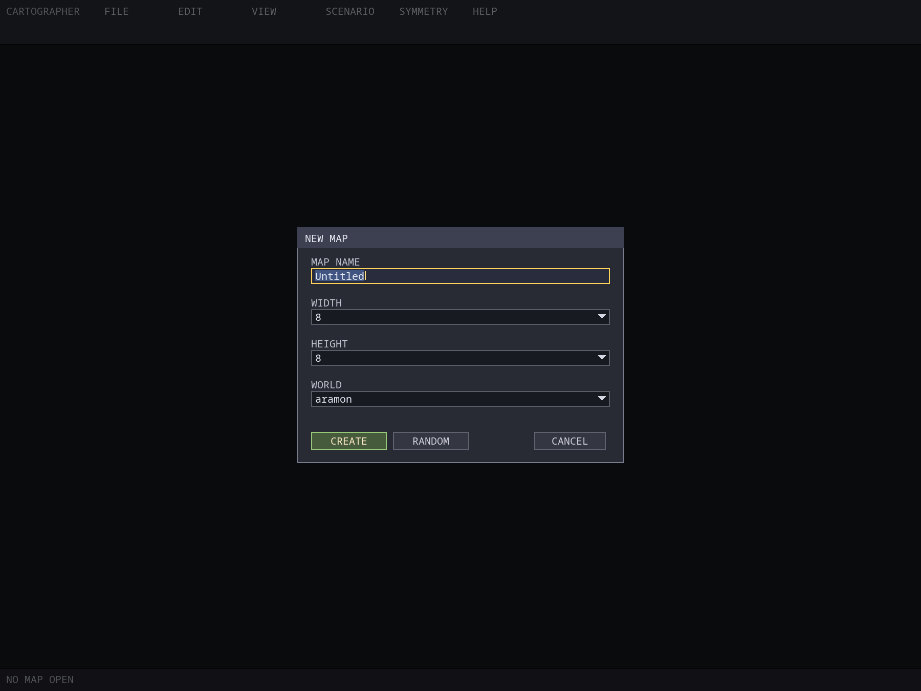

*The **New Map** dialog, opened with **File → New map** over the empty window.*

| Field | Choices |
| --- | --- |
| **MAP NAME** | Any name that can be a file name: no `/ \ : * ? " < > \|`, no trailing dot or space, and not a reserved Windows name such as CON or COM1. |
| **WIDTH**, **HEIGHT** | 8, 16, 24, 32, 48 or 64 map units. One unit is 512 game pixels, the size of one standard terrain section. Use [Resize](#resizing-the-map) later for other sizes from 1 to 64. |
| **WORLD** | aramon, veruna, taros, zhon or creon. The world decides which terrain sections and features you can use. |

**CREATE** (or **Enter**) makes a flat map covered with the world's plain
ground, with no start positions, features or units yet. **CANCEL** (or **Esc**)
keeps the current map.

Open the dialog again at any time with **N**, **Ctrl+N** or
**File → New map**. If the current map has unsaved changes, Cartographer asks
first. A new map starts a fresh undo history.

### If Cartographer closed unexpectedly

While a map has unsaved changes, Cartographer writes a **recovery copy** about
once a minute. The status bar shows **Recovery saved** when it does. If
Cartographer or your computer stops before you save, the next start (from the
shortcut, without a map named) shows a **Recover map** message:

| Button | Result |
| --- | --- |
| **Recover** | Opens the recovered map, still unsaved, with its name and save folder. |
| **Discard recovery** | Deletes the recovery copy and continues to the empty window. |
| **Cancel** | Closes Cartographer and keeps the recovery copy for next time. |

If the newest recovery copy is damaged, Cartographer tries the one before it. If
neither can be read, the message says why and both copies are kept.

Saving the map, or closing Cartographer normally, removes the recovery copies.

### Command line

The command line is optional; shortcuts start Cartographer without one. These
options work in every build:

| Option | Effect |
| --- | --- |
| `"<map name>"` | Open an installed map by name, for example `cartographer "Ulasem Arena"`. Case does not matter; leave out `.tnt`. |
| `<file.kmp>` or `<file.tnt>` | Open a map file on disk. |
| `--data <folder>` | Use this game folder for this launch only. It overrides the saved setting without changing it, and Preferences then shows the folder as locked. |
| `--out <folder>` | Save into this folder instead of the game's `Maps` folder. |
| `--new WxH --world <world> [--random]` | Start on a new blank (or randomly generated) map of W × H units instead of the empty window. |
| `--save <file.tnt>` | Write the map (an installed map named on the same command line, or one made with `--new`) as loose files (see [Export loose files](#export-loose-files)) and exit without starting the editor. |
| `--bundle <file.kmp>` | The same, but write a `.kmp`. |
| `--version`, `-v` | Print the version and build and exit, without starting the editor. |
| `--help`, `-h` | Print the command-line options and exit, without starting the editor. |

---

## Walkthrough: your first 2-player map

This builds a small, fair two-player map from scratch and plays it. Each step
links to the section that explains it in full.

1. **Create the map.** Cartographer starts with no map open: choose
   **File → New map** (or press **Ctrl+N**). The name *Untitled* is already
   selected, so type over it, for example
   *Twin Rivers*. Set **WIDTH** and **HEIGHT** to 16 and **WORLD** to aramon.
   Click **CREATE**.
2. **Turn on live symmetry.** Press **M**. A cyan line appears down the middle
   of the map (choose **View → Fit map** to see more of it), and the status bar
   reads *LIVE SYMMETRY ON*. From now on, what you place on the left half is
   mirrored onto the right half. ([Symmetry](#symmetry))
3. **Shape the land.** With the **TERRAIN** tool and **PLACE** mode, choose a
   section in the left browser (click the group button to pick a group, or type
   in the search box, for example *clearing*) and click on the left half of the
   map. Hold the button and drag to paint repeatedly. The yellow outline shows
   where the section lands; a cyan outline shows where its mirror image will go.
   Pieces with a compass direction in their name, such as *Clearing · NE*,
   usually have a mirror twin. Numbered pieces such as *River #1* usually do
   not; the status bar then says *NO MIRROR TWIN* and only your side is
   stamped. ([Terrain](#terrain))
4. **Place the starts.** Choose **STARTS** in the toolbar and click on the left
   half. Start **1** appears there and start **2** appears at the mirrored spot.
   ([Start positions](#start-positions))
5. **Add mana and scenery.** Choose **FEATURES** and clear the search box if it
   still holds your terrain search. Click the category button until it shows
   **mana**, pick a mana deposit and click near start 1: the mirrored copy
   appears near start 2 by itself. Then switch the category to trees or rocks
   and scatter some on the left half only; live symmetry fills in the right
   half. ([Features](#features-trees-rocks-mana-and-ruins))
6. **Check it.** Press **C**. Cartographer checks the starts, mana deposits and
   paths and lists anything that would cause problems in a game. Click an entry
   to jump to it. ([Checking your map](#checking-your-map))
7. **Save it.** Press **Ctrl+S**. The map is saved as
   `Twin Rivers.kmp` in your game's `Maps` folder.
   ([Saving](#saving-opening-and-sharing))
8. **Try it.** Press **F5**. The game opens a private lobby with your map. Set
   seat 2 to a computer player and start. Close the game to come back to the
   editor. ([Testing](#testing-a-map-in-the-game))
9. **Play it for real.** Start the game (restart it if it was already running).
   *Twin Rivers* is now in the skirmish map list as a 2-player map, and you can
   host it in multiplayer; other players download it automatically.

---

## Quick how-tos

Each of these is the short path; the linked sections explain every step.

### Make a scenario map in 6 steps

Start from a map with start positions, for example the one from the
[walkthrough](#walkthrough-your-first-2-player-map).

1. **Place the armies.** Choose **UNITS**, press **[** or **]** to set the owner
   (the status bar's `PLAYER: 0` is Player 1), and click units onto the map.
   Placed units replace the starting Monarchs, so give Player 1 something that can
   fight, build or move. ([Units](#units))
2. **Mark the places.** Click **REGIONS** and, in PLACE mode, drag a rectangle
   for each area the rules need; press **Enter** to name it, for example
   *The Hill*. ([Regions](#regions))
3. **Write the rules.** Press **T** for Scenario Scripting. **TEMPLATES** inserts
   ready-made rules (an opening message, timed victory, reaching a region,
   eliminating opponents, losing all forces, reinforcements); check the unit,
   region and time they name. Give every player a way to win and to lose: the
   usual endings are off in a scenario. ([Rules and triggers](#rules-and-triggers))
4. **Limit the units (optional).** Press **U** for Use Only units and tick the
   types players may build. ([Use Only units](#use-only-units))
5. **Check and test.** Press **C** for Check Map and fix what it lists, then
   **F5** to play the scenario in a private lobby; seat every player the scenario
   needs. ([Checking your map](#checking-your-map),
   [Testing](#testing-a-map-in-the-game))
6. **Save and play.** Press **Ctrl+S**. In the game, pick the map on the skirmish
   or multiplayer create screen and turn **MAP SCENARIO** on under the map
   preview. ([Sharing a scenario](#sharing-a-scenario))

### Make an AI mod in 5 steps

An AI mod is a game mod that changes how the computer players build, on every
map. It needs no map.

1. **Create the pack.** Choose **File → New AI mod...** (**Ctrl+Shift+N**) and
   type a pack name. The AI Profiles window opens with that pack.
   ([Making an AI mod without a map](#making-an-ai-mod-without-a-map))
2. **Pick the AI.** The **TAK ENGINE AI** tab changes our six levels
   (`ai/takengine.txt`); **DEFAULT AI** changes the RETAIL level
   (`ai/default.txt`). Use **PREVIEW LEVEL** to see what one level will do.
3. **Change units.** In a unit's row, click **BUILD** to switch it off or on, or
   click the WEIGHT (CHANCE on DEFAULT AI) or LIMIT cell, type a value and press
   **Enter**. A preset changes many units at once.
   ([Setting a unit](#setting-a-unit), [Presets](#presets))
4. **Save.** Click **SAVE TO PACK...**. It writes `mods/game/<pack>/ai/` in your
   game data folder.
5. **Test and play.** **TEST IN GAME...** picks a map and opens a private lobby
   with the pack ticked; seat computer players at the levels you changed
   (**RETAIL** for the DEFAULT AI). To play with it later, the host ticks the
   pack under GAME MODS in the room.

---

## The editor window


*The editor on Ulasem Arena, with the Terrain tool chosen. Numbered markers were drawn onto the picture.*

1. **Menu bar**: FILE, EDIT, VIEW, SCENARIO, SYMMETRY and HELP. Click a title to
   open its menu; click it again, click elsewhere or press **Esc** to close it.
   Checkbox items show `[X]` or `[ ]`, and choices show `(*)` or `( )`.
2. **Tool buttons**: **TERRAIN**, **FEATURES**, **UNITS**, **STARTS** and
   **BLOCKED** choose what you are editing. The active tool is gold. **Tab**
   steps through them.
3. **Mode buttons**: **PLACE**, **SELECT**, **ERASE** and **PAN** choose what
   the left mouse button does. The active mode is green.
4. **REGIONS**: switches to editing named trigger areas. See
   [Regions](#regions).
5. **TEST MAP (F5)**: opens the current map in the game. While a test game is
   open it reads **TEST RUNNING**. The test room is one you host, so your
   always-enabled game packs (`mods/game/always_enabled/`) apply there; the
   launch message names them.
6. **Search box**: filters the browser below it. **Ctrl+F** jumps here; **Enter**
   or **Esc** returns to the map. The text stays when you change tools, so clear
   it if a browser looks empty.
7. **Group or category button**: with the Terrain tool it picks a group of
   sections; with Features and Units it cycles through categories.
8. **Counter line**: how many items the browser shows. The Units tool shows a
   faction button here instead, and the Blocked tool the number of blocked
   cells.
9. **Variant badge**: this terrain piece has variants; the badge shows which one
   is chosen and how many there are (here 1 of 3).
10. **Scrollbar**: appears when the browser list is longer than the window. Drag
    it, click above or below it to move a page, or use the mouse wheel over the
    browser.
11. **Map canvas**: the map itself.
12. **Minimap**: the whole map, with the visible area outlined and start
    positions as small squares. Click or drag in it to move the view.
13. **Status bar**: see below.

> **Mind the Esc key.** This guide often says to press **Esc** to cancel or
> close something. When there is nothing left to cancel, Esc closes
> Cartographer, and if the map is saved it closes without asking. See
> [What Esc does](#what-esc-does).

The window title shows the map name, `*` when there are unsaved changes, and
what is open, for example `[Validation results]` or `[Terrain overlay]`.

### The status bar

The status bar along the bottom shows, from left to right:

| Item | Meaning |
| --- | --- |
| `( x, z )` | The map cell under the pointer. A cell is 16 game pixels; these are the coordinates that Region and Unit Properties use. |
| `TOOL:` and `ZOOM:` | The current tool and zoom. |
| `BRUSH:` | Terrain tool only: **TERRAIN + OBJECTS** or **OBJECTS PROTECTED** (see [What a stamp replaces](#what-a-stamp-replaces)). |
| `PLAYER:`, `UNITS:`, `SELECTED:` | Units tool only: the owner for new units, the number of placed units and how many are selected. |
| `BRUSH:`, `BLOCKED CELLS:` | Blocked tool only: the brush size, the number of blocked cells on the map, and a reminder of Shift+drag and the overlay colours (see [Blocked cells](#blocked-cells)). |
| `STARTS:` | Other tools: the number of start positions. |
| `SAVED` / `UNSAVED` | Whether the map has changes since it was last saved. |
| `USEONLY:` | Shown when a [Use Only list](#use-only-units) is set. |
| Other messages | *Updating minimap...*, *Recovery saved*, *CLEAR AREA: drag a box (K cancels)*, the symmetry state, and the result of the last symmetry or clipboard action (shown first for a few seconds). |

Two things replace the whole status bar: pointing at a browser item shows that
item's full name, and in region mode it shows the region controls. If the layer
you are editing is hidden, it reads *LAYER HIDDEN* (see
[Layers](#layers)).

### Hover help

Rest the pointer on a tool button, a mode button, **REGIONS**, **TEST MAP**, the
**SYMMETRY** menu title, the browser's search box and buttons, or the minimap,
and a short explanation appears after about half a second. **Help → Editor
controls** shows a summary of the controls.

### Menus

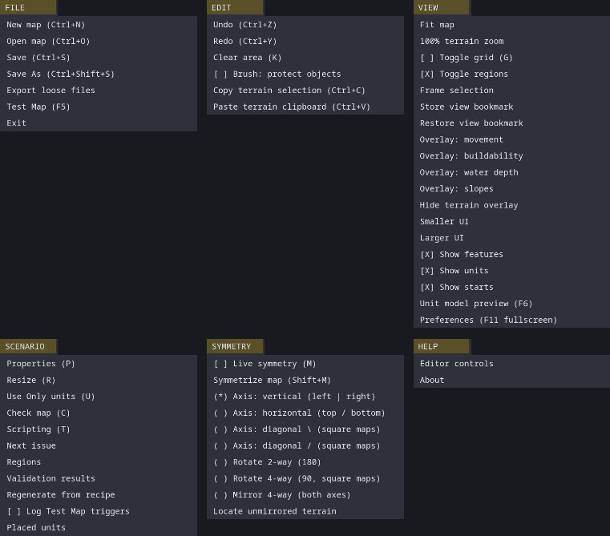

*All six menus, each shown open on its own.*

| Menu | Items |
| --- | --- |
| **FILE** | New map (Ctrl+N), Open map (Ctrl+O), Save (Ctrl+S), Save As (Ctrl+Shift+S), Export loose files, Test Map (F5), New AI mod... (Ctrl+Shift+N), Open AI mod... (Ctrl+Shift+O), Exit |
| **EDIT** | Undo (Ctrl+Z), Redo (Ctrl+Y), Clear area (K), Brush: protect objects (checkbox), Copy terrain selection (Ctrl+C), Paste terrain clipboard (Ctrl+V) |
| **VIEW** | Fit map, 100% terrain zoom, Toggle grid (G), Toggle regions, Frame selection, Store view bookmark, Restore view bookmark, Overlay: movement / buildability / water depth / slopes, Hide terrain overlay, Smaller UI, Larger UI, Show features, Show units, Show starts, Unit model preview (F6), Preferences (F11 fullscreen), Show blocked cells (B) |
| **SCENARIO** | Properties (P), Resize (R), Use Only units (U), Check map (C), Scripting (T), Next issue, Regions, Validation results, Regenerate from recipe, Log Test Map triggers (checkbox), Placed units, AI Profiles... (A) |
| **SYMMETRY** | Live symmetry (M), Symmetrize map (Shift+M), seven mirror choices, Locate unmirrored terrain |
| **HELP** | Editor controls, About |

---

## Moving around the map

| To do this | Do this |
| --- | --- |
| Zoom in or out | Turn the **mouse wheel** over the map. It zooms around the pointer, up to 400%. |
| Pan | **Right-drag** anywhere on the map, in any mode. In **PAN** mode, left-drag pans too. |
| Pan with the keyboard | **Arrow keys**. |
| Zoom with the keyboard | **=** or **+** zooms in, **-** zooms out. **1** to **5** jump to 100%, 75%, 50%, 25% and 12.5%. |
| Jump to a place | Click or drag in the **minimap**. |
| See the whole map | **View → Fit map** zooms all the way out. |
| Back to full size | **View → 100% terrain zoom** (or **1**). |
| Go to what you selected | **View → Frame selection** centres on the selected units, or on the selected features when the Features tool is active. |
| Remember a view | **View → Store view bookmark**, then **Restore view bookmark** to return. There is one bookmark, kept until you close Cartographer. |
| Go to a start position | Choose the **STARTS** tool and click **PLAYER n** in the browser. |

The map always fills the view: you cannot zoom out past the point where the map
reaches the edges of the window. On a map whose shape differs from the window,
**Fit map** therefore shows the whole width or the whole height, and you scroll
for the rest.

**Edge scrolling** is off by default. Turn it on in
[Preferences](#preferences) to scroll the view by resting the pointer near the
edge of the map, or on the outermost edge of the window (the screen, in
fullscreen).

**F11** switches between a window and borderless fullscreen.

---

## Tools, modes and layers

Cartographer has five **tools**, one for each kind of thing on the map, and four
**modes** that decide what a left click does with that tool.

| | **PLACE** | **SELECT** | **ERASE** | **PAN** |
| --- | --- | --- | --- | --- |
| **TERRAIN** | Stamp the chosen section; drag to paint | Drag a rectangle to copy | (nothing) | Drag to pan |
| **FEATURES** | Place the chosen feature; drag to paint | Select, box-select and move | Click or drag to remove | Drag to pan |
| **UNITS** | Place a unit, or drag an existing one | Select, box-select and move | Click a unit to remove it | Drag to pan |
| **STARTS** | Add a start, or drag an existing one | Drag a start to move it | Click a start to remove it | Drag to pan |
| **BLOCKED** | Block cells under the brush; drag to paint; Shift+drag fills a rectangle | (nothing) | Clear blocked cells; drag or Shift+drag as for Place | Drag to pan |

The **REGIONS** button works like a sixth tool for trigger areas; see
[Regions](#regions).

In **PLACE** mode a preview follows the pointer and shows where a click will put
things. Terrain sections and features show a see-through image with a yellow
outline; units show the outline of their footprint; the BLOCKED tool shows its
brush (red in Place mode, white in Erase mode).

### Layers

**View → Show features**, **Show units** and **Show starts** hide or show those
layers, and **View → Toggle regions** and **Toggle grid** (**G**) do the same
for region outlines and the grid. **View → Show blocked cells** (**B**) tints
[blocked cells](#blocked-cells) with every tool. Cartographer remembers these
choices.

You cannot edit a hidden layer: the status bar reads *LAYER HIDDEN*. Choosing the
layer's tool (or an item in its browser) shows the layer again.

The **grid** draws faint lines every 32 game pixels (one terrain block) and
brighter lines every 512 pixels (one map unit, the size of a standard section).

---

## Terrain

The ground of a map is made of **sections**: prefab pieces of terrain from the
original game, each with its painted art **and its heights**. A cliff section
brings a real cliff, a coast section brings water and a shore, and so on. There
is no separate tool for raising or lowering ground: you change the shape of the
land by stamping sections that have the heights you want. **View → Overlay:
slopes** and **Overlay: water depth** show the result (see
[Terrain overlays](#terrain-overlays)).

Sections belong to a world. The browser only offers the sections of the map's
world (chosen when the map was created).

### The terrain browser

The **TERRAIN** browser shows two columns of thumbnails with a short name under
each. The chosen piece has a gold frame.

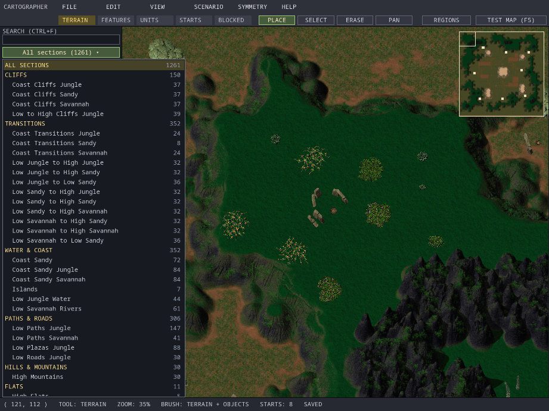

*The group list for a Zhon map (Ulasem Arena). Each kind is followed by the original game's folders, with section counts.*

- **Groups.** Click the group button (it starts as *All sections*) to choose a
  group. The list shows kinds (CLIFFS, TRANSITIONS, WATER & COAST, PATHS &
  ROADS, TOWNS & FORTS, HILLS & MOUNTAINS, FLATS, SPECIALS & DETAILS, OTHER)
  and, indented under each kind, the original game's section folders. Only
  groups the world has are listed. The wheel scrolls the list; **Esc** or a
  click elsewhere closes it. Cartographer remembers the group you chose for each
  world.
- **Search.** Click the search box or press **Ctrl+F** and type. The search
  looks through every group and matches readable names, the original file
  names and folder names. While you search, the group button reads *Search: all
  groups*. Choosing a group clears the search.
- **Readable names.** Pieces get names such as *Cliff · NE outer · variant 2*,
  built from the kind, compass direction, corner type and variant. Point at a
  thumbnail and the status bar shows the full name with the original file name
  and folder.
- **Variants.** Pieces that come in several numbered or lettered variants share
  one thumbnail. A badge such as **1/3** in its corner shows which variant is
  chosen. **Click the chosen piece again** to step to the next variant.

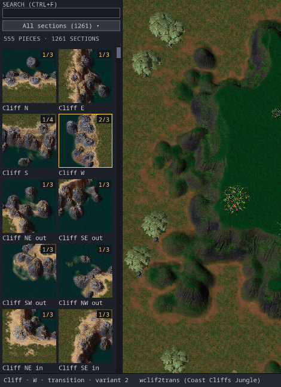

*Clicking the chosen piece again moved it to variant 2 of 3. Pointing at it shows the full name in the status bar.*

### Stamping sections

With the **TERRAIN** tool in **PLACE** mode:

- **Click** to stamp the chosen section. Its top-left corner snaps to a grid the
  size of the section itself, so neighbouring stamps of the same size line up
  exactly. A standard section is 16 × 16 blocks (512 × 512 game pixels).
- **Drag** to paint: a new copy is stamped each time the pointer reaches the next
  snapped position. One press-drag-release is one undo step.
- A see-through preview with a yellow outline shows exactly where the section
  will land.
- A stamp that hangs over the edge of the map is cut off at the edge.

### What a stamp replaces

A stamp always replaces the **art and heights** under it. It never touches
units or start positions.

Many sections also carry their own trees, rocks and other features, plus
invisible markers that the game uses for roads and blocked ground. By default
(**BRUSH: TERRAIN + OBJECTS** in the status bar) a stamp brings those along and
replaces the features already in its area.

Tick **Edit → Brush: protect objects** to keep the features you have placed. The
status bar then reads **BRUSH: OBJECTS PROTECTED**: existing features stay, the
section adds none of its own, and only the road and blocker markers on empty
cells follow the new terrain. This setting is not remembered after you close
Cartographer.

Either way, a stamp replaces the [blocked cells](#blocked-cells) you painted in
its area with the section's own markers, so paint blockers after the terrain is
finished.

### Copying and pasting terrain

You can copy any rectangle of the map, terrain and objects together, and stamp
it elsewhere like a section.

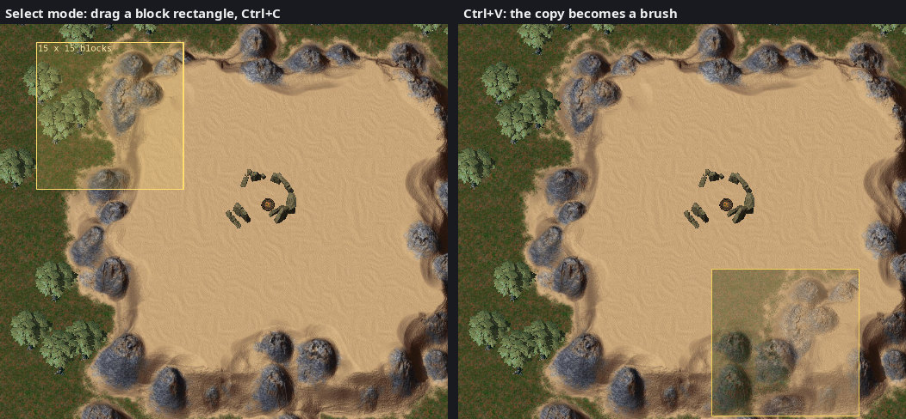

*Copying a rectangle of Ulasem Arena (left) and pasting it as a brush (right).*

1. Choose the **TERRAIN** tool and **SELECT** mode.
2. Drag a rectangle on the map. It snaps to 32-pixel blocks and shows its size.
   **Esc** clears it.
3. Press **Ctrl+C** (or **Edit → Copy terrain selection**). The copy holds the
   tiles, heights, features, road and blocker markers, and the units whose
   centres are inside. The status bar says what was copied.
4. Press **Ctrl+V** (or **Edit → Paste terrain clipboard**). Cartographer
   switches to **PLACE** mode with the copy as the brush, centred on the pointer.
5. Click to paste. Each click pastes once; dragging does not repeat it.
6. Press **Esc**, or choose a section in the browser, to go back to section
   brushes.

What comes along when you paste follows **Edit → Brush: protect objects**: with
protection on, no features or units are pasted and the existing features stay.
Pasted units that would land off the map or on top of another unit are skipped,
and the status bar counts them. Pasted units lose their display names.

The copy stays available after you open another map. Pasting into a map of a
different world asks first, because the terrain art belongs to the world it was
copied from.

### Clearing an area

**Clear Area** removes every unit and feature inside a box. It does not change
the terrain.

1. Press **K** (or **Edit → Clear area**). The status bar reads *CLEAR AREA:
   drag a box (K cancels)*.
2. Drag a box on the map. It is drawn in red.
3. Confirm: *Remove all units and features in this area? (N unit(s), M cells)*.

It also removes the invisible road and blocker markers in the box, including
[blocked cells](#blocked-cells) you painted. Start positions and regions stay.
Press **K** again to cancel before dragging. Clear Area is one undo step.

To change the terrain itself, stamp other sections over it.

### Resizing the map

**Scenario → Resize** (**R**) opens **RESIZE MAP** with **WIDTH (UNITS)** and
**HEIGHT (UNITS)**, each from 1 to 64. One unit is 512 game pixels, or 32 cells.

- The map grows or shrinks at its **right and bottom** edges; the top-left
  corner stays where it is.
- New ground is flat and copies the tile in the map's top-left corner. Stamp
  sections over it.
- Shrinking asks first (*CROP MAP*), because terrain and features past the new
  edges are removed. Undo restores them.
- Cartographer refuses to shrink while start positions, units or regions lie
  outside the new size, and says which. Move or remove them first.

### Terrain overlays

The **View** menu can colour the map to show how the game sees it:

| Overlay | What it shows |
| --- | --- |
| **Overlay: movement** | Where the unit type chosen in the Units browser can go: green allowed, red blocked, judged from terrain, features and [blocked cells](#blocked-cells). Flying units show where they can fly, not where they can land. |
| **Overlay: buildability** | Where that unit type can be placed or built: green allowed, red blocked, counting terrain, features and units already placed. |
| **Overlay: water depth** | Brighter blue is deeper water. |
| **Overlay: slopes** | Darker green is flat ground; brighter orange is steeper. |


*Overlay: movement for the Horseman on Ulasem Arena. The steep edge of the arena floor, the stone ruin and every tree block a Horseman.*

The movement and buildability overlays use the unit chosen in the **Units**
browser, so choose a unit there first. An overlay takes a moment to work out
(an **ANALYZING TERRAIN** box appears; **Esc** cancels). It disappears as soon
as you change anything on the map; **View → Hide terrain overlay** removes it
by hand.

---

## Features: trees, rocks, mana and ruins

Features are the objects that sit on the ground: trees, bushes, rocks, mana
deposits, ruins, walls, buildings and so on. The game decides what each one
does (whether it blocks units, can be reclaimed and so on) from its own
definitions; Cartographer only places them.

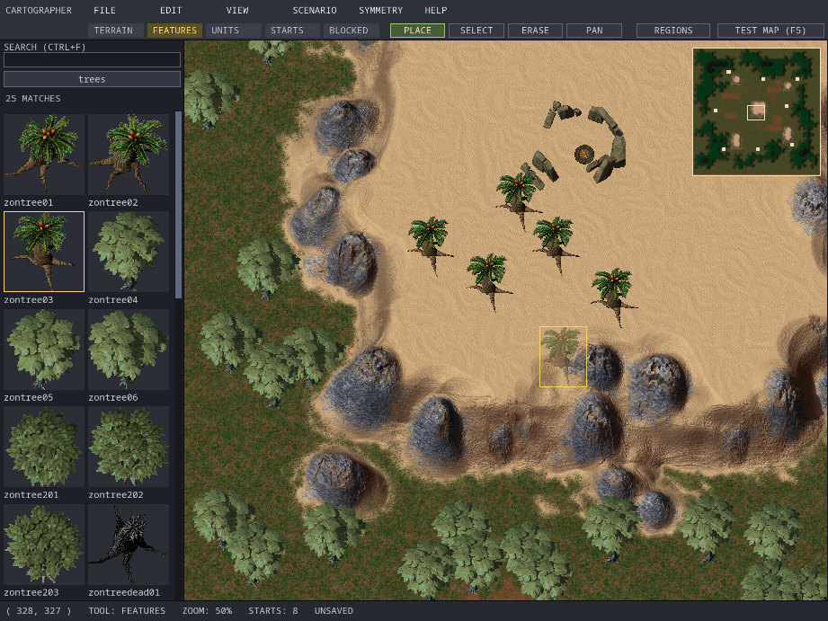

*Placing palm trees in Ulasem Arena. The see-through tree shows where the next click will put one.*

### The features browser

The **FEATURES** browser lists the features of the map's world plus those
available in every world, sorted by category. The **category button** starts at
**ALL**; each click moves to the next category (for example *mana*, *rocks*,
*trees*). The search box matches feature names and categories. The line under
the buttons counts the matches.

### Placing features

In **PLACE** mode, **click** to put the chosen feature in the 16-pixel map cell
under the pointer, or **drag** to put one in every cell the pointer passes
over. Dragging fills cells densely, so for a natural look click features one at
a time.

Each cell holds one feature. Placing on a cell that already has one replaces it
without asking. A cell holding one of the invisible road or blocker markers
that terrain sections bring (see [What a stamp replaces](#what-a-stamp-replaces))
or that you painted (see [Blocked cells](#blocked-cells)) loses the marker too.

A large feature's footprint covers several cells, so two features can overlap
even though each stands in a cell of its own. When the game loads the map it
sets features down row by row from the top, left to right, and one whose
footprint overlaps a feature set down before it removes that earlier one, as
in the original game (since 0.9.0). Cartographer still draws both, so leave
room between large features you want to keep.

### Selecting and moving features

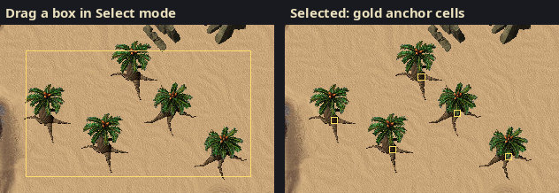

*Box-selecting trees. A selected feature is marked by a gold square on its anchor cell, the cell it actually stands in.*

In **SELECT** mode:

- **Click** a feature to select it, or **drag a box** from empty ground to
  select every feature whose anchor cell is inside. **Shift** adds to the
  selection (Shift+click also removes a selected feature from it). A click on
  empty ground clears the selection.
- A feature is selected by its **anchor cell**, the cell it stands in, not by its
  picture. With large trees, click near the base of the trunk.
- **Drag** a selected feature to move the whole selection. A move that would
  push a feature off the map, onto another feature or onto a road or blocker
  marker does not happen.
- **Enter** shows a list of the selected features with their cell positions.
- **Delete** removes them. **Ctrl+C**, **Ctrl+X**, **Ctrl+V** and **Ctrl+D**
  copy, cut, paste and duplicate (see
  [Selecting, copying and undo](#selecting-copying-and-undo)).

### Removing features

In **ERASE** mode, click or drag over features to remove them, one cell at a
time. Erasing clears the whole cell, so it also removes any invisible road or
blocker marker there. For a large area use [Clear Area](#clearing-an-area)
(**K**). To clear only blocked cells, use the
[BLOCKED tool](#erasing-blocked-cells) in Erase mode.

A feature that the map's world does not define (for example one pasted from a
map of another world) is drawn as a small **red dot**. You can select and erase
it; Check Map reports it as an error.

---

## Blocked cells

Some ground has to stay closed even though nothing stands on it: castle walls
and gates that are part of the terrain art, cliff faces, a mountain crest. The
game marks such cells with an invisible **blocker**. No unit can walk, sail or
hover into a blocked cell, in Retail and Legion pathfinding alike, and nothing
can be built on one. Flying units pass over them. Terrain sections bring their
own blockers (see [What a stamp replaces](#what-a-stamp-replaces)); the
**BLOCKED** tool paints and erases them by hand. The original editor had no
such tool.


*Ladron's Tarn with the BLOCKED tool. The red cells along the castle walls are the shipped map's own blockers; the road is blue.*

### Painting blocked cells

1. Choose the **BLOCKED** tool (the fifth toolbar button, or **Tab**).
2. Choose a brush in the browser: **1 × 1**, **2 × 2**, **4 × 4**, **8 × 8** or
   **16 × 16** cells. **[** and **]** step through the sizes while the tool is
   chosen. The size is not remembered after you close Cartographer. The brush
   list ignores the browser's search box.
3. In **PLACE** mode, click to block the cells under the brush, or drag to paint
   a stroke. A red outline under the pointer shows the brush. However fast you
   drag, the stroke has no gaps, and even a 1 × 1 stroke is a wall without
   diagonal openings.
   A stroke can start past the edge of the map, and one that slips past the
   edge picks up again where the pointer comes back, joined by a line.

Painting blocks only **empty** cells. A feature, a road marker or a cell that is
already blocked stays as it is.

### Filling a rectangle

Hold **Shift** and drag, in Place or Erase mode, to draw a yellow rectangle.
When you let go, every cell in it is blocked (or, in Erase mode, cleared). The
brush size does not matter for rectangles. **Esc** drops the rectangle before
you let go.

### Erasing blocked cells

In **ERASE** mode the brush outline is white. Click, drag or Shift+drag to clear
blocked cells, including the ones terrain sections brought. Erasing changes
nothing else: features and roads stay.

### Seeing blocked cells

While the BLOCKED tool is chosen, blocked cells are tinted **red** and road
cells **blue**, so you can see why painting skipped a cell. Press **B** (or
**View → Show blocked cells**) to keep the tint with every tool; Cartographer
remembers this. The movement overlay (**View → Overlay: movement**) shows
blocked cells as blocked too.

The browser's counter line and the status bar show how many blocked cells the
map has, and the status bar shows the brush size.

### What else changes blocked cells

- **Terrain stamps** replace the blocked cells in their area with the section's
  own markers, with or without **Brush: protect objects**. Paint blockers after
  the terrain is finished.
- **Placing a feature** on a blocked cell replaces the blocker, and erasing with
  the **Features** tool clears the whole cell, blocker included.
- **Clear Area** (**K**) removes the blocked cells in its box.
- **Live symmetry** (**M**) blocks and clears the mirror cells too. A mirror
  cell that holds a feature or a road is skipped, and the status bar says so.
- **Symmetrize** (**Shift+M**) copies the source side's blocked cells onto empty
  cells on the other side, with either **TERRAIN** choice. It does not clear
  blocked cells on the other side; only mirrored terrain replaces them.
- **Undo**: each click, stroke or rectangle is one undo step.

Blocked cells are saved in the map itself, so the game blocks them in every
match on the map, Test Map included. They do not change the minimap.

---

## Units

The **UNITS** tool places units on the map: buildings, armies, Monarchs, ships,
and special objects such as the flags in *King of the Hill*.

> Placed units belong to the map's **scenario**. They appear in a scenario game
> (Test Map, **F5**, or a game created with **MAP SCENARIO** on), and then they
> **replace the usual starting Monarchs**. In a game with MAP SCENARIO off,
> placed units are not used. See [Scenario maps](#scenario-maps).


*King of the Hill, Units tool. The browser is filtered to Aramon ground units; eight of Player 1's units are box-selected.*

### The units browser

Each row shows the unit's portrait, its name, and its type ID and role, for
example *Horseman* and *ARAKNIGH - GROUND*. Only units that the game can create
on a map are listed.

- The **role button** cycles through ALL, AIR, BUILDERS, BUILDINGS, GROUND, MANA
  and NAVAL. Anything that can build is listed under BUILDERS, including
  factories such as the Barracks.
- The **faction button** cycles through ALL FACTIONS, ARAMON, TAROS, VERUNA,
  ZHON and CREON. Neutral creatures and objects that belong to no side appear
  only under ALL FACTIONS.
- The search box matches names, type IDs and roles.

### Owners and colours

New units belong to the **current owner**, shown as `PLAYER: n` in the status
bar. Press **[** and **]** to change it (0 to 7). Units are drawn as small
squares in their owner's colour, with their type ID (such as *ARAARCH*), or
their display name if you gave one, above them when you are zoomed in. These
colours are only the editor's markers; the game lobby gives players their own
colours.

| Owner number | In the game | Colour in the editor |
| --- | --- | --- |
| 0 | Player 1 | blue |
| 1 | Player 2 | red |
| 2 | Player 3 | green |
| 3 | Player 4 | yellow |
| 4 | Player 5 | magenta |
| 5 | Player 6 | cyan |
| 6 | Player 7 | orange |
| 7 | Player 8 | light grey |
| 8 | Neutral | grey |

> **Watch the numbering.** The status bar and the Unit Properties PLAYER field
> count owners from **0**. Everything else (the Placed units list, the trigger
> rules, the game lobby) counts players from **1**. Owner 0 is Player 1.

A **neutral** unit (owner 8) belongs to no player. Set it by typing 8 in
[Unit Properties](#unit-properties); **[** and **]** only reach 0 to 7.

### Placing units

In **PLACE** mode:

- **Click** empty ground to place one unit of the chosen type. Keep the button
  down and drag to adjust its position before letting go.
- **Click** an existing unit's square to grab and drag it instead.
- **Double-click** a unit to open its properties.

A unit is placed with the **top-left corner of its footprint** on the clicked
cell, the way the game places it. The preview outline is drawn centred on the
pointer, so a large building lands a little right of and below the outline.
Select it afterwards to see its real footprint.

Cartographer does not stop you placing a unit where it could not stand: a ship
on dry land, a building on a cliff, or two units on top of each other.
**Check map** reports these. To see in advance where a unit fits, choose it in
the browser and use **View → Overlay: buildability** (see
[Terrain overlays](#terrain-overlays)).

### Selecting and moving units

In **SELECT** mode, click a unit's square to select it, **Shift+click** to add
or remove one, or drag a box from empty ground to select every unit whose centre
is inside. Drag a selected unit to move the whole selection. Selected units show
a gold outline of their footprint and a short line for the way they face.

In **ERASE** mode, click a unit to remove it.

### Unit properties

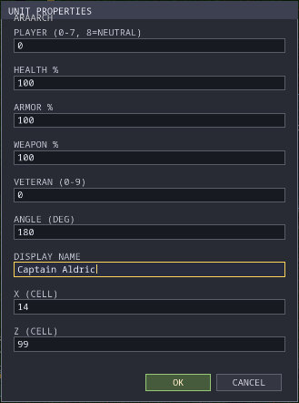

*Unit Properties for one of Player 1's Archers on King of the Hill, with a display name typed in. The unit's type ID, ARAARCH, is printed at the top, partly over the title bar.*

Press **Enter** with a unit selected, or double-click it. The fields:

| Field | Values | Effect in the game |
| --- | --- | --- |
| **PLAYER (0-7, 8=NEUTRAL)** | 0 to 8 | The owner (0 is Player 1, 8 is neutral). |
| **HEALTH %** | 0 to 100 | Starting hit points, as a percentage of the unit's normal maximum. |
| **ARMOR %** | 0 to 1000 | Multiplies the unit's armour. 100 is normal. |
| **WEAPON %** | 0 to 1000 | Multiplies the unit's weapon strength. 100 is normal. |
| **VETERAN (0-9)** | 0 to 9 | Starting veteran rank. Units that cannot become veterans ignore it. |
| **ANGLE (DEG)** | whole degrees | The direction it faces. 0 faces down the map (south), 90 faces right (east). |
| **DISPLAY NAME** | text | A name shown on the unit in the game instead of its type name. The game shows at most 31 bytes (about 31 letters). Trigger rules still refer to the type, never this name. |
| **X (CELL)**, **Z (CELL)** | inside the map | The cell of the footprint's top-left corner. |

With several units selected, the dialog is titled **SELECTED UNIT PROPERTIES**:
only the fields you change are applied, to every selected unit, and changing X
or Z moves the whole selection by the same amount. The name field then reads
**NAME (SINGLE UNIT ONLY)** and is ignored.

### Finding placed units

**Scenario → Placed units** lists every placed unit, with its number, name, type,
owner and position. The position is the centre of its footprint in game
pixels (16 per cell), for example *X 232.000000 Z 1592.000000*, not the cell
numbers that the status bar and Unit Properties use. Type in
**SEARCH NAME, TYPE OR OWNER** to filter, for
example *flag*, *player 2* or *neutral*. Use **Up** and **Down** to move through
the list. **Click** or **Enter** selects the unit and centres the map on it;
**Shift+Enter** also opens its properties.

### Previewing a unit model

**F6** (**View → Unit model preview**) shows a 3D view of the selected unit
when exactly one is selected, otherwise of the unit chosen in the browser.
Drag to turn it and use the wheel to zoom. **Esc** or **Enter** closes it.

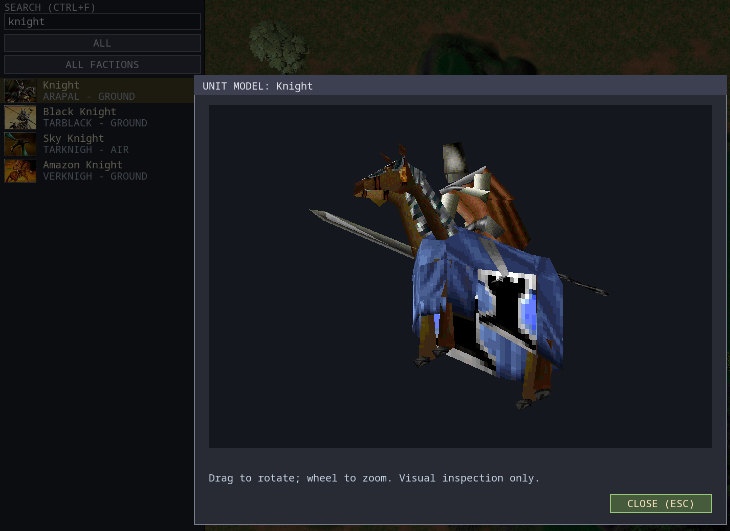

*F6 on the Knight, after searching the browser for "knight".*

---

## Start positions

Start positions decide where players begin. A skirmish map needs at least two;
the game seats at most eight.

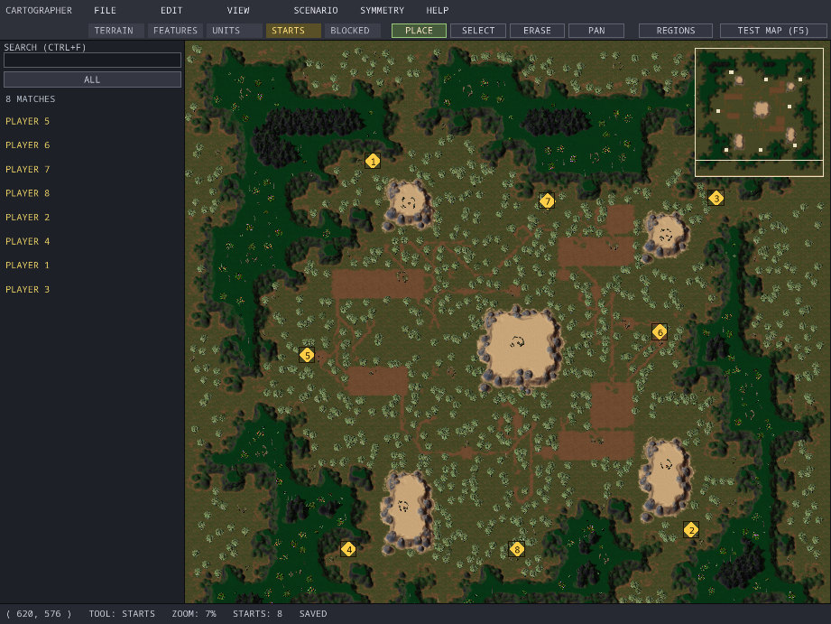

*Ulasem Arena's eight start positions. The browser lists them in the order the map stores them.*

With the **STARTS** tool:

- **Add** a start: in **PLACE** mode, click empty ground. It takes the lowest
  free number from 1 to 8. A ninth click says *START POSITIONS FULL*.
- **Move** a start: drag its diamond (in **PLACE** or **SELECT** mode).
- **Remove** a start: in **ERASE** mode, click its diamond.
- **Find** a start: click **PLAYER n** in the browser to centre the map on it.

Starts are drawn as gold diamonds with their number, and as small squares on
the minimap. You cannot type a new number for a start. To renumber, remove
starts and add them again: each new one takes the lowest free number.

When the game's **Start locations** option is **Fixed**, the players take the
starts in number order, top slot first, and empty slots are skipped, as in the
original game. A two-player game on an eight-start map uses starts 1 and 2,
whichever slots the players sit in, so put starts 1 and 2 where a one-on-one
should begin. **Random** shuffles them. **By slot**, which the original game does
not have, puts the player in slot N on start N, so a player in slot 8 always
begins at start 8. It counts the starts in number order as well, so gaps matter
even more there: on a map numbered 1, 2, 4, slot 3 begins at start 4. Keep the
numbers 1, 2, 3 … without gaps so that Fixed and By slot work predictably (Check
Map warns about gaps). When a scenario places units, they replace the Monarchs
and decide where the players begin, whatever the option says.

---

## Selecting, copying and undo

### Selection and the clipboard

Features and units have their own selections and their own clipboards.

| Key | Features tool | Units tool |
| --- | --- | --- |
| **Ctrl+C** | Copy the selected features | Copy the selected units |
| **Ctrl+X** | Cut | Cut |
| **Ctrl+V** | Paste at the pointer | Paste at the pointer |
| **Ctrl+D** | Duplicate at the pointer | Duplicate at the pointer |
| **Delete** | Delete the selection | Delete the selection |
| **Enter** | List the selected features | Open Unit Properties |

- **Pasting features**: the group keeps its shape. Its topmost feature (the
  leftmost one, if several share the top row) lands on the cell under the
  pointer, or the middle of the view if the pointer is off the map. The whole
  group must fit on empty cells inside the map; otherwise nothing is pasted and
  *FEATURES NOT PASTED* explains why.
- **Pasting units**: the first copied unit lands on the cell under the pointer
  and the rest keep their spacing; the group is shifted to stay inside the map.
  Pasted units keep their owner and properties but **lose their display names**.
- After a paste, the pasted objects are selected and the mode switches to
  **SELECT**, so you can drag them into place.
- The clipboards survive opening another map, so you can copy between maps.
  Features pasted into a map of another world show as red dots (see
  [Removing features](#removing-features)).
- Terrain has its own clipboard: see [Copying and pasting terrain](#copying-and-pasting-terrain).
- The Edit menu's copy and paste items are for terrain only. Feature and unit
  copying uses the keys.

### Undo and redo

**Ctrl+Z** undoes, **Ctrl+Y** (or **Ctrl+Shift+Z**) redoes. Undo covers every
change to the map: terrain, features, blocked cells, units, starts, regions,
rules, scenario properties, the Use Only list, the map's AI profiles and the
map name. It does not
cover the view, the clipboards or preferences.

- Each mouse gesture is one step, from pressing the button to letting go: a whole
  painted stroke or a whole group move undoes at once. Each dialog change or key
  command is one step.
- The history keeps up to about 64 MB of changes; the oldest steps are dropped
  first.
- Undo works only from the map: while a dialog or the Scripting, Use Only or
  Regions window is open, those take the keys. Close it first. The AI Profiles
  window is the exception: there Ctrl+Z and Ctrl+Y undo and redo its own
  changes, back to where it opened (see
  [Undo in the window](#undo-in-the-window)).
- Undo clears the current selection.
- Undoing back to the last save shows **SAVED** again.
- Opening a map or making a new one starts a fresh history.

### What Esc does

**Esc** first cancels whatever is open or in progress, in this order: an open
menu or list, the browser search box, a dialog, the terrain clipboard brush, a
terrain selection, a blocked-cell rectangle still being dragged, region editing.

> **Careful: when there is nothing left to cancel, Esc closes Cartographer.** If
> the map has unsaved changes you are asked first (**SAVE**, **DISCARD** or
> **CANCEL**). If everything is saved, Cartographer closes straight away.
> Esc does not clear a unit or feature selection, and it does not cancel Clear
> Area (press **K** for that).

---

## Symmetry

Fair multiplayer maps usually give every player the same ground. The
**SYMMETRY** menu helps in two ways: **live symmetry** mirrors your edits as you
make them, and **Symmetrize** copies one part of the map onto the rest in one
go.

### Choosing the mirror

| Symmetry menu choice | What it does |
| --- | --- |
| **Axis: vertical (left \| right)** | Mirror left to right across a vertical line (the default). |
| **Axis: horizontal (top / bottom)** | Mirror top to bottom. |
| **Axis: diagonal \\** and **Axis: diagonal /** | Mirror across a diagonal. Square maps only. |
| **Rotate 2-way (180)** | Copy by turning the map half round, for two players in opposite corners. |
| **Rotate 4-way (90, square maps)** | Four copies, each a quarter turn apart. Square maps only. |
| **Mirror 4-way (both axes)** | Mirror across both the vertical and horizontal lines. |

A choice that needs a square map is marked *n/a* on other maps. Use
[Resize](#resizing-the-map) to make the width and height equal.

### Live symmetry

Press **M** (or **Symmetry → Live symmetry**) to turn it on or off. The axis is
drawn on the map as a cyan line (rotations show a cross and a ring at the
centre), and the status bar shows the mirror in use.


*Live symmetry on Ulasem Arena. One click stamped a sandy rock transition on the left of the axis and its mirror twin on the right. The stamp also replaced the stone ruin that stood in the right-hand area.*

While it is on:

- **Units, features, start positions and blocked cells** that you place, move,
  erase, paste, duplicate or delete are mirrored at once. The status bar reports
  *MIRRORED n change(s)*, or how many mirrored changes were skipped because they
  would fall off the map, overlap something or need a start number when all
  eight are used. Mirrored starts take the next free number.
- **Terrain stamps** also stamp each section's **mirror twin**: the section
  whose picture is the mirror image, for example *Cliff · NW outer* for
  *Cliff · NE outer*. A cyan outline previews where the twin will go. Terrain is
  never flipped, because its lighting is painted in; a section with no known
  twin is stamped only where you clicked, and the status bar says so
  (*NO MIRROR TWIN for section …*). A stamp that crosses the axis (overlaps its
  own mirror image) is not mirrored either; one that ends exactly on the axis
  is.
- **Terrain clipboard pastes** are mirrored only when every block of the copy
  has a twin and the paste does not cross the axis; otherwise the status bar
  says it was pasted at the source only.
- **Not mirrored**: Clear Area, property changes, and region editing.
- Mirrored copies of units do not get the original's display name.
- An edit and its mirrored copies undo together with one **Ctrl+Z**.

### Symmetrize

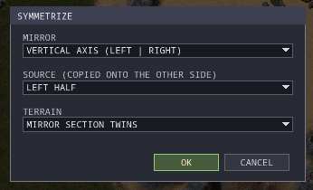

*The Symmetrize dialog (Shift+M).*

**Shift+M** (**Symmetry → Symmetrize map**) copies one part of the map onto the
rest:

| Field | Choices |
| --- | --- |
| **MIRROR** | The mirror to use (only the ones that fit the map). |
| **SOURCE (COPIED ONTO THE OTHER SIDE)** | The part to copy: a half, a triangle or a quadrant, depending on the mirror. **CURRENT SELECTION** is offered when the current tool has a selection (selected units, selected features, or a terrain rectangle). |
| **TERRAIN** | **MIRROR SECTION TWINS** copies terrain using twin sections; **LEAVE TERRAIN** copies only objects. |

Click **OK** and Cartographer first works out the result and tells you what
would be copied and replaced, then asks you to confirm. The whole change is
**one undo step**.

- With a half, triangle or quadrant as the source, everything on the other side
  is replaced: units, features, start positions and regions. Regions that rules
  refer to are kept. Mirrored starts get the next free numbers, and mirrored
  units go to the player whose start position mirrors the original owner's.
- With **CURRENT SELECTION**, only the selected objects are copied (and terrain
  only for a terrain rectangle). Start positions and regions are not copied.
- [Blocked cells](#blocked-cells) on the source side (or in a selected terrain
  rectangle) block their mirror cells too, where those are empty, with either
  TERRAIN choice. Blocked cells on the other side are not cleared.
- Copied regions get the original name with *mirror* added (for example
  *Player 1 mirror*). Rules do not use them until you rename them or point
  rules at them. Copied units lose their display names.

Where a terrain section has no known twin, the old terrain on the other side is
left as it was. The result message says how many blocks were left, and
**Symmetry → Locate unmirrored terrain** (or **Scenario → Next issue**) takes
you to each one, so you can fix it by hand.

---

## Generating a random map

Cartographer can start you off with a generated map, the same generator the game
uses for its random maps.

1. Open **New Map** (**N**), type a name and choose a size and world.
2. Click **RANDOM**. The **RANDOM MAP SETTINGS** dialog opens.
3. Adjust the settings and click **GENERATE**. A **GENERATING MAP** box appears
   (**Esc** cancels it and keeps your current map).
4. The **GENERATED MAP PREVIEW** shows the map with numbered start positions.
   Click **ACCEPT** (**Enter**) to use it, **SETTINGS** to go back and change
   the settings, or **DISCARD** (**Esc**) to keep your current map.


*Generating a 4-player, 16 × 16 Aramon Riverlands map from seed 2026.*

| Setting | Meaning |
| --- | --- |
| **SEED (REPRODUCIBLE)** | The random number the map grows from. The same seed and settings always give the same map. A new seed is drawn each time you open New Map. |
| **PLAYERS (2-8)** | How many start positions to make. |
| **LAYOUT** | Mainland, Lakes, Islands, Taros Maze, Veruna Ports, Aramon Riverlands, Zhon Clearings or Creon Highlands. |
| **TREES**, **ROCKS**, **MANA** | How many of each, from 0 to 255. More mana adds more mana sites per player. |
| **WATER INTENSITY** | How strongly lakes appear, from 0 (dry) to 255. Used by Mainland, Lakes and Zhon Clearings. Ignored by Islands, Veruna Ports and Aramon Riverlands, which make their own water, and by Taros Maze and Creon Highlands. |
| **RELIEF** | How many hills, from 0 (flat) to 255. |
| **WIDTH**, **HEIGHT** | 1 to 64 units. |
| **WORLD** | The world to use. |
| **SCATTERED MANA (BY MAP AREA)** | None, Minimum, Medium, High or Max neutral mana spots spread over open ground, by area. Max is as dense as a home with six spots; each lower level halves it. Choosing any level on a map saved by an older version upgrades its recipe to version 9. |

The generator adjusts some settings without asking, and the preview shows the
size it really used:

- The **themed layouts set their own world**: Taros Maze makes a Taros map,
  Veruna Ports a Veruna map, Aramon Riverlands an Aramon map, Zhon Clearings a
  Zhon map and Creon Highlands a Creon map.
- Maps are at least 4 × 4 units, and each layout has a larger minimum for more
  players:

| Layout | Up to 4 players | 5 to 8 players |
| --- | --- | --- |
| Mainland | 8 × 8 | 12 × 12 |
| Lakes | 12 × 12 | 16 × 16 |
| Islands | 16 × 8 for 2, 16 × 16 for 3 or 4 | 24 × 16 for 5 or 6, 24 × 24 for 7 or 8 |
| Themed layouts | 16 × 16 | 24 × 24 |

Accepting replaces the whole map: terrain, features, start positions and any
scenario content. The new map is unsaved, its description is set to
*Generator recipe: …*, and the settings (the **recipe**) are saved with the
map.

**Scenario → Regenerate from recipe** reopens the settings with the recipe of
the open map, so you can try another seed or density. Accepting keeps the map's
name and description and replaces everything else. It can be undone with
**Ctrl+Z**. A map that was not generated has no recipe, and Cartographer says
so.

---

## Scenario maps

A scenario turns a map into a mission: preset armies, named areas, and rules
such as "hold the hill for five minutes to win".

### When scenarios run

> Scenario content (placed units, regions and rules, and the Use Only list)
> runs in a **scenario game**:
>
> - a test game, opened with **Test Map (F5)** in Cartographer or with the
>   game's `--play-map` option (see [Sharing a scenario](#sharing-a-scenario));
> - a skirmish or multiplayer game created with **MAP SCENARIO: ON**. The button
>   sits under the map preview on the game's create screens. It is offered for
>   every map whose scenario has placed units or rules, the shipped scripted maps
>   such as *King of the Hill* included, and the lines under it say what the
>   scenario changes. It starts off and turns off again whenever another map is
>   picked, so a map chosen with it off plays as a plain skirmish map. It is
>   greyed, with the reason, for a map without a playable scenario: one with no
>   scenario, an empty one, one that needs a placed unit type this
>   install lacks, or one whose placed units give Player 1 nothing to command
>   (*PLAYER 1 GETS NO ARMY*). Player 1 is the player who creates the game, and
>   placed units replace every Monarch, so Player 1 needs a placed unit that can
>   fight, build or move (animals, villagers, monsters and unarmed buildings such
>   as lodestones do not count) or a rule that creates units for it. Many
>   downloaded maps used the scenario editor only to place scenery or wildlife,
>   and play as ordinary skirmish maps. A map that needs a unit type this
>   install lacks is offered with the warning *PACK NEEDED:* and the unit, in
>   single player and multiplayer alike, when the install has a game mod pack
>   (one the host could tick in the room, or an always-enabled one); if no
>   applied pack supplies the unit, the game refuses to start and says which
>   unit is missing. Maps with a playable scenario carry a gold
>   **S** in the map list.
>
> The test copy that each Test Map or `--play-map` run leaves in the game's
> `MapCache` folder (in the game's per-user folder, beside its `settings.ini`) appears in the map list with a fingerprint in brackets after
> its name (see [Testing a map in the game](#testing-a-map-in-the-game)).
> Choosing the test copy of a map with a scenario always plays that scenario,
> just as the test did: its MAP SCENARIO button reads ON and cannot be changed.
>
> A map whose only scenario content is a Use Only list has no scenario (the
> original Cartographer did not mark one either), so MAP SCENARIO is not
> offered for it and its list applies only in a test game. Its test copy's
> button reads OFF, and the lines under it say *TEST COPY: USE ONLY LIST* and
> how many unit types can be built; the lobby says the same.

In a scenario game:

- If the map has **placed units**, they replace the usual starting Monarchs, and
  each player's view starts at the middle of their units. A map with rules or
  regions but no placed units keeps the normal Monarch starts.
- Every player who owns placed units or has rules of their own must have a seat
  in the lobby. The lobby lists those seats (*NEEDS SEATS 1-4*), tags each empty
  one *NEEDED BY SCENARIO*, and keeps **START** greyed until they are filled; a
  start that still fails says why under the buttons (*Seat player N in the
  lobby to play this scenario*). Neutral units need no seat, and neither does a
  player whose rules are all empty.
- **Start Locations** are always fixed, and **Monarch Expendable** reads
  *SCENARIO*: the scenario decides how the game ends.
- A **Use Only** entry that names no unit type installed stops a test game from
  starting (*Unknown authored Use Only unit*), so a typo is caught. In a game
  created with MAP SCENARIO such an entry is left out instead: maps made for the
  original game often list units that no install has.
- A map with scenario content can be started with only one player; other maps
  need two, as in any skirmish.
- The usual endings are switched off: losing your Monarch, or every unit, does
  not lose the game. Players win or lose only through the Victory and Defeat
  actions of your rules (or by leaving the game). Give every scenario rules for
  both; the [templates](#rules-and-triggers) include some.

### Scenario properties

**Scenario → Properties** (**P**) has two fields: **SCENARIO NAME** and
**DESCRIPTION** (**Shift+Enter** starts a new line in the description). They are
stored with the map, and the description is also saved as the map's `.txt`
file. The game's map list shows the map's file name, its player count (the
number of start positions) and its size; it does not show these two fields.

The dialog also shows the map's DEFAULT AI profile: *standard* (the game's own
`ai/default.txt`) or the name of the map's own profile. **EDIT AI PROFILES...**
opens the [AI Profiles](#ai-profiles) window, where it is changed. There are no
settings here for win conditions or resources; those come from
[rules](#rules-and-triggers).

### Regions

A **region** is a named rectangle of map cells. Rules use regions as places:
"if I control a unit **at The Hill**", "create a Knight **at Reinforcements**".


*King of the Hill with the REGIONS button on and The Hill selected. Its handles resize it; dragging inside moves it.*

Click **REGIONS** in the toolbar to edit regions on the map. The status bar
reads *REGIONS: PLACE DRAWS; SELECT MOVES/RESIZES; ENTER NAMES; ESC CANCELS*.

| Mode | What the left button does |
| --- | --- |
| **PLACE** | Drag to draw a new region. It is named *Region N*, and Cartographer switches to SELECT with the new region selected. |
| **SELECT** | Click a region to select it. Drag inside it to move it; drag an edge or a corner handle to resize it. Double-click to open its properties. |
| **ERASE** | Click a region to delete it. |
| **PAN** | Pan only. |

**Enter** opens the selected region's properties and **Delete** deletes it.
**Esc** or a right-click cancels a drag in progress; **Esc** with nothing to
cancel, choosing a tool, or **Tab** leaves region mode. **View → Toggle regions**
shows or hides region outlines outside region mode.

**Region properties** (**NEW REGION** or **REGION PROPERTIES**) has the
**NAME** and the **LEFT**, **TOP**, **RIGHT** and **BOTTOM** cells. Both corner
cells are inside the region; the numbers are the cell coordinates shown in the
status bar.

- Names must be unique, 1 to 63 bytes long, and not *Anywhere* (which the rules
  already use for the whole map).
- **Renaming a region updates every rule that uses it.**
- A region that a rule uses cannot be deleted (*REGION NOT DELETED*). Change the
  rule's location first.

**Scenario → Regions** lists all regions with their corners. Click a row to
centre the map on it; double-click (or **Enter**) to edit it. The buttons are
**NEW**, **EDIT**, **DELETE**, **EDIT ON MAP** (closes the list and turns on
region mode) and **DONE**. **Ctrl+N** adds a region; **Esc** closes the list.

### Rules and triggers

**Scenario → Scripting** (**T**) opens **SCENARIO SCRIPTING**, where you write
the map's rules. A rule is a set of **conditions** and **actions**: when all its
conditions are true, its actions run.


*King of the Hill's first rule: whoever has the most Swordsmen on the hill takes the flags.*

**The window.**

- **`<` and `>`** switch between the nine **rule sets**: **ALL PLAYERS**, then
  **PLAYER 1** to **PLAYER 8**. The header shows how many rules the set has.
- The **RULES** column lists the rules (as *Rule N 1c/2a*, meaning one condition
  and two actions, or by the name you gave it). The **CONDITIONS** and
  **ACTIONS** columns show the selected rule. The active column is marked `*`.
- **FULL TEXT** shows the selected rule, condition or action in words.
  **PgUp**/**PgDn** or the wheel scroll it, and **COPY TEXT** copies it.
- **+RULE** and **-RULE** add and remove rules; **NAME** (or **Enter** on a
  rule) names the selected rule. Names are for your convenience only: they are
  kept in the map's `.editor` file beside the scenario data, which the game reads
  unchanged, and they survive undo, copying and reopening. **+COND**/**-COND** and
  **+ACT**/**-ACT** add and remove conditions and actions; adding one opens a
  list of the 26 kinds to choose from.
- **COPY**, **PASTE**, **DUPLICATE**, **UP** and **DOWN** work on the selected
  column (also **Ctrl+C**, **Ctrl+V**, **Ctrl+D**, **Alt+Up** and **Alt+Down**).
  A condition cannot be pasted among actions or the other way round.
- **COPY PLAYER** copies all the rules of the current set. Switch to another
  set and click **APPEND PLAYER** to add them to its end, for example to give
  each player the same rules.
- **DONE** or **Esc** closes the window.

**Editing a condition or action.** Double-click it, or select it and press
**Enter**. A dialog shows one field per value it needs:

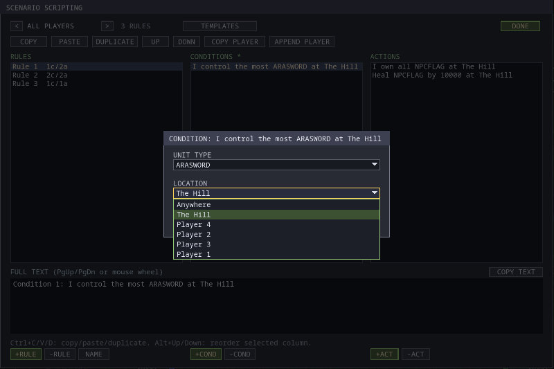

*Editing a condition. The LOCATION list offers Anywhere and the map's regions.*

| Field | Choices |
| --- | --- |
| **UNIT TYPE** | *Any Unit*, or a unit type ID such as ARASWORD. The **Create** action needs a real type. |
| **PLAYER** | *All Players* or *Player 1* to *Player 8*. |
| **LOCATION** | *Anywhere* or one of the map's regions. |
| **VALUE** | A whole number (a count, a number of seconds, an amount of mana, a timer number…). |
| **FLAG** | A flag name. Type one, or pick one already used in this rule set. |
| **TEXT** | A message. |

**Tab** moves between fields, **Alt+Down** opens a list, **Left** and **Right**
step through it, **Enter** saves and **Esc** cancels. Cartographer will not save
a value the game cannot use (an unknown region or unit type, a number out of
range, text longer than 63 bytes) and says what is wrong. *Any Unit* in a
Create action is the exception: it is saved, but only Check Map warns that it
does nothing.

**Templates.** **TEMPLATES** inserts a ready-made rule after the selected one:

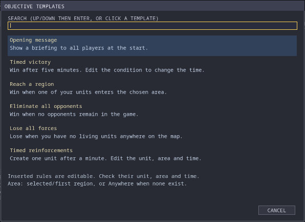

*The six objective templates.*

| Template | Condition | Actions |
| --- | --- | --- |
| **Opening message** | Start of game | Display a message ("Complete your objective.") to the rule set's player, or to all players |
| **Timed victory** | Gametime greater than 300 (seconds) | Victory for me |
| **Reach a region** | I control more than 0 Any Unit at *(region)* | Victory for me |
| **Eliminate all opponents** | Opponents left in game is less than 1 | Victory for me |
| **Lose all forces** | I control less than 1 Any Unit at Anywhere | Defeat for me |
| **Timed reinforcements** | Gametime greater than 60 | Create *(unit type)* at *(region)* |

Each template also ends with **Disable rule**, so it happens once. The region is
the one selected in the Regions list, otherwise the first region, otherwise
*Anywhere*. The unit for Timed reinforcements is the selected placed unit's type,
otherwise the first type in the list. Check and edit both after inserting.

#### How rules run in the game

- Rules are checked at the start of the game and then once every game second.
- All the conditions of a rule must be true at the same time.
- **A rule whose conditions stay true runs again every second** until something
  stops it. End a one-off event with the **Disable rule** action.
- The **ALL PLAYERS** set is copied to every seated player, before that player's
  own rules. In these rules *I* and *me* mean each player in turn, and Disable
  rule only stops that player's copy.
- The first victory or defeat a player receives is their result. Giving one
  player victory does not defeat the others; add rules for that.
- Unit types are the type IDs shown in the units browser (*ARASWORD*, not
  *Swordsman*). Region names are matched without regard to case.
- **Flags use only the first letter of their name**: *alpha* and *apple* are the
  same flag. Check Map warns about this.

#### Conditions

| Condition | Notes |
| --- | --- |
| Start of game | True only at the first check. |
| Gametime greater than / less than *value* | Game time in seconds. |
| Timer *value1* greater than / less than *value2* | Timers are numbered; false if the timer was never set. |
| I killed more than / less than *value* *unit type* | Units of that type I have killed. |
| I killed the most / the least *unit type* | Compared with every other player still in the game. |
| I lost more than / less than *value* *unit type* | Units of that type I have lost. |
| I lost the most / the least *unit type* | |
| I control the most / the least *unit type* at *location* | |
| I control more than / less than *value* *unit type* at *location* | Counts my living, finished units in the area. |
| Flag *flag* more than / less than *value* | False if the flag was never set. |
| Always / Never | |
| Opponents left in game is less than / greater than *value* | Counts opponents still in the game who are not my allies. |
| Random: *value* percent of the time it will be true | Checked every second. |
| Resources less than / greater than *value* | My mana. |

#### Actions

| Action | Notes |
| --- | --- |
| Set countdown timer *value1* to *value2* | Counts down one per second (it can go below 0). |
| Set countup timer *value1* to *value2* | Counts up one per second. |
| Set flag *flag* to *value* | |
| Add *value* to flag *flag* / Sub *value* to flag *flag* | Only changes a flag that has been set. |
| Victory for me / Defeat for me | Defeat removes that player's units. |
| Victory for me and all of my teammates / Defeat for me and all of my teammates | |
| Victory for all of my opponents / Defeat for all of my opponents | |
| Create *unit type* at *location* | Creates one unit for me in a free spot in the area. Needs a real unit type: a new Create action starts as *Any Unit*, which creates nothing (Check Map warns about it). |
| Destroy *unit type* at *location* | Destroys **my** units of that type there. |
| I own all *unit type* at *location* | Takes over every unit of that type in the area, whoever owns it. |
| Heal / Damage *unit type* by *value* at *location* | Changes the hit points of my units there by *value* hit points (not a percentage). |
| Move all *unit type* at *location* to *location* | Orders my units there to the middle of the second area. |
| Display gameclock | Shows *GAME TIME h:mm:ss* at the top left for the rest of the game. |
| Display *player* *text string* | Shows a message for about 8 seconds to that player, or to all. |
| Display *player* *text string* *flag* *text string* | The same, with the flag's value between the two texts (only if the flag has been set). |
| Disable rule | This rule never runs again (for this player). |
| Set resource limit to *value* | Caps my mana storage and stops my natural income. |
| Set resources to *value* / Add *value* to resources / Sub *value* from resources | Changes my mana. |
| Set resources normal | Removes the resource limit. |

Test your rules in a test game: Check Map can spot wrong values, but only
playing shows whether a mission works. **Scenario → Log Test Map triggers**
records which rules fired (see [Trigger log](#trigger-log)). The
[scenario reference](crt-triggers.md) has more technical detail.

### Use Only units

**Scenario → Use Only units** (**U**) opens a checklist of every unit type, by
type ID (for example *ARAARCH*). Click a row to tick or untick it. The header
reads *ALL UNITS ALLOWED* while nothing is ticked, or *N ALLOWED*. **UNRESTRICT**
clears the list; **DONE**, **Enter** or **Esc** closes it.

When the scenario runs, players can build and train only the ticked types; the
computer players keep to the list too. Placed units of other types stay on the
map, and rules can still create them. The status bar shows `USEONLY: n` while a
list is set.

---

## AI profiles

An **AI profile** is a short text file that tells a computer player which units
to build, how often and how many. A map can carry its own profiles, so the
computer players on your map build what suits it: no ships on a land map, more
flyers on an island map, no siege weapons in a scenario. The profiles travel
with the map: in multiplayer every player and the server get the same files.
You can also save them as a **game mod**, so that they apply on every map
while that mod is ticked.

The game has two kinds of computer player, and each reads its own file:

| Computer player | File | What the file does |
| --- | --- | --- |
| **DEFAULT AI** (the 1999 game's own AI) | the map's **own profile**, `ai/<name>.txt`, named by the map | The whole profile: every unit the file does not name is built at full chance with no limit. |
| Our levels: **Defensive**, **Easy**, **Normal**, **Hard**, **Absurd**, **Absurdly Defensive** | one file for all six, `ai/takengine.txt` | Changes only the units it names, in every level; every other unit keeps each level's own built-in values. The six built-in tables are the same today, so the file sets the same values for every level; the levels still play differently and treat limits their own way (see [One file, six levels](#one-file-six-levels-preview-level)). |

The DEFAULT AI is the one the room calls **RETAIL**. See
[AI difficulty](user-guide.md#ai-difficulty) in the game guide for how each
level plays.

Maps or mods made for 0.8.11 or earlier may carry a file for each level
(`ai/d.txt`, `ai/e.txt`, `ai/n.txt`, `ai/h.txt`, `ai/a.txt`, `ai/ad.txt`). The
game no longer reads those; see [Old level files](#old-level-files).

### The AI Profiles window

**Scenario → AI Profiles...** (**A**) opens the window. **Scenario →
Properties** also shows the map's DEFAULT AI profile, with an **EDIT AI
PROFILES...** button. While the window is open, the title bar shows `[AI]`.

![The AI PROFILES window for map AiTest. Left: DEFAULT AI selected, with its file ai/aitest.txt and the tag map *, then TAK ENGINE AI with ai/takengine.txt (also tagged map *), PREVIEW LEVEL (< HARD >), the PRESETS buttons NO FLYERS, NO SHIPS and CLEAR ALL, PREVIEW WITH GAME MOD (PACK: NONE) and the GAME MOD buttons. Right: the rule line ORIGINAL-GAME RULES: THE FIRST LINE NAMING A UNIT WINS; GROUP RULES COMBINE, the choice between the standard profile and this map's own profile named aitest, the FIND, SIDE and GROUP filters, and a table of flying units, each with BUILD OFF, CHANCE 100 %, SET BY line 7 and so on, and LIMIT 0. Footer: Plays: DEFAULT AI on this map reads ai/aitest.txt from this map, and the buttons START FROM, TEXT VIEW, CHECK, GROUP RULES and DONE](img/cartographer/ai-profiles.jpg)

*The DEFAULT AI tab of a map with its own profile, after **No flyers**: every
flying unit is switched off.*

- **Left column**: the two tabs, **DEFAULT AI** and **TAK ENGINE AI**
  (`ai/takengine.txt`, the one file all six of our levels read). A profile the
  map carries is tagged `map`; `*` means it changed since the window opened,
  and `as written` marks a file written by hand (see below). Under them are
  **PREVIEW LEVEL**, the [old level files](#old-level-files) notice when the map
  still has them, the **presets**, **PREVIEW WITH GAME MOD** and the **GAME
  MOD** buttons.
- **The rule line** at the top says how this kind of file works. DEFAULT AI:
  *the first line naming a unit wins; group rules combine*. TAK ENGINE AI:
  *whole numbers; units by name only; later lines win*.
- **The unit table** lists the units the computer players can build. Type in
  **FIND** to search by name or file name (for example *archer* or
  *araarch*), and pick a **SIDE** or **GROUP**. **SET ONLY** shows only the
  units this file sets. Units that no builder of their side can make are
  hidden; tick **UNBUILDABLE** to show them too.
- **The line under the table** explains the selected unit in words: its value
  and which line of the file sets it, or what it gets when the file does not
  name it.
- **The footer** says which file the computer player will really use on this
  map (see [Which file plays](#which-file-plays)).
- **DONE** or **Esc** closes the window.

#### Setting a unit

Click a cell, type, and press **Enter** (**Esc** cancels the typing).
**Right-click** a cell, or press **Delete**, to return it to *not set*.

| Column | DEFAULT AI | TAK ENGINE AI |
| --- | --- | --- |
| **BUILD** | Click to switch the unit **OFF** (never built) or back **ON**. | The same (shown for the preview level). |
| **CHANCE** / **WEIGHT** | **CHANCE**, 0 to 100 %. 100 % is normal; a lower number makes the AI pick the unit less often against other units it wants just as much; 0 % never builds it. | **WEIGHT**, a whole number from 0 to 999. Higher means picked more often among what that builder can make; 0 never builds it. The grey **BUILT-IN** column shows the preview level's own value. |
| **LIMIT** | How many of the unit the AI may have: a number, or *no limit*. 0 means never built. | A number, or blank for the built-in limit. 0 means never built. |

#### One file, six levels: PREVIEW LEVEL

`ai/takengine.txt` is read by all six of our levels. A value you set replaces
that unit's value in **every** level; a unit you do not set keeps **each**
level's own built-in value. (Today the six built-in tables hold the same
values, so PREVIEW LEVEL changes only the limits in play.) The table can show only one level at a time: **PREVIEW LEVEL** (click
for the next level, right-click for the one before) picks whose built-in
values fill the unset cells and the **BUILT-IN** column, and whose limits in
play are shown. Your settings (marked `*`) are the same for every level.

Each level also changes limits as it plays: Easy halves them, Hard and Absurd
raise them by half (at least 1), and the Defensive levels ignore every limit
except 0. The **LIMIT (IN PLAY)** column shows `> n` when the level changes your
number, and `+` when Hard or Absurd may raise it further in a long game; the
line under the table says it in words (*In play on Hard: 4 in play, more in
long games*). Step **PREVIEW LEVEL** to see what another level makes of the
same number.

The real odds of a unit being built also depend on what the AI needs at that
moment, so the window never shows a final percentage.

#### Presets

**NO FLYERS** and **NO SHIPS** switch off every flying unit or every ship;
**CLEAR ALL** removes every unit setting from the file. Each asks first and
says how many units it changes. Units you already set keep their settings,
and Undo takes a preset back.

On the TAK ENGINE AI tab the presets write `ai/takengine.txt`, so they apply
to all six levels.

#### Old level files

A map or game mod made for 0.8.11 or earlier may still carry the old per-level
files `ai/d.txt`, `ai/e.txt`, `ai/n.txt`, `ai/h.txt`, `ai/a.txt` or
`ai/ad.txt`. The game no longer reads them. Cartographer keeps them in the map
(or pack) byte for byte, as ordinary unused files, and the left column shows a
notice naming them, with **MERGE INTO TAK ENGINE...**:


*After merging Normal's old file. The old files are still in the map, so the
notice stays until you delete them.*

- The dialog lists the old files in level order with how many units each
  sets. Files that set exactly the same units merge as one. When they differ,
  pick the file to use; **Normal**'s is preselected.
- **MERGE** writes that file's unit settings into `ai/takengine.txt`: each unit
  it names takes its weight and limit there; units `ai/takengine.txt` already
  sets and the old file does not keep their values. Cartographer checks the
  result with the game's own reader before it stores it.
- The old files stay unless you tick **Also delete the old level files**.
- One **Undo** takes back the whole merge (and the deletes). In a game mod's
  pack there is no undo, as for every pack edit.

#### The DEFAULT AI's own profile

A map starts with **the standard profile** (`aiprofile=DEFAULT` in its map
settings): the DEFAULT AI reads the game's own `ai/default.txt`, as on every
shipped skirmish map. The standard profile is shown read-only.

To give the map a profile of its own, choose **This map's own profile, named**.
Cartographer proposes a name made from the map name (lower case, letters,
digits, spaces, `-` and `_`, at most 32 characters) and asks where to **START
FROM**:

- **STANDARD DEFAULT AI** copies your install's `ai/default.txt`, so the AI
  plays as usual until you change something. This is the usual choice.
- **EMPTY** starts with every unit at full chance and no limit. The AI then
  plays worse, because the standard profile switches off units it should not
  build.

The profile is saved in the map as `ai/<name>.txt`, and the map's settings
name it. You can rename it in the name field: the file moves with the name.
A name cannot contain `.`, `/` or `\`, and cannot be `default`, `takengine`
or an old level file name (`d`, `e`, `n`, `h`, `a`, `ad`). Choosing **the standard profile**
again asks first, then removes the map's file. Cartographer never writes a new
`ai/default.txt` into a map: that name is read by every map without a profile
of its own. A map that already carries one keeps it, and choosing its own
profile offers to move it there.

#### Group rules (DEFAULT AI)

**GROUP RULES** (DEFAULT AI tab) switches the right side to rules that change
a whole group of units at once, by one of the unit categories of your install
(*ara*, *fly*, *factory* and so on) or **ALL**.


*A group rule that halves the chance of every Aramon unit. The Archer has its
own row, so the rule skips it.*

- **+ ADD GROUP RULE** picks a word from a list of this install's categories.
  Click a rule's keyword to switch it between **WEIGHT** (a chance) and
  **LIMIT**, and its value to change it. `^` moves a rule up, `v` moves it
  down, and **X** removes it. Each move is one Undo step.
- **Order matters.** Rules apply from the top down: for limits the last rule
  wins, and a chance is worked out (and kept between 0 and 100 %) after each
  rule in turn.
- The selected rule lists every unit it covers, with its value now.
- **A group rule never changes a unit that has its own row** for the same
  thing (chance or limit): the unit's own row comes first and locks it. The
  window shows such a unit as *set individually, skipped*.
- Group chances combine: two 50 % rules leave a unit at 25 %. For limits, the
  last rule wins.
- **TABLE** goes back to the unit table.

TAK ENGINE AI has no group rules: our levels read unit names only.

#### Text view and Check

**TEXT VIEW** shows the file itself, and you can edit it freely. Marks in the
margin show lines that do nothing (`!`) and lines that a line before or after
replaces (`~`); point at a mark for the reason. **INSERT UNIT** adds the
selected unit's name. **TABLE VIEW** goes back.

**CHECK** lists problems in all the map's AI files: misspelled unit names
(with a suggestion), lines that do nothing, a decimal or a capital `Weight` in
`ai/takengine.txt`, a side that could build nothing at all (and on which
levels), old level files the game no longer reads, and more. Click a
problem to see its line. Check Map reports the warnings and errors too (see
[What Check Map reports](#what-check-map-reports)). None of them stops you from
saving.

#### Files written by hand

A file Cartographer did not write, for example one from a downloaded map,
opens **as written**: the window shows what it does, line by line, but the
table is read-only, and the file is saved unchanged, byte for byte.
**MAKE EDITABLE** rewrites it in Cartographer's own layout, but only if the
rewritten file makes the AI do exactly the same; otherwise it stays as
written. The Text view can always edit it.

#### Which file plays

The footer names the file each computer player will read, in plain words, for
example *DEFAULT AI on this map reads ai/islands.txt from this map. A ticked
game mod's ai/islands.txt would replace it; a game mod's ai/default.txt would
not.* The rules:

- A ticked game mod's file replaces a map's file with the same name, the whole
  file, not line by line: a game mod's `ai/takengine.txt` replaces the map's
  for all six levels. For our levels the footer reads, for example, *All six
  levels (Normal shown) read ai/takengine.txt from this map, each over its own
  built-in table, unless a ticked game mod has ai/takengine.txt, which then
  replaces it entirely.*
- The DEFAULT AI first looks for the map's own profile name (game mod, then
  the map, then your install), and only then for `ai/default.txt` in the same
  order. So a game mod's `ai/default.txt` does not replace a map's own profile.
- Your install never supplies `ai/takengine.txt`. Cosmetic mods never supply
  AI files. The old level files are never read, wherever they are.
- Campaign missions always use the DEFAULT AI.

**PREVIEW WITH GAME MOD** steps through your game mods (**PACK: NONE** means
none), so the footer can show what happens when one of them is ticked. The
lists in this window (here, OPEN FROM GAME MOD and File → Open AI mod) show
your ordinary packs in `mods/game/`, not the always-enabled packs in
`mods/game/always_enabled/`, which Cartographer does not edit: to edit one,
move its folder out of `always_enabled/` first. The preview and the checks see
one pack over the install, without your always-enabled game packs. While a
pack is picked, the unit table also lists the units it adds, tagged `pack`.

#### Saving as a game mod

**SAVE AS GAME MOD...** writes the map's AI files into a game mod pack:
`mods/game/<pack>/ai/` in your game data folder. Type a new pack name, or step
through the existing packs with `<` and `>`. The dialog shows the full folder,
one row per file with what it will do (new, identical, replaces), and which
files to write: `ai/takengine.txt` is ticked; the old level files are not
offered; the DEFAULT AI profile is not ticked, and
can be written either as `ai/default.txt` (every map that uses the standard
profile) or under the map's profile name (only maps whose profile has that
name).

- A file that would replace a different one asks first and shows what
  changes. The old file is copied to `mod-backups` in Cartographer's settings
  folder (see [Where Cartographer keeps its files](#where-cartographer-keeps-its-files)),
  never into the pack, because every file in a pack is sent to other players.
- Other files in the pack are never touched.
- A DEFAULT AI profile written as `ai/default.txt` gets a new comment line at
  the top that names that file and the pack (and the map it was saved from);
  nothing else in it changes. A file written by hand is saved exactly as it is.
- If the game data folder is read-only (for example a game installed under
  Program Files), **SAVE FAILED** says so.
- A game mod applies only when it is ticked: the host ticks it in the room, in
  single player and multiplayer alike (or it is in the host's
  `mods/game/always_enabled/`). A game that is already running shows a new pack
  the next time a room opens.
- A pack cannot be named `always_enabled` (that folder holds the packs the game
  always applies), nor take the name of a pack in `mods/game/always_enabled/`
  (ignoring case): the always-enabled copy would hide it.

**OPEN FROM GAME MOD...** lists your game mods; with more than 14, scroll the
list with the mouse wheel or its scrollbar, or use **Up**/**Down**,
**Page Up**/**Page Down**, **Home**/**End** and **Enter**. It opens one pack's AI
files for editing instead of the map's. The title then reads **GAME MOD PACK:**. These edits are not part of the
map: **SAVE TO PACK...** writes them back to the pack, and **CLOSE PACK** goes
back to the map's files, asking first about unsaved pack edits. The pack's
units are listed, tagged `pack`.

#### Undo in the window

**Ctrl+Z** and **Ctrl+Y** work inside the window, one step per change, back to
where the window opened. Earlier map edits undo after **DONE**. A pack's files
opened with OPEN FROM GAME MOD have no undo: CLOSE PACK discards what is not
saved.

#### Testing AI profiles

**Test Map** (**F5**) takes the map's AI files into the test game. In the
room, give each computer seat the level you are testing (**RETAIL** for the
map's DEFAULT AI profile; every other level reads `ai/takengine.txt`). To test
a game mod's files, tick that pack in the room, or use **TEST IN GAME...** in
an AI mod (below).

### Making an AI mod without a map

A game mod's AI files apply on every map while the pack is ticked, so making
one needs no map. **File → New AI mod...** (**Ctrl+Shift+N**) asks for a pack
name and opens the AI Profiles window with that pack as the only document.
**File → Open AI mod...** (**Ctrl+Shift+O**) lists your game mods
(`mods/game/` in the game data folder) and opens one. No map is opened or
shown: the editor behind the window is empty, the toolbar reads **AI MOD (NO
MAP OPEN)** with the pack's name, and the menus that need a map (Edit,
Scenario, Symmetry, and the map commands under File and View) are greyed out.

![The AI MOD (NO MAP) window for game mod pack Harder AI, over an empty editor: the toolbar reads AI MOD (NO MAP OPEN): Harder AI and the status bar AI MOD Harder AI: mods/game/Harder AI/ai/ in the data folder, UNSAVED. Left: the tabs DEFAULT AI (ai/default.txt) and TAK ENGINE AI (ai/takengine.txt, tagged pack *), PREVIEW LEVEL < NORMAL >, the presets, the banner PACK: Harder AI, An AI mod: no map is open. No undo; SAVE TO PACK writes the files, and the buttons SAVE TO PACK... *, CLOSE PACK and TEST IN GAME.... Right: the Archer (araarch) row with BUILD OFF, WEIGHT 0 *, BUILT-IN 5 / 16. Footer: Plays: with Harder AI ticked, all six levels read this pack's ai/takengine.txt over their own built-in tables, on every map; a game mod wins over a map's own copy (the install never supplies this file). Buttons TEXT VIEW, CHECK and CLOSE](img/cartographer/ai-mod.jpg)

*A new AI mod, Harder AI, with one TAK ENGINE AI setting: the Archer is never
built by any of our levels while the pack is ticked. Nothing is saved yet.*

- **The pack name** follows the same rules as SAVE AS GAME MOD. New AI mod
  refuses the name of a pack you already have (open that one with Open AI mod
  instead). Nothing is written until **SAVE TO PACK...**, which creates
  `mods/game/<pack>/ai/`.
- **The open map.** If it has unsaved changes, the command asks first and the
  changes are lost. A map without unsaved changes is only put aside: it comes
  back when the AI mod closes. A new, untouched map counts as nothing to lose.
  Where no map is put aside (a lost or untouched map, or none open), closing the
  AI mod returns to the empty window, as a fresh start shows it.
- **TAK ENGINE AI** edits the pack's `ai/takengine.txt`, read by all six of our
  levels over their own built-in tables, exactly as on a map's tab (PREVIEW
  LEVEL included).
- **DEFAULT AI** edits the pack's `ai/default.txt`, which RETAIL reads on every
  map that uses the standard profile. **NEW NAME...** switches the tab to a
  named profile, `ai/<name>.txt` (the same name rules as a map's own profile),
  which RETAIL reads only on maps whose profile has that name; click the file
  name to step between the pack's DEFAULT files. **START FROM...** fills an
  empty file from your install's standard profile, or starts it empty. The
  map-only choice between the standard profile and *this map's own profile* is
  not shown.
- **Units** are your install's plus the pack's own, tagged `pack`. Presets,
  group rules, the text view, CHECK and MAKE EDITABLE work as they do for a
  map, and every value is read by the game's own code.
- **The footer** says what the file does once the pack is ticked: a game mod's
  file wins over a map's file of the same name and over your install's.
- **SAVE TO PACK...** writes as described in
  [Saving as a game mod](#saving-as-a-game-mod): it asks before replacing a
  different file, and keeps the old one in `mod-backups`, never in the pack.
  There is no undo. **CLOSE PACK**, **CLOSE** or **Esc** ends the AI mod and
  asks first about unsaved edits; so do quitting, **File → New map** and
  **File → Open map**, which go back to maps.
- **TEST IN GAME...** plays the pack as it is saved: with unsaved edits it
  asks to save them first. Then it lists your install's maps (type to search,
  click or **Enter** to pick). The game opens its private test lobby on a test
  copy of that map, as **Test Map** does, with this pack ticked as the room's
  only game mod. This applies to that run only: your own ticks under the
  room's mod list stay saved. Your always-enabled game packs
  (`mods/game/always_enabled/`) apply too, as in every room you host, and the
  launch message names them. Seat the computer players at the levels to test
  (**RETAIL** for the DEFAULT AI profile). The map's own AI files come along;
  where the pack has a file of the same name, the pack's is used.

From a terminal, `takclient --play-map <map.kmp> --game-mod "<pack>"` does the
same with a map snapshot of your own (see [Sharing a scenario](#sharing-a-scenario)).

---

## Checking your map

### Check Map

**Scenario → Check map** (**C**) looks for problems the way the game would see
them. It runs in the background (an **ANALYZING TERRAIN** box; **Esc**
cancels) and then lists what it found.


*Check Map on a practice map with one start position, no mana and a War Galley placed on dry land.*

- **ERROR** lines (red) are definite problems to fix. **WARNING** lines
  (amber) may be intended (an island map has unconnected areas on purpose) but
  are worth a look.
- **Click** an entry that has a place on the map to jump there.
- **CHECK MAP** runs the check again; **CLOSE**, **Enter** or **Esc** closes the
  list.
- If you change the map, the list says its results may be out of date.
- **Scenario → Next issue** jumps to each entry in turn and describes it.
  **Scenario → Validation results** reopens the last list without checking
  again.

Checking never stops you from saving. Even the shipped maps produce warnings;
*Ulasem Arena*, for example, has many about mana-deposit footprints and
small separate areas.

#### What Check Map reports

| Area | Messages (shortened) | What to do |
| --- | --- | --- |
| Start positions | *No player start positions*; *Fewer than two player starts*; *More than eight player starts* | Add or remove starts. |
| | *Start N: start number must be 1 through 8*; *duplicate start number*; *outside map*; *overlaps another start* | Move or remove the start. |
| | *Start N: unsuitable for (Monarchs)* | A Monarch could not be placed there; move the start to open, level ground. |
| | *Start numbering has a gap at N* | Renumber so the starts run 1, 2, 3… |
| | *Start N: no ground approach route to another start*; *…to a mana deposit* | The start is cut off; open a path (or ignore it on an island map with transports). |
| | *Start N: preplaced units currently block (Monarch)* | Move placed units away from the start. |
| Mana | *No recognized mana deposits* | Add mana features. |
| | *Mana deposit: engine rejects lodestone footprint for …*; *preplaced units currently block …* | A lodestone could not be built on that deposit; clear the ground around it. |
| Movement | *(Unit) and N equivalent unit types: K disconnected movement regions …* | The map has areas that unit cannot walk between. Normal for islands and walled areas. |
| Placed units | *outside map*; *invalid owner*; *unknown unit type* | Move, fix or delete the unit. |
| | *engine placement rejects this terrain or feature footprint* | The game's build rules would not allow it there (for example a ship on land). |
| | *engine placement blocked by earlier preplaced units* | Placed units overlap. |
| | *in-game display name is limited to 31 bytes* | Shorten the name. |
| | *Use Only prevents constructing more of this type* | The unit is placed but cannot be built. |
| | *unit model is missing* | The unit has no 3D model in this install. |
| | *initial naval output site cannot place …* | A placed shipyard has no room to launch its ships; check the water in front of it. |
| | *vertical placement is preserved but ignored*; *custom-type health is preserved but …* | Values in some shipped maps that the game ignores; usually harmless. |
| Crusades | *(Unit) does not exist with CRUSADES on: … stop a CRUSADES game from starting this scenario*; *Custom stats for (unit) are skipped with CRUSADES on*; *rule …: (unit) does not exist with CRUSADES on* | The Crusades balance has no Trapdoor Spider, Heligrin, Cult of Lokken Ship, Sea Serpent, Mummy or second Lokken unit. A game with Crusades on cannot start a scenario that places one; replace it if the map should also be played with Crusades. |
| Terrain and features | *Unreadable terrain image …*; *Invalid terrain dimensions …* | The map's terrain is damaged. |
| | *Missing feature definition: (name)* | The feature does not exist in this world; erase the red dots. |
| Regions | *Region name is empty or duplicated*; *Region has out-of-map bounds* | Rename or resize the region. |
| Rules | *(rule set), rule G, condition/action R: …* | A value in a rule is wrong; the message says which. |
| AI profiles | *AI profile ai/(file) line N: …*; *AI profile aiprofile: …* | A line in one of the map's AI files does nothing, or the map's profile name has no file; open [AI Profiles](#ai-profiles) and press **CHECK** for the details. |

The checks of placed ships use each shipyard's starting pose; they cannot judge
every launch, and they cannot tell whether your rules do what you want. Test
in the game.

### Terrain overlays

The movement, buildability, water depth and slope overlays are described under
[Terrain overlays](#terrain-overlays) in the Terrain section. They are a quick
way to see where units can walk or build before you run Check Map.

---

## Testing a map in the game

Press **F5**, click **TEST MAP (F5)** in the toolbar, or choose **File → Test
Map**. Cartographer saves a temporary copy of the map, **including unsaved
changes**, and starts the game with it.

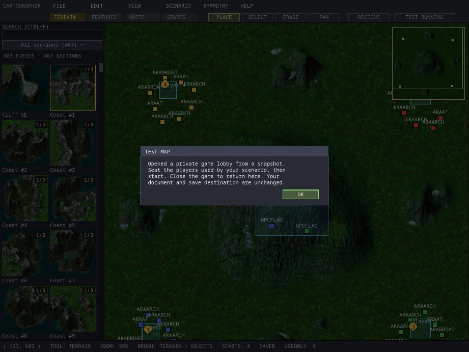

*After F5 on King of the Hill. The toolbar button reads TEST RUNNING until the game closes.*

The game opens a **private lobby** for the map, as for a single-player game:


*The game's lobby for a Test Map of King of the Hill. Its scenario needs four players, so seats 2 to 4 are tagged and START waits for them.*

1. Fill the seats your map needs, as in any lobby: set the other open seats to
   computer players (or close the ones you do not need). For a scenario, the
   lobby tags every seat that owns placed units or has rules *NEEDED BY
   SCENARIO*, and **START** stays greyed until each of them is filled.
2. Click **READY**, then **START**.
3. Play. Close the game window when you are done; Cartographer is still open
   with your map, unchanged and with the same save folder.

Notes:

- Testing does not save your map. Save it yourself when you are happy.
- The map's AI profiles go into the test game too. Give the computer seats the
  level you are testing (see [Testing AI profiles](#testing-ai-profiles)).
- Only one test can run at a time. Pressing F5 again says *A test is already
  running*.
- If the game cannot load the test copy, it shows **Cannot test map** with the
  reason. Problems with a scenario, such as a placed unit type this install does
  not have, are reported when you start the game from the lobby, in red under
  the buttons (*CANNOT START: ...*). If the game stops with an error,
  Cartographer shows **TEST MAP ENDED** with the error code.
- Each test leaves a verified copy of the map in the game's `MapCache` folder, in
  the game's per-user folder beside its `settings.ini` (see the
  [game user guide](user-guide.md#where-files-are-kept)); the game data folder is
  never written.
  These copies appear in the game's and Cartographer's map lists as
  *Test* followed by a number and a fingerprint, for example
  `Test 1792011008282376239 [bc9730de769612c0]`, and they keep their scenario
  (see [When scenarios run](#when-scenarios-run)). They are harmless. On disk
  each copy is a pair of files, `.kmp` and `.takmap`, whose long names start
  with the 16 characters in brackets. The same folder also holds the maps the
  game has downloaded for multiplayer games, so if you clear out test copies,
  delete only the pairs whose names match a test copy's fingerprint.

### Trigger log

Tick **Scenario → Log Test Map triggers** before pressing F5 to record what the
rules do. The TEST MAP message then shows where the log is written: a
`playtest-logs` folder in Cartographer's settings folder (see
[Where Cartographer keeps its files](#where-cartographer-keeps-its-files)). Each
line records the game tick (30 per second), the player, the rule number and
each action it tried, for example `tick=30 player=1 group=1 FIRED`. A log stops
at 4 MB. The setting is remembered.

---

## Saving, opening and sharing

### Save

**Ctrl+S** (or **File → Save**) saves the map as `<map name>.kmp` in the **save
folder**, with no questions. A message shows the full path.

- The save folder is your game's `Maps` folder, unless you opened the map from
  another folder (then it is that folder) or started Cartographer with `--out`.
- If a file of that name exists, it is replaced, and the previous version is
  kept beside it as `<map name>.kmp.bak`.
- **Ctrl+B** also saves the `.kmp`.

Saving happens in the background with a **SAVING MAP SNAPSHOT** box, which is
usually too quick to notice. **CANCEL (ESC)** stops it and leaves the previous
file untouched. If a save fails, **SAVE FAILED** says why (for example *Save
folder does not exist* or *Cannot write map (disk full or write error)*).

### Save As

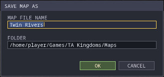

*Save As on Linux, saving into the game's Maps folder.*

**Ctrl+Shift+S** (or **File → Save As**) asks for a **MAP FILE NAME** and a
**FOLDER**, both typed (there is no folder browser). It always saves a `.kmp`.
The folder must already exist. If a different file of that name is already
there, **REPLACE MAP** asks first; the old one is kept as a `.bak` file.
Afterwards the map has the new name and Ctrl+S saves there.

> **Give edited copies of shipped maps a new name.** If you open an installed map
> such as *Ulasem Arena* and press Ctrl+S, Cartographer saves
> `Maps/Ulasem Arena.kmp`. But when two maps share a name, the installed one
> wins: the game's map list, and opening the map by name in Cartographer, both
> find the original, not your copy. Use **Save As** with a new name, such as
> *Ulasem Arena Remix*.

### Export loose files

**File → Export loose files** writes the map as separate files in the save
folder instead of one `.kmp`: `<name>.tnt` (terrain), `.ota` (map settings and
start positions), `.crt` (placed units, rules and regions), `.editor` (rule
names), `.tdf` (the Use Only list) and `.txt` (the description). The map's AI
profiles go in an `ai` folder in the save folder (`ai/takengine.txt`). Use it when
you want the individual files, for example to look at them or to use them with
other tools.

A map with AI profiles cannot be exported as loose files into the game's `Maps`
folder (or a folder inside it): the game reads a loose `Maps/ai/<name>.txt` for
every map, not as this map's own. **EXPORT FAILED** says *Save as .kmp to keep
AI profiles with the map*; save a `.kmp`, or export to another folder.

Loose files in the `Maps` folder are **not** listed by the game or found by name
in Cartographer. To open them again, use **File → Open** with the full path of
the `.tnt` file; Cartographer loads the other files beside it.

### Opening a map

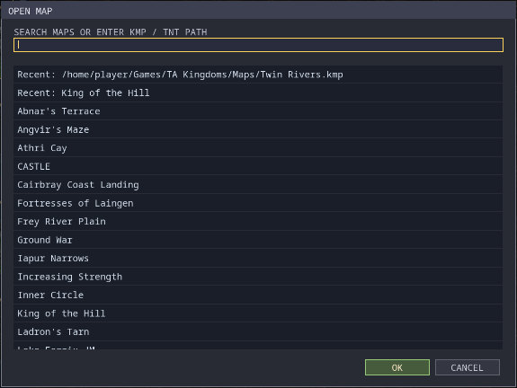

*Open Map lists recent maps first, then every installed map.*

**Ctrl+O** (or **File → Open map**) opens **OPEN MAP**:

- The list starts with up to 12 **Recent** maps, then every installed map in
  alphabetical order: the shipped maps, `.kmp` files in your `Maps` folder, and
  maps the game has downloaded or tested (shown with a fingerprint in
  brackets).
- Type to filter the list. **Click a row to open that map.**
- Or type a map name or the full path of a `.kmp` or `.tnt` file and press
  **Enter**. Enter opens exactly what you typed, not the first match in the
  list.
- If there are unsaved changes, Cartographer asks before opening.
- If a map cannot be found or read, **OPEN FAILED** says why.

Opening a file from disk makes its folder the save folder. Opening an installed
map by name keeps the current save folder. Opening a map starts a fresh undo
history.

### Closing Cartographer

Close the window, choose **File → Exit**, or press **Esc** (with nothing else to
cancel). If there are unsaved changes, **UNSAVED CHANGES** asks *Save changes
before exiting?*:

| Button | Result |
| --- | --- |
| **SAVE** (**Enter**) | Saves `<map name>.kmp` in the save folder (as Ctrl+S does), then closes. If the save fails, Cartographer stays open. |
| **DISCARD** | Closes without saving. |
| **CANCEL** (**Esc**) | Goes back to editing. |

A new map that you never named is saved as `Untitled.kmp`.

### Files in a map

A `.kmp` file is a single archive holding these files:

| File | Contents |
| --- | --- |
| `.tnt` | Terrain art, heights, features and minimaps. |
| `.ota` | Map settings: world, size, start positions, scenario name and description, the generator recipe. The player count shown in the game is the number of start positions. |
| `.crt` | Placed units, rules and regions. |
| `.editor` | Rule names (used only by Cartographer). |
| `.tdf` | The Use Only list (written even when empty). |
| `.txt` | The description (or the name, if there is no description). |

The `.kmp` can also carry **AI profiles**: `ai/<name>.txt` files at the top of
the archive, beside the map's own folder rather than inside it. You make and
edit them in the [AI Profiles](#ai-profiles) window. When you open a `.kmp` file
(**File → Open** with its full path or an installed map's name) or a loose
`.tnt`, Cartographer keeps every file in its `ai` folder and saves each one again
unchanged, byte for byte. Undo, recovery copies and **Test Map** keep them too.
Each map keeps its own files: two installed maps that both carry `ai/takengine.txt` (or
name the same profile) each open, play and travel with their own copy.

Only some of these files go with the map to other players and into **Test
Map**: `ai/default.txt`, `ai/takengine.txt` and the file the map's AI profile names
(`aiprofile=islands` reads `ai/islands.txt`). Any other file, such as
`ai/notes.txt` or an old level file like `ai/n.txt`, stays in your `.kmp` but is
not sent; Check Map says so.

### Sharing your map

- **For skirmish games**, give other players the `.kmp` file and ask them to put
  it in their game's `Maps` folder. The game finds maps there when it starts.
- **In multiplayer**, the host's map is sent automatically to every player who
  does not have it, before the game starts. See
  [map sharing](map-transfer.md).
- Others can open your `.kmp` in Cartographer with **File → Open** and its full
  path, or by name once it is in their `Maps` folder.

#### Sharing a scenario

To play your scenario, players put the `.kmp` in their game's `Maps` folder,
pick it on the skirmish or multiplayer create screen and turn **MAP SCENARIO**
on (see [When scenarios run](#when-scenarios-run)). In multiplayer only the host
needs it: the host's copy, scenario files included, is sent to everyone and
checked before the game starts, so every player plays exactly the same
scenario.

To test a scenario `.kmp` the way Cartographer does, open it in the game's test
lobby directly, from a command prompt or terminal, giving the full path of the
file, for example:

```sh
takclient --play-map "/home/player/Games/TA Kingdoms/Maps/Twin Rivers.kmp"
```

On Windows the program is `takclient.exe`, in the same folder as
`cartographer.exe`; on macOS it is inside the app, at
`Total Annihilation - Kingdoms.app/Contents/MacOS/takclient`. This opens the
same private lobby as F5 in Cartographer. The `.kmp` must contain exactly one
map. Add `--game-mod "<pack>"` to tick one game mod in that lobby (see
[Making an AI mod without a map](#making-an-ai-mod-without-a-map)). Afterwards the scenario's test copy stays in the player's map list (with a
fingerprint in brackets), so they can choose it from there next time.

### Where Cartographer keeps its files

Cartographer's own settings live in a `Cartographer` folder next to the game's
settings folder:

| System | Folder |
| --- | --- |
| Windows | `%APPDATA%\TAKengine\Cartographer\` |
| macOS | `~/Library/Application Support/TAKengine/Cartographer/` |
| Linux | `~/.local/share/TAKengine/Cartographer/` |

It holds `preferences.txt` (window size, UI scale, which layers are shown, the
grid, fullscreen, edge scrolling, the trigger log setting, the 12 recent maps
and the terrain group chosen for each world), the `recovery-…` folders for
unsaved work, `playtest-logs` for trigger logs, and `mod-backups`, where
[Save as game mod](#saving-as-a-game-mod) keeps the AI files it replaced or
deleted in a pack (one folder per pack and save). The game data folder is
stored in the game's own `settings.ini` (see the
[game user guide](user-guide.md#where-files-are-kept)).

The maps you save are in the game data folder's `Maps`. Downloaded maps and Test
Map copies are in `MapCache`, and saved random maps in `Maps`, in the game's
per-user folder (beside its `settings.ini`); the game itself never writes into the
data folder.

---

## Preferences

**View → Preferences** opens the editor's settings. **OK** (**Enter**) applies
and saves them at once; **CANCEL** (**Esc**) leaves them unchanged.


*View → Preferences on Linux.*

| Setting | Choices | Notes |
| --- | --- | --- |
| **DISPLAY (F11 TOGGLES)** | WINDOWED, BORDERLESS FULLSCREEN | Fullscreen covers the screen at its own resolution. Leaving it restores the window's size and position. **F11** switches at any time. |
| **EDGE SCROLLING (POINTER AT THE MAP EDGE)** | OFF (default), ON | When on, resting the pointer within a few pixels of the map's edge for a moment scrolls the view that way, and stops at the edge of the map. Resting the pointer on the outermost pixel of the window (of the screen, in fullscreen) also scrolls, even over the browser, menu bar or status bar. It does not scroll over the minimap, while a menu, dialog or window is open, or while a mouse button is held. |
| **UI SCALE (CAPPED TO FIT THE WINDOW)** | 50% to 200% (default 200%) | Makes all of the editor's text and controls bigger or smaller. The scale is reduced automatically so the editor always fits the window, so on a small window you may see less than the chosen size. **View → Smaller UI** and **Larger UI** change it in 25% steps. |

### Game data folder

The **GAME DATA FOLDER (SHARED WITH THE GAME)** row shows the retail
installation in use. It is the same setting as the game's
[**Options → Data folder**](user-guide.md#game-data-folder).

1. Click **CHANGE...** and choose another installation folder. (On Linux the
   folder picker needs `kdialog` or `zenity`.)
2. If the folder is not a valid installation, a red note says what is missing,
   and the current folder is kept.
3. A valid folder is **saved at once** for both Cartographer and the game. The
   note reads *Saved. Restart Cartographer to load …*, and a **RESTART NOW**
   button appears. The game uses the new folder the next time it starts.
4. **RESTART NOW** applies the other settings (as OK does) and restarts
   Cartographer with the new folder. If the map has unsaved changes, you are
   asked to save first; if saving fails, the restart is cancelled.

After the restart Cartographer reopens your map: the saved file, or the
installed map by name. A new map that was never saved is not reopened. If the
new installation does not have the map, Cartographer says so (**OPEN FAILED**)
and shows the empty window.

The row is greyed out, and cannot be changed, when Cartographer was started with
`--data` or from inside an installation folder; those always win.

---

## Keyboard and mouse reference

On macOS, **Cmd** works wherever this guide says **Ctrl**.

Single-letter keys do nothing while you are typing in the browser's search box
or a dialog. Letter shortcuts also work with Ctrl held (Ctrl+P opens Properties,
and so on), except where a Ctrl combination is listed below.

### Anywhere on the map

| Key | Action |
| --- | --- |
| **Ctrl+N** or **N** | New map |
| **Ctrl+O** | Open map |
| **Ctrl+S** or **Ctrl+B** | Save the `.kmp` |
| **Ctrl+Shift+S** | Save As |
| **Ctrl+Shift+N** | New AI mod (a game mod's AI files, without a map) |
| **Ctrl+Shift+O** | Open AI mod |
| **Ctrl+Z** | Undo |
| **Ctrl+Y** or **Ctrl+Shift+Z** | Redo |
| **Ctrl+F** | Search the browser |
| **Tab** | Next tool: Terrain, Features, Units, Starts, Blocked (also leaves region mode) |
| **Ctrl+L** | Switch between the Terrain and Features tools |
| **[** and **]** | Previous / next owner for new units (0 to 7); with the Blocked tool, smaller / larger brush |
| **P** | Scenario properties |
| **R** | Resize the map |
| **U** | Use Only units |
| **C** | Check map |
| **T** | Scenario scripting |
| **A** | AI Profiles |
| **K** | Clear Area on / off |
| **G** | Grid on / off |
| **B** | Show blocked cells with every tool on / off |
| **M** | Live symmetry on / off |
| **Shift+M** | Symmetrize |
| **1**, **2**, **3**, **4**, **5** | Zoom to 100%, 75%, 50%, 25%, 12.5% |
| **=** or **+**, **-** | Zoom in, zoom out |
| **Arrow keys** | Pan |
| **F5** | Test Map |
| **F6** | Unit model preview |
| **F11** | Borderless fullscreen on / off |
| **Esc** | Cancel; with nothing to cancel, close Cartographer (see [What Esc does](#what-esc-does)) |

### Tool keys

| Tool | Key | Action |
| --- | --- | --- |
| Terrain | **Ctrl+C** | Copy the terrain rectangle (Select mode) |
| | **Ctrl+V** | Use the terrain copy as the brush |
| | **Esc** | Back to section brushes, or clear the terrain rectangle |
| Features, Units | **Ctrl+C**, **Ctrl+X** | Copy, cut the selection |
| | **Ctrl+V**, **Ctrl+D** | Paste, duplicate at the pointer |
| | **Delete** | Delete the selection |
| | **Enter** | Features: list the selection. Units: Unit Properties |
| Blocked | **[**, **]** | Smaller, larger brush |
| | **Shift** + drag | Fill a rectangle (Place: block; Erase: clear) |
| | **Esc** | Drop the rectangle being dragged |
| Region mode | **Enter** | Region properties |
| | **Delete** | Delete the selected region |
| | **Esc** | Cancel a drag, or leave region mode |

With the Starts tool, in region mode, or when the current tool's layer is
hidden, **Ctrl+C** runs Check Map (there is nothing to copy there, so the **C**
shortcut takes it). With the Features or Units tool, **Ctrl+C** with nothing
selected empties that clipboard.

### Dialogs and lists

| Where | Keys |
| --- | --- |
| Any dialog | **Tab** / **Shift+Tab** next / previous field; **Enter** OK; **Esc** cancel (first closes an open list); **Left** / **Right** change a list field; **Alt+Down** open a list |
| Text fields | **Ctrl+A** select all, **Ctrl+C** / **Ctrl+X** / **Ctrl+V**, **Home**, **End**, arrows, **Backspace**, **Delete** |
| Scenario description | **Shift+Enter** new line |
| Unsaved changes | **Enter** save and close, **Esc** cancel |
| Generated map preview | **Enter** accept, **Esc** discard |
| Busy boxes (checking, overlays, generating, model loading, saving) | **Esc** cancel |
| Validation results, Use Only, model preview | **Enter** or **Esc** close |
| Placed units | type to filter, **Up** / **Down**, **Enter** select, **Shift+Enter** properties, **Esc** close |
| Regions list | **Ctrl+N** new, **Enter** edit, **Esc** close |
| Scripting | **Enter** edit or name the selection; **Ctrl+C** / **Ctrl+V** / **Ctrl+D** copy, paste, duplicate; **Alt+Up** / **Alt+Down** move; **PgUp** / **PgDn** scroll the full text; **Esc** close |
| Templates | type to search, **Up** / **Down**, **Enter** insert, **Esc** close |
| AI Profiles | click a cell, type, **Enter** set, **Esc** cancel; **Delete** or right-click returns a cell to not set; **Ctrl+Z** / **Ctrl+Y** undo, redo; **Esc** close |

### Mouse

| Action | Effect |
| --- | --- |
| Left button | Depends on the tool and mode (see [Tools, modes and layers](#tools-modes-and-layers)) |
| Right-drag | Pan, in any mode (in region mode, a right-click also cancels a drag) |
| Wheel over the map | Zoom around the pointer |
| Wheel over the browser or a list | Scroll |
| Double-click | Properties of a unit, a region, or a condition or action |
| Shift+click, Shift+drag | Add to (or toggle) the selection; with the Blocked tool, Shift+drag fills a rectangle |
| Click or drag in the minimap | Move the view |

---

## Troubleshooting and FAQ

**My map is not in the game's map list.**
Check that it was saved as a `.kmp` in the `Maps` folder of the installation the
game uses (the SAVED message shows the path). The game reads that folder when it
starts, so restart the game. Loose exported files are not listed. If your map
has the same name as an installed map, the installed one is listed instead:
save it under a new name.

**SAVE FAILED: Save folder does not exist.**
The save folder is missing, usually because the installation has no `Maps`
folder. Create a `Maps` folder in the installation, or use **Save As** with a
folder that exists.

**I edited a shipped map and saved, but the game still has the old one.**
Your copy has the same name as the shipped map, so the game finds the original.
Open your copy with **File → Open** (it is in the Recent list), then **Save As**
under a new name.

**My placed units, rules or Use Only list do nothing in a skirmish.**
Turn on **MAP SCENARIO** under the map preview when you create the game: a map
chosen with it off plays as a plain skirmish map. If the button is greyed, the
reason is written under it (a map whose only content is a Use Only list has no
scenario). See [When scenarios run](#when-scenarios-run).

**The game says "Seat player N in the lobby to play this scenario".**
Player N owns placed units or has rules. Seat a human or computer player in seat
N. Remember that owner 0 in the editor is Player 1. The lobby already tags such
seats *NEEDED BY SCENARIO* and keeps **START** greyed until they are filled.

**Test Map says "Cannot find takclient beside Cartographer".**
Cartographer starts the game from its own folder. Install the game and
Cartographer from the same package and keep them together. On macOS keep
the two apps in one folder. In every case you can save the map and
open it with `takclient --play-map` (see
[Sharing a scenario](#sharing-a-scenario)).

**Cartographer closed when I pressed Esc.**
With nothing left to cancel, Esc closes Cartographer; if everything was saved it
does not ask. Nothing was lost: start it again and open the map with
**Ctrl+O**.

**The browser is empty, or shows only a few items.**
The search box keeps its text when you change tools, and the category or group
button may still be set. Clear the search box, and click the category button
until it shows ALL (or choose *All sections* for terrain).

**The minimap still shows the old terrain.**
It catches up a moment after you stop stamping; the status bar shows
*Updating minimap...* meanwhile.

**My trees vanished when I stamped terrain.**
A stamp replaces the features in its area with the section's own. Tick **Edit →
Brush: protect objects** first, or press **Ctrl+Z**.

**The terrain I stamped is not mirrored.**
Either the section has no mirror twin (the status bar says *NO MIRROR TWIN*),
or the stamp crossed the symmetry axis. Stamp another piece, or fix the other
side by hand.

**Ctrl+C opened Check Map.**
With the Starts tool, in region mode, or with the current tool's layer hidden,
there is nothing to copy, so Ctrl+C acts as **C**. Close the results with Esc.

**Cartographer cannot find my game data, or I want to switch installs.**
Use **View → Preferences → GAME DATA FOLDER**, which saves the folder for
Cartographer and the game. Starting Cartographer with `--data <folder>` also
works, but only for that launch: it is not remembered. The folder must contain `data.hpi`, `terrain.hpi`,
`sections.hpi` and `maps.hpi`.

**The text is too small or too big.**
Change **UI SCALE** in Preferences, or use **View → Smaller UI** / **Larger UI**.
The scale is limited so that the editor fits the window; make the window bigger
to allow a larger scale.
On a Linux Wayland desktop at a display scale above 100%, blurry text means
Cartographer is running in an X11 window: it follows the game's **Options →
Display → Native Wayland** setting (see the
[game user guide](user-guide.md#display)), which takes effect when Cartographer
is restarted.

**What happened to my unsaved work after a crash?**
Start Cartographer from its shortcut and choose **Recover**. See
[If Cartographer closed unexpectedly](#if-cartographer-closed-unexpectedly).

---

## Known limits

- **Maps with rules but no placed units keep the Monarchs.** Every player
  starts with the usual Monarch as well as anything the rules create. The
  original game may have started such maps with no units at all; that is not
  yet confirmed.
- **Computer players do not read scenarios.** They ignore regions and
  objectives and simply play with the units they are given; a computer player
  in a seat that has no units does nothing. The lobby warns about such a seat
  (*NO PLACED UNITS: PLAYER N*).
- **You start in seat 1, but can move.** The player who creates the game takes
  seat 1, and players who join take the lowest open seat. In the lobby of an
  ordinary game, any seated player (the host too) can press **MOVE HERE** on an
  open seat to take it; the seat moves with the player's side, colour, team and
  ready state. Moving is refused once the game is running and in campaign
  missions. Close the seats your scenario does not need before
  others join, so that they land in seats that have units.
- **No height brush.** Heights come with terrain sections; there is no tool for
  raising or lowering ground directly.
- **Terrain is never flipped.** Symmetry uses twin sections, which are found by
  their names. Some pieces have no twin, a few name-matched twins are not exact
  mirror images, and a twin keeps the variant number rather than the closest
  height. *Ulasem Arena*'s raised Zhon plateaus are an example of terrain with
  many pieces that have no twin.
- **Unit placement preview.** The outline for a large unit is centred on the
  pointer, but the unit is placed with its footprint's corner on the clicked
  cell, so it lands slightly to the right and below.
- **No placement checks while editing.** Units can be placed on any ground and
  on top of each other; Check Map reports problems afterwards.
- **Features have no properties.** Their behaviour comes from the game's own
  definitions.
- **Some values in shipped maps are kept but cannot be edited**: custom
  unit-type statistics (the game applies their armour, weapon and veteran
  values but ignores their health) and a height for placed units (which the
  game ignores).
- **Features from downloaded maps.** Some downloaded maps in your `Maps` folder
  bring their own features, and the Features browser offers them too (the game
  loads them for every map). A map that uses them plays from the `Maps` folder,
  but a copy opened from another folder, and a Test Map copy, cannot find them:
  they show as red dots and Check Map reports *Missing feature definition*.
- **Re-saving downloaded maps.** If a downloaded map came with its own terrain
  images or feature files, re-saving it in Cartographer writes only the map's
  own files, not that extra art.
- **Mods** (`mods/` packs, including the always-enabled packs in
  `mods/cosmetic/always_enabled/` and `mods/game/always_enabled/`) are not
  loaded in the editor. The one exception is the AI Profiles
  window, which lists a game mod's units while that pack is previewed or
  opened there.
- **Display names** are cut to 31 bytes in the game.
- **Text.** The editor's own font covers Latin (including Vietnamese), Greek,
  Cyrillic, Armenian and Georgian letters, common symbols, Japanese kana, Korean
  Hangul and about 7,000 common Chinese characters. Right-to-left scripts,
  scripts that need shaping or combining marks, and rare characters show as
  boxes.
- **Check Map is advisory.** It does not judge whether your rules work; test in
  the game.
