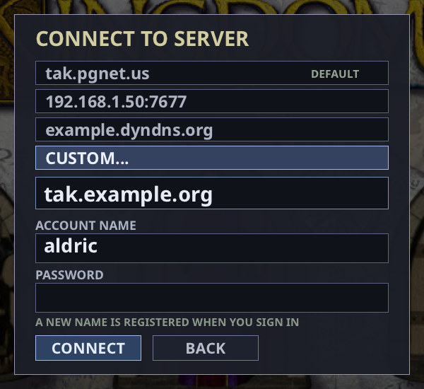

# Public server deployment

`takserver` is the dedicated server for internet games. Only the server needs an
open port: players connect out to it by typing its hostname, and single-player
games run their own private server automatically, so you only need this guide to
host games for other people.

The server includes native TLS, authentication, resource admission limits and an
optional Linux service sandbox. These reduce risk; they do not constitute an
independent security audit or protection against a volumetric DDoS.

## Versions

Server and clients must speak the same gameplay protocol; update the server and
every client together when it changes. **0.9.5 changes it (protocol 299):** a
0.9.5 `takserver` accepts only 0.9.5 players and turns away 0.9.4 and older
clients with a *protocol version mismatch* message, and a 0.9.4 or older server
turns away 0.9.5 players, so update `takserver` when you announce 0.9.5 to your
players. Which versions play together is listed in
the [user guide](user-guide.md#versions) and in the [CHANGELOG](../CHANGELOG.md).

**0.9.4 removes the Darien Crusades campaign service.** `--crusades-db` and
`--crusades-definition` no longer exist: a server still started with either
(and its value) logs a warning that the option was removed and is ignored, and
starts as usual, so take them out of your service drop-in or script. A leftover campaign database (`campaign.sqlite` and its `-journal`,
`-wal`, `-shm` and `.service-lock` companions) and `crusades-replays/` folder are
never read; delete them when you no longer want them. `crusades_admin` is no
longer shipped. The Crusades *balance* is unaffected: it is still the room's
CRUSADES option.

## Quick setup: Linux package

These steps use the installed Linux package and built-in Let's Encrypt support.
You do **not** need to download or copy a service unit from the source repository.

1. **Choose a hostname and configure networking.** Point a hostname you control
   (for example, `tak.example.org`) at the server. Allow inbound TCP **80** for
   certificate validation and **7677** for the game, plus outbound HTTPS **443**.
   If you publish an IPv6 address, it must reach this server too. Another service
   must not occupy port 80 when takserver validates its certificate.

2. **Copy your retail game data.** Replace `/path/to/retail-install` below with
   the actual directory containing your game's archives and maps:

   ```sh
   sudo mkdir -p /srv/tak-data
   sudo cp -a /path/to/retail-install/. /srv/tak-data/
   sudo chown -R root:root /srv/tak-data
   sudo chmod -R a+rX /srv/tak-data
   ```

   The service cannot read `/home` because of its sandbox. Do not use a symlink
   back into your home directory. Clients need matching base game data.

3. **Install the ACME override template.** For a first-time setup:

   ```sh
   sudo mkdir -p /etc/systemd/system/takserver.service.d
   sudo cp -i /usr/share/doc/tak-engine/systemd/takserver-acme.conf \
     /etc/systemd/system/takserver.service.d/acme.conf
   ```

   If you already have `acme.conf`, keep it and edit it instead of overwriting
   your configuration. The packaged unit is already installed at
   `/usr/lib/systemd/system/takserver.service`.

4. **Set your hostname before starting.** Open the copied override:

   ```sh
   sudoedit /etc/systemd/system/takserver.service.d/acme.conf
   ```

   Replace **`YOUR.SERVER.NAME`** after `--acme-domain` with your actual hostname
   (for example, `tak.example.org`), without `https://` or a port. The data path
   defaults to `/srv/tak-data`; use the settings template below to change it.
   Keep the empty `LoadCredential=` and `ExecStart=` lines; they replace the default manual-certificate configuration.
   Using `--acme-agree-tos` accepts the CA subscriber agreement.

5. **Enable and start the service.**

   ```sh
   sudo systemctl daemon-reload
   sudo systemd-analyze verify takserver.service
   sudo systemctl enable --now takserver
   ```

   If it was already running, also run `sudo systemctl restart takserver` to
   apply your changes. Systemd creates the private state directory automatically.

6. **Check startup, then connect.**

   ```sh
   sudo systemctl status takserver --no-pager
   sudo journalctl -u takserver -f
   ```

   For first-time ACME setup, wait for `ACME: certificate installed` before connecting.
   A listening service can still be waiting for issuance or a persisted retry deadline.
   Players then enter just your hostname in the multiplayer connection screen.
   Press Ctrl+C to leave the log viewer; this does not stop the server.

   

**Optional: change server defaults.** Copy and edit the settings template:

```sh
sudo mkdir -p /etc/systemd/system/takserver.service.d
sudo cp -i /usr/share/doc/tak-engine/systemd/takserver-settings.conf \
  /etc/systemd/system/takserver.service.d/settings.conf
sudoedit /etc/systemd/system/takserver.service.d/settings.conf
sudo systemctl daemon-reload
sudo systemctl restart takserver
```

The template lists the default paths, port, game/account limits, storage budgets
and systemd resource limits. Change individual values such as
`Environment="TAK_SERVER_MAX_RUNNING_GAMES=8"` without rewriting the startup
command. It works with both certificate modes. Restart between matches, since
it disconnects active games. For examples and existing-installation migration,
see [changing server defaults](#changing-server-defaults).

The server renews its certificate automatically and opens port 80 only during
validation. Local configuration stays in `/etc/systemd/system/takserver.service.d/`;
accounts, maps, replays and certificate state live under `/var/lib/takserver`.
Map and mod package checks run off the network loop with bounded admission and
work limits (see [resource controls](#resource-controls)). Until the first
certificate is issued, ACME retries automatically and the server refuses game
connections.

**Check who is playing.** On the server machine, run `takserver --status` (add
`--port 7678` for a different game port). It prints one JSON object with
`running_games`, `lobby_games` and `connected_clients`, then exits. It needs no
game data, account or certificate arguments, and works with TLS and ACME servers.
See [querying server status](#querying-server-status) for what each count includes.

To use an existing certificate instead of Let's Encrypt, or if something goes
wrong, see [Linux service setup](#linux-service-setup).

## Running on Windows or macOS

Every package includes `takserver`, but the supplied service unit and sandbox are
Linux-specific: there are no Windows or macOS service installers. Run it with the
command lines under [Encrypted connections](#encrypted-connections) (your own
certificate) or [Built-in Let’s Encrypt certificates](#built-in-lets-encrypt-certificates).

- Use a dedicated standard service account and restrict the data, account and key
  permissions to it.
- Open the game port (TCP 7677 by default) in the firewall, plus TCP 80 when using
  built-in Let’s Encrypt, and configure the service account so the process may
  bind port 80.
- Keep the retail data, accounts file, map cache and replay directory on local
  paths the account can read (and write, for the last three).

## Encrypted connections

A listener reachable off the machine requires a certificate and private key:

```sh
takserver --data /srv/tak-data \
  --accounts /var/lib/takserver/accounts.conf \
  --map-cache-dir /var/lib/takserver/maps \
  --replaydir /var/lib/takserver/replays \
  --tls-cert /etc/takserver/fullchain.pem \
  --tls-key /etc/takserver/private.pem
```

Create the writable directories and restrict them to the server account before
starting. The certificate must cover the DNS name players use and chain to a CA
trusted by their operating system. The certificate file includes intermediate
certificates. Renew it before expiry and restart the server to load the renewal;
there is no live certificate reload.

Players enter just **`your-server.example`** in the multiplayer server field.
The client automatically uses TLS and port **7677**. An optional `:port` supports
servers on other ports; existing `tls://` addresses also work. TLS verifies both the certificate chain and the DNS name/IP address.
An invalid certificate fails the connection; there is no plaintext fallback.
A TLS listener accepts only TLS connections. TLS 1.2 or later protects the whole
session, including registration, login, game passwords, chat and commands.
Account authentication is still required by default.

OpenSSL is compiled into the binaries on Linux, Windows x64/ARM64 and macOS
x64/ARM64. No OpenSSL DLL/shared library is shipped or required. Windows and
macOS system trust anchors are imported; Linux uses system CA bundles. An
administrator may configure OpenSSL's standard `SSL_CERT_FILE`/`SSL_CERT_DIR`
for a private CA. There is deliberately no “ignore certificate errors” option.

`--local` binds loopback and permits plaintext for a private local client or
an encrypted tunnel. `--allow-plaintext` explicitly permits an unencrypted
external listener for a trusted LAN/test environment. It is **not** a public
Internet deployment setting. To use one from the multiplayer menu, explicitly
enter `tcp://hostname` (and an optional `:port`). Bare menu hostnames always use
TLS, with no plaintext fallback. Automatically launched single-player servers
keep their private loopback connection. Debug command-line harness connections
retain their explicit transport behavior. Clients too old to support TLS cannot
connect to a TLS listener; see [Versions](#versions) for which clients a server
accepts.

The login exchange alone is not session encryption. Do not expose the old
plaintext port alongside TLS as a compatibility fallback.

## Built-in Let’s Encrypt certificates

`takserver` can obtain and renew its own certificate without Certbot or another
installed ACME program:

```sh
takserver --data /srv/tak-data \
  --accounts /var/lib/takserver/accounts.conf \
  --map-cache-dir /var/lib/takserver/maps \
  --replaydir /var/lib/takserver/replays \
  --acme-domain tak.example.org --acme-agree-tos \
  --acme-state /var/lib/takserver/acme
```

Replace `tak.example.org` with a DNS hostname you control. Its A/AAAA records
must reach this machine, including IPv6 if published. Allow incoming TCP **80**
through the firewall/router and outgoing HTTPS **443** to the CA. The game still
uses TCP **7677**. The server opens an HTTP listener only while an HTTP-01
challenge is pending, serves only its exact challenge token, and closes it after
validation or failure. It does not run a general website, redirect service, or
permanent port-80 listener, and does not change your firewall automatically.
If another service already owns port 80, issuance fails cleanly; TAK will not stop
that service or fall back to plaintext. Wildcards and IP certificates are not
supported by this implementation.

`--acme-agree-tos` records the operator’s agreement to the CA subscriber terms.
`--acme-email you@example.org` optionally supplies an account contact. The state
directory defaults to `takserver-acme`; use a persistent absolute directory for a
service. Keep it private and back it up: it contains the account key, certificate
key, certificate chain and retry state. A process lease prevents two servers from
managing the same directory. A directory is tied to its hostname and CA; use
separate directories for different hosts and staging.

Initial issuance and renewal run in a background worker. Until a certificate is
available, the game listener refuses connections; it never falls back to plaintext.
Subsequent starts reuse a valid saved certificate. Transient initial failures and
persisted backoffs leave the service running, so the packaged systemd restart
limit cannot prevent eventual recovery. Shutdown interrupts retry waits promptly;
do not delete retry state to bypass a CA backoff. The worker uses bounded
requests, nonce retries, persistent exponential backoff and CA `Retry-After`
handling. Without renewal information from the CA it renews when about one-third
of certificate lifetime remains (half for certificates shorter than ten days),
without assuming a fixed 90-day lifetime.
The temporary HTTP-01 listener allows 32 connections globally and four per
normalized source address (IPv4 and IPv4-mapped IPv6 share a limit). Its three-second
deadline and 8 KiB request limit also apply to incomplete requests.
When the CA directory advertises `renewalInfo`, the worker follows ACME Renewal
Information ([RFC 9773](https://www.rfc-editor.org/rfc/rfc9773)): it fetches the
`suggestedWindow` for the current certificate (certID from its Authority Key
Identifier and serial), renews at a point inside that window, and renews at once
when the window has already passed, which is how a CA signals revocation or
mis-issuance. The point within the window is derived from the certificate ID, so
it is stable across restarts while different certificates still spread out. The
worker polls again after the CA's `Retry-After` (limited to between one minute and
one day; six hours without one) and logs the chosen time with any CA
`explanationURL`. Once the CA has returned a usable window for the certificate,
renewal orders carry `replaces` with its ID; if the CA answers `alreadyReplaced`,
the worker orders without it. A window that runs past expiry is cut at expiry. A CA
without `renewalInfo`, a malformed window, or a window starting after expiry keeps
the fixed rule; a failed poll keeps the current schedule and retries within an hour.
At each poll the worker also checks the current certificate against its CRL (see
below) and renews immediately if the CA has revoked it. A successful
renewal atomically saves the certificate/key bundle and switches new connections
to it; existing games keep their established TLS sessions. Renewal failures keep
the previous certificate and log the problem. An expired certificate will still
be rejected by clients, so administrators must monitor renewal failures.

On Linux, the listener needs permission to bind port 80. The optional
[systemd ACME drop-in](../packaging/systemd/takserver-acme.conf) grants only
`CAP_NET_BIND_SERVICE` while retaining the main service sandbox. Linux packages
install the service in `/usr/lib/systemd/system/takserver.service` and the template
plus setup notes in `/usr/share/doc/tak-engine/systemd/`. Neither the service nor
ACME is enabled automatically. Copy the `takserver-acme.conf` template to
`/etc/systemd/system/takserver.service.d/acme.conf`, replace its hostname, and
review the paths before restarting. It replaces the manual certificate options
and credential entry. Do not run the game server as root just to bind port 80.
On Windows and macOS, see [Running on Windows or macOS](#running-on-windows-or-macos).
State uses private owner ACLs on Windows and owner-only Unix
permissions. No new DLL/shared-library dependency is added; OpenSSL is static and
the vendored JSON parser is header-only (see `ACME-LICENSES.txt`).

Use `--acme-staging` with a **separate state directory** to exercise Let’s Encrypt’s
test service before production. Staging certificates are not trusted by ordinary
clients.

## Resource controls

| Option | Default | Scope |
|---|---:|---|
| `--max-games` | 16 | Lobby and running rooms combined |
| `--max-running-games` | 4 | Concurrent referee simulations |
| `--max-accounts` | 10,000 | New registrations; existing logins remain available |
| `--map-memory-mib` | 512 | Reserved uploads plus retained room packages; includes canonical and decoded file bytes |
| `--map-storage-mib` | 4,096 | Download cache and saved generated maps together |
| `--replay-memory-mib` | 256 | Estimated replay history memory per game |
| `--replay-storage-mib` | 4,096 | Each replay archive directory |

Limits must be positive; invalid values fail startup. Game count limits may be
raised to 64, accounts to 100,000, and memory/storage limits to 65,536 MiB.
Choose limits appropriate to the host. These are application budgets, not a
replacement for a process memory limit or filesystem quota: simulation state,
transient decoding/serialization, TLS and allocator overhead also use memory.

Map uploads reserve their advertised size before receiving data and expire
after 30 seconds without progress or five minutes total. Each package remains
limited to 256 MiB. New disk writes are rejected at quota; old maps/replays are
not silently deleted. Existing downloaded maps remain selectable. Uploaded maps and
game mods and saved generated maps go in `--map-cache-dir`; without it, in
`TAKengine/takserver` in the service account's per-user data folder (`$XDG_DATA_HOME`
or `~/.local/share` on Linux, `%APPDATA%` on Windows). The `--data` folder is only
read, so it can be read-only to the service account.

Ordinary lobby/chat/setting requests have per-connection, account, IP and global
work budgets. Expensive creation/start/map-offer requests cost more than small
queries; map chunks have separate byte budgets. Keepalive has a connection
budget so one abusive connection cannot disconnect its healthy NAT neighbours.
Authentication retains its own throttles. Account-file
rewrites are also limited globally. New connections are limited before TLS
allocation (32 per IP and 128 globally per second). Upload reads apply
backpressure at 4 MiB/s per connection and 16 MiB/s globally; fast legitimate
senders are paced rather than disconnected.

Map and game-mod validation uses one background worker and at most two waiting
jobs. Admission reserves twice the advertised package size for canonical and
extracted bytes, including jobs whose sender disconnects. Cached file sizes are
checked before allocation and must match the offer; uploaded lengths and final
admission are checked again. On a cache miss, even an installed map is requested
from the host instead of rebuilding it on the network loop. This can add a first-use
upload but preserves the existing protocol. Validation results are discarded after
the host leaves, changes rooms or changes the relevant settings.
Cancellation uses a shared atomic flag whose lifetime is independent of the
connection, including on the macOS 14 SDK; workers never dereference a departed
client to check cancellation.

TDF parsing preserves case-insensitive, last-definition lookup and duplicate
section order, using an index instead of scanning earlier entries. Limits are
65,536 sections, 262,144 nodes (sections plus assignments), depth 32, and a
conservative 64 MiB allocation-accounting allowance. Map feature definitions share
these limits across the package and have an additional 8 MiB source-text limit.
Oversized custom content is rejected. The map-memory setting is a package admission
budget, not a total process RSS limit: the single worker also uses bounded parser,
geometry and cache-writing scratch memory. Keep systemd's MemoryMax above the
package budget plus simulation and validation working memory.

Commands have one-second byte and count budgets: 4 MiB/65,536 commands per connection
and account (source address for unauthenticated private clients), and
32 MiB/524,288 commands globally. These exceed normal client command credits,
including large battles at 4x speed. Exhaustion applies receive backpressure;
batches that do not fit the 512-command queue are dropped whole before decoding.
Overflow summaries are limited to one per connection per five seconds and four
per second globally. Accepted batches are parsed once, with no partial enqueue.

All admitted player-command batches are checked before enqueueing: invalid command
types, truncated/trailing data, non-finite coordinates and coordinates outside
the simulation’s signed 16.16 range are rejected. Spectators cannot submit
player commands. Production count requests are limited to the client’s maximum
batch of ten, preventing a forged count from allocating billions of queue entries.
Ownership is stamped by the server and checked by the simulation.

Spectating is a per-room rule. The host's **Allow spectators** setting
(`GameOptions.allowSpectators`) travels in every room snapshot and
in the game list. When it is off, the server refuses every `Spectate` into that
room with "spectators are not allowed in this game". That covers a browser's
watch request, a player who left the game and asks to watch, and a reconnecting
client, because `Spectate` is the only way to join a room without a slot. A seated
player's reconnect (`Rejoin` with its resume token) is unaffected. Only the host may change
the rule, in the lobby; if the host leaves the lobby, the player who inherits the
room inherits the rule too. Once the game starts, it is fixed: an in-game
`SetGameOptions` changes only speed. A host who created the room to watch it
keeps that seat.
`server_spectators_test.py` checks each of these against a real server.

A seated player the server stops hearing from (nothing for 8 seconds, or a
connection closed without leaving) stops the game for everyone, with a countdown on
every screen. Each human seat has one 30-second budget for the whole game, spent from
the player's last contact (so the 8 silent seconds count) in whole seconds; a shorter
silence that still holds the game up is charged for everything past its first second.
Silence before the first tick or while the client is still loading is not charged
(a connection that closes then is counted down from the close). A player back
within the budget, on the same connection or by the client's automatic reconnect
(`Rejoin`, which streams only the ticks it missed), carries on; otherwise the server
closes that connection and its own AI, at Normal, plays the seat for the rest of the
game (`Event::AiTakeover`, recorded in the replay). The accounting is wall-clock time
on the server, so a server whose own upload stalls for more than a second charges
every seat it holds up. A player who quits the game
deliberately leaves at once, without a wait. The two times can be shortened for tests
with `TAK_STALL_MS` and `TAK_DROP_WAIT_MS` (milliseconds) in the server's
environment; `server_disconnect_test.py` checks the wait, the takeover, a
resume and a reconnect against a real server.

Silence timeouts: a seated player silent for 15 seconds is disconnected (the server
pings after 5 s of quiet). While a client is loading a game (from the server's
`GameStarting` to the client's `Loaded`) the allowance is 30 seconds, because a slow
machine or a huge map can load for longer than 15 s without reading its connection;
the log then says `timed out while loading (30 s)`. The lobby and play keep 15 s, a
spectator has 120 s. Tests can scale them with `TAK_TIMEOUT_MS` and
`TAK_LOAD_TIMEOUT_MS`; `server_load_timeout_test.py` checks all three cases.

Voice chat is relayed, never stored or recorded: a client's
frames go only to the room members that have switched voice chat on and that
its diplomacy mask picks (the whole room before the game starts), never back
to the talker and never to a client still catching up. Each talker is relayed
at most 60 frames and 16 KB a second (about 3 KB/s is normal), and the whole
server at most 4,000 frames a second; the excess is dropped. 300 frames a second
from one connection, a malformed frame, or a client sending server-to-client
voice fails that connection. Voice leaves through a low-priority queue behind
all game traffic, and a listener whose link lags the running game is sent no
voice for 5 to 60 seconds, so voice never slows a game.
`server_voice_test.py` and `server_voice_slow_test.py` check these rules against
a real server. See [voice chat](multiplayer-design.md#voice-chat-protocol-276).

Public games cannot enable benchmark/stress workloads or launch local campaign
missions. Private `--local --no-auth` games retain those features. Debug builds
have an explicit `--allow-benchmarks` override for isolated performance harnesses;
Release builds do not accept it. This does not disable map scenarios (rooms created with MAP SCENARIO on, and Test
Map copies), which the server checks against the verified map package at START
(`server_map_scenario_test.py`).

A game that exhausts its replay-memory budget is stopped and its clients are
disconnected with a resource-limit error. History is not silently truncated,
which would invalidate reconnects and replays. Campaign resource failures do
not award victory credit. Ordinary replay saving is skipped when its disk quota
is full; a campaign outcome whose required replay cannot be persisted is handled
as a no-credit abort. With `--replaydir`, stopping the server with SIGTERM
(`systemctl stop`) or Ctrl-C first writes the replays of the games still
running, which used to be lost. Every replay is written under a temporary name
and renamed once complete, so a server stopped part way never leaves a
truncated `.takrep`.

`--closed-registration` allows existing accounts to log in while refusing new
ones. It can be enabled after inviting the initial community. Keep the account
file private and back it up together with the replay directory, if you keep one. Do not use game-account passwords on unrelated services.

## Linux service setup

Linux packages include these files:

| File | Purpose |
| --- | --- |
| `/usr/lib/systemd/system/takserver.service` | Packaged service unit |
| `/usr/share/doc/tak-engine/systemd/takserver-acme.conf` | Optional ACME override template |
| `/usr/share/doc/tak-engine/systemd/takserver-settings.conf` | Optional server settings and resource limits |
| `/usr/share/doc/tak-engine/systemd/README.md` | Installed setup notes |

Installing the package does **not** start or enable the server. The ACME template
is also inactive until copied into the service's override directory and edited.
Choose either built-in ACME or an existing certificate below before starting.

For a packaged installation, the unit is already installed: **do not copy another
unit into `/etc/systemd/system/`**. Follow the numbered steps below. Keep custom
settings in `/etc/systemd/system/takserver.service.d/` so package upgrades can
update the vendor unit without replacing your configuration. The
[quick setup](#quick-setup-linux-package) above is the short version of these steps.

### 1. Install the retail data

The default service expects retail files in `/srv/tak-data`. Replace the source
path in this example with your actual retail installation directory:

```sh
sudo mkdir -p /srv/tak-data
sudo cp -a /path/to/retail-install/. /srv/tak-data/
sudo chown -R root:root /srv/tak-data
sudo chmod -R a+rX /srv/tak-data
```

The directory must contain the actual game archives and other retail data, not
just an empty folder. Use matching base game files on the server and clients.
The service has `ProtectHome=yes`: data under `/home` is hidden, even if it is
world-readable. A symlink from `/srv/tak-data` into `/home` does not bypass that
sandbox. Copy the data outside `/home` as shown above.

Systemd creates and manages `/var/lib/takserver` for writable accounts, downloaded
maps, replays and ACME state. You do not need to create a permanent `takserver`
user or make that state directory world-writable.

### 2. Choose a certificate mode

**Built-in Let's Encrypt:** copy the supplied template and edit it:

```sh
sudo mkdir -p /etc/systemd/system/takserver.service.d
sudo cp -i /usr/share/doc/tak-engine/systemd/takserver-acme.conf \
  /etc/systemd/system/takserver.service.d/acme.conf
sudoedit /etc/systemd/system/takserver.service.d/acme.conf
```

If `acme.conf` already exists, keep your existing file and edit it instead of
overwriting it. The `cp -i` command prompts before replacing a file.

**Replace `YOUR.SERVER.NAME` with your real public DNS hostname**, such as
`tak.example.org`, without a URL scheme or port number. The complete drop-in
then looks like this:

```ini
[Service]
LoadCredential=
ExecStart=
ExecStart=/usr/bin/takserver \
    --data ${TAK_SERVER_DATA} \
    --accounts ${TAK_SERVER_ACCOUNTS} \
    --map-cache-dir ${TAK_SERVER_MAP_CACHE} \
    --replaydir ${TAK_SERVER_REPLAYS} \
    --port ${TAK_SERVER_PORT} \
    --max-games ${TAK_SERVER_MAX_GAMES} \
    --max-running-games ${TAK_SERVER_MAX_RUNNING_GAMES} \
    --max-accounts ${TAK_SERVER_MAX_ACCOUNTS} \
    --map-memory-mib ${TAK_SERVER_MAP_MEMORY_MIB} \
    --map-storage-mib ${TAK_SERVER_MAP_STORAGE_MIB} \
    --replay-memory-mib ${TAK_SERVER_REPLAY_MEMORY_MIB} \
    --replay-storage-mib ${TAK_SERVER_REPLAY_STORAGE_MIB} \
    --acme-domain tak.example.org \
    --acme-agree-tos \
    --acme-state /var/lib/takserver/acme \
    $TAK_SERVER_EXTRA_ARGS
CapabilityBoundingSet=CAP_NET_BIND_SERVICE
AmbientCapabilities=CAP_NET_BIND_SERVICE
```

The empty `LoadCredential=` and `ExecStart=` entries remove the base unit's manual
TLS configuration before supplying the ACME command. Keep them. Use the settings drop-in below to change the data path or limits. Check the
executable path if you installed elsewhere. `--acme-agree-tos` records
your acceptance of the CA subscriber agreement.

Point the hostname's A/AAAA records at the server, allow inbound TCP **80** and
**7677**, and allow outbound HTTPS **443**. Port 80 must be available for issuance
and renewal; takserver listens there only during validation. Certificates and
keys are managed under `/var/lib/takserver/acme`. You do not need manual
`/etc/takserver` certificate files in this mode. See
[built-in certificate handling](#built-in-lets-encrypt-certificates) for renewal
and port-conflict behavior.

**Existing certificate:** leave the ACME drop-in uninstalled. Install your
certificate chain and private key at the paths used by the base unit:

```sh
sudo install -d -m 755 /etc/takserver
sudo install -m 644 /path/to/fullchain.pem /etc/takserver/fullchain.pem
sudo install -m 600 /path/to/private.pem /etc/takserver/private.pem
```

The certificate must cover the hostname players enter. Systemd reads the
root-only key and passes it privately to the dynamic service user. Allow inbound
TCP **7677**; takserver does not use port 80 in this mode. Renew the certificate
externally and restart the service after replacing its files.

### 3. Start and check the service

```sh
sudo systemctl daemon-reload
sudo systemd-analyze verify takserver.service
sudo systemctl enable --now takserver
sudo systemctl status takserver --no-pager
sudo journalctl -u takserver -f
```

If the service was already running when you changed its configuration, run
`sudo systemctl restart takserver` after `daemon-reload`; `enable --now` does not
restart an already active service. `sudo systemctl cat takserver` shows the unit
and its drop-ins, which is useful for checking the effective command and hostname.

For first-time ACME setup, wait for `ACME: certificate installed` before connecting.
The listener can be running while issuance or a persisted backoff is still pending;
it refuses game connections until a certificate is available. A valid saved
certificate is usable immediately. Players enter just the configured hostname
in the multiplayer connection screen.

If a connection is rejected, inspect the journal for the actual reason. A retail
game-data mismatch can mean the `--data` directory is missing, inaccessible or
contains different base files. Confirm that path exists outside the hidden home
directories. For ACME failures, check the hostname, DNS records, firewall and
whether another process owns port 80.

### Querying server status

Run this on the machine hosting the server:

```sh
takserver --status
```

For a nondefault game port, use `takserver --status --port 7678`. A successful
query writes only JSON to standard output and exits with status 0:

```json
{
  "running_games": 2,
  "lobby_games": 1,
  "connected_clients": 7
}
```

Counts include private games. `running_games`
includes started games that are loading or paused; `lobby_games` counts rooms
that have not started. `connected_clients` counts established player, spectator,
and game-browser sessions. It excludes unfinished handshakes/logins, disconnected
players' seats held for the disconnect wait, AI players, and status queries themselves.

No `--data`, account, or certificate arguments are needed. The server binds a
small status listener to **127.0.0.1 UDP** on the game TCP port's numeric value
(7677 by default). This also works with manual TLS and while ACME is waiting for
a certificate; it reports activity, not certificate readiness. The UDP port must
be free when the server starts. Do not forward or open it to the Internet: this
is a local monitoring interface and requires no change to the packaged service
sandbox. For remote monitoring, run the command through SSH.

The query requires an updated running server. Failure or a three-second timeout
returns a nonzero exit status with a diagnostic on standard error and no JSON
on standard output. Status processing is bounded to 32 datagrams per second,
including invalid requests, with at most eight handled per network-loop pass.
Poll about once per second; excessive local traffic can cause query timeouts.
Status does not modify game state or change the gameplay network protocol.

### Changing server defaults

The packaged `takserver-settings.conf` works with either manual TLS or the current
ACME template. You can change paths, port, game/account limits, storage budgets
and systemd resource limits without rewriting `ExecStart`.

1. Copy the settings template and open your local copy:

   ```sh
   sudo mkdir -p /etc/systemd/system/takserver.service.d
   sudo cp -i /usr/share/doc/tak-engine/systemd/takserver-settings.conf \
     /etc/systemd/system/takserver.service.d/settings.conf
   sudoedit /etc/systemd/system/takserver.service.d/settings.conf
   ```

   Keep an existing `settings.conf` rather than overwriting your settings. The
   template starts with the defaults listed under [resource controls](#resource-controls).

2. Change the values you need. For example, these entries allow up to 32 rooms,
   eight running games and 20,000 accounts, with a 16 GiB process memory ceiling:

   ```ini
   [Service]
   Environment="TAK_SERVER_MAX_GAMES=32"
   Environment="TAK_SERVER_MAX_RUNNING_GAMES=8"
   Environment="TAK_SERVER_MAX_ACCOUNTS=20000"
   MemoryMax=16G
   ```

   The full template also includes `TAK_SERVER_PORT`, `TAK_SERVER_DATA`,
   `TAK_SERVER_ACCOUNTS`, `TAK_SERVER_MAP_CACHE`, `TAK_SERVER_REPLAYS`,
   `TAK_SERVER_MAP_MEMORY_MIB`, `TAK_SERVER_MAP_STORAGE_MIB`,
   `TAK_SERVER_REPLAY_MEMORY_MIB`, and `TAK_SERVER_REPLAY_STORAGE_MIB`.
   Game-count limits must be 1–64; account and budget limits must be positive.
   Memory/storage budgets are in MiB. Changing `MemoryMax` alone does not change
   the application's limits. If changing the game port, update your firewall and
   tell players to enter `hostname:port`.

   Keep writable paths under `/var/lib/takserver`; the sandbox makes most other
   locations read-only and hides home directories. Data paths may contain spaces:
   keep each complete `Environment="NAME=value"` assignment quoted as shown.

   To allow only existing accounts, change the template's empty extra-arguments
   entry to:

   ```ini
   Environment="TAK_SERVER_EXTRA_ARGS=--closed-registration"
   ```

   Set it back to `Environment="TAK_SERVER_EXTRA_ARGS="` to allow registration.
   Extra flags are split into arguments by systemd, not run through a shell.
   Do not put passwords or private keys in environment settings. TLS/ACME choices
   remain in the base unit or `acme.conf`; do not duplicate those options here.

3. Apply and inspect the configuration:

   ```sh
   sudo systemctl daemon-reload
   sudo systemd-analyze verify takserver.service
   sudo systemctl restart takserver
   sudo systemctl cat takserver
   sudo systemctl show takserver -p Environment -p MemoryMax -p TasksMax -p LimitNOFILE
   sudo journalctl -u takserver -n 50 --no-pager
   ```

   Restarting disconnects active games, so apply changes between matches.
   The variables are expanded by systemd into normal command-line arguments;
   this does not add environment-variable handling to the Release server.

**Upgrading an existing setup:** an older `acme.conf` or a full service copy under
`/etc/systemd/system/takserver.service` may contain a hard-coded `ExecStart`.
Environment settings will not change that command. Use `systemctl cat takserver`
to inspect it, then merge the current packaged template's variable-based command
into your local configuration, preserving your hostname and custom settings.
Do not overwrite an existing ACME file with `YOUR.SERVER.NAME` still in it.

### Source installations and older packages

If installing from source, or using an older package without these files, use
[the service unit](../packaging/systemd/takserver.service) and
[ACME template](../packaging/systemd/takserver-acme.conf) from this checkout.
From the checkout root, install the service with:

```sh
sudo install -m 644 packaging/systemd/takserver.service /etc/systemd/system/takserver.service
```

A unit in `/etc/systemd/system/` takes precedence over the packaged unit. For
packaged installations, keep custom settings in drop-ins rather than copying or
editing the vendor unit.

### Service isolation and maintenance

The unit uses a dynamic unprivileged user, private state directory, read-only
system and home isolation, restricted system calls and address families, no
executable writable memory, bounded logs, and process limits. The base unit has
no capabilities; the ACME override grants only `CAP_NET_BIND_SERVICE`. Review the
8 GiB process memory limit and the [game limits](#resource-controls) for your host.
Do not run takserver as root to make certificate issuance work.

Keep SSH/admin access separately restricted. Back up private state and monitor
certificate and quota errors. Use filesystem quotas if needed; application
limits do not cap the system journal's total size.
Package updates replace the vendor unit and template, not your edited drop-in.

## Remaining risks

Known limits: malicious asset-parser inputs not covered by the server's
tests, CPU-heavy but valid maps/scenarios, distributed connection exhaustion,
and attacks exceeding the host/network capacity. Map admission and room caps
bound work but do not isolate each referee into its own process. The TLS client
checks chains, hostnames and expiry, then online revocation: after the handshake
it fetches the CRL named by the server certificate's CRL Distribution Points
(plain HTTP, 4-second limit, 10 MiB cap; Let's Encrypt no longer runs OCSP, so
CRLs are the online source) and refuses the connection if a valid CRL lists the
certificate. A CRL is trusted only when its issuer and signature match the
certificate's issuer, that issuer may sign CRLs, it is current (five minutes of
clock skew) and its issuing distribution point covers the fetched URL and
end-entity certificates; delta, indirect and reason-partitioned CRLs are not
used. CRLs are cached for up to six hours (never past their `nextUpdate`).
Revocation is soft-fail: an unreachable or unusable CRL logs "revocation status
unavailable" and the connection continues, because failing closed would let any
CRL-host outage lock players out. An attacker who can block the CRL fetch can
therefore still use a revoked certificate. Certificates without a CRL
distribution point (such as short-lived certificates) and self-issued
certificates are not checked. The ACME client applies the same check to the CA
API connection. Keep OpenSSL and operating-system trust stores updated.

Implementation references: [OpenSSL hostname verification](https://docs.openssl.org/3.6/man3/SSL_set1_host/),
[OpenSSL protocol minimum](https://docs.openssl.org/master/man3/SSL_CTX_set_min_proto_version/),
and [systemd execution sandbox](https://github.com/systemd/systemd/blob/main/man/systemd.exec.xml).

## Validation and testing (for developers)

See the [2026-10-01 validation report](public-server-validation-2026-10-01.md)
for local suites, remote TLS matches, and the deployment boundary.

`tls_test` checks encrypted framing/backpressure, valid connections, wrong host,
untrusted/expired certificates, abrupt peer closure and plaintext rejection, and
CRL revocation through a loopback CRL host: good, revoked, cached, unreachable
(soft-fail) and no distribution point, plus forged, stale, out-of-scope and
malformed CRLs.
`server_public_test.py` exercises real-server admission, map reservation,
registration closure, floods, invalid configuration, TLS login and ordinary
lobby traffic. `server_spectators_test.py` checks the per-room spectator rule. `server_commands_test` checks malformed command batches and
unsafe coordinates. Existing authentication, campaign, map-transfer and multiplayer
regressions remain required. Native platform CI runs the TLS test and verifies
that executable imports contain no new non-system dynamic libraries.

### Focused untrusted-input regressions

Run the parser, worker, command, package and local server tests with:

```sh
ctest --test-dir build --output-on-failure -R '^(tdf_limits|validationworker|server_commands|server_command_flood|map_transfer|map_transfer_data|mod_packs|mod_transfer|server_public|acme)$'
```

Data-backed tests require CMake's `TAK_TEST_DATA` to point to a retail installation.
The additional local HTTPS ACME fixture requires Python `cryptography` (test-only):

```sh
python3 tools/acme_recovery_test.py --driver build/acme_test_driver --tls-tool build/tls_test
python3 tools/acme_ari_test.py --driver build/acme_test_driver --tls-tool build/tls_test
```

It deliberately waits through the real initial CA backoff, then verifies successful
issuance without restarting and recovery from a future persisted deadline. It uses
only loopback endpoints and temporary keys; it does not contact Let's Encrypt.
`acme_ari_test.py` checks that a past renewal window renews at once with
`replaces`, that `alreadyReplaced` falls back to an ordinary order, and that a
future window or a CA without `renewalInfo` keeps the certificate.
The C++ ACME test also covers long persisted backoff, prompt shutdown, strict paths
and challenge availability while another source holds incomplete connections, and
the RFC 9773 certID example, RFC 3339 window parsing and window selection.

### ACME tests

For local development, `acme_test_driver` and
`tools/acme_pebble_test.py` exercise issuance, saved-state reuse, background
renewal, occupied-port failure, retained certificates, backoff and listener cleanup
against [Pebble](https://github.com/letsencrypt/pebble). The test driver’s custom
CA endpoint and challenge port are not production server options. The native
`acme` CTest covers responder bounds, exact paths, slow peers and cleanup.

For the integration script, run Pebble with its default port 5002 for HTTP
validation, `PEBBLE_AUTHZREUSE=0`, and DNS/hosts mapping `acme.tak.test` to this
machine. Point `--ca` at Pebble’s API root certificate:

```sh
python3 tools/acme_pebble_test.py --driver build-o2/acme_test_driver \
  --ca /path/to/pebble.minica.pem
```

The optional integration harness needs Python’s `cryptography` package to create
an already-due fixture; the game/server and native CTests do not need Python
cryptography, Pebble, or a container runtime. Validation on 2026-10-01 passed the
169-test optimized Debug suite, six focused Release and Clang checks, and both
native and end-to-end ACME checks under AddressSanitizer/LeakSanitizer. Pebble was
configured to reject 50% of nonces to exercise retry handling. The TLS regression
also replaces the server context while an established connection transfers data.
These checks do not issue a production certificate or alter any live service.
