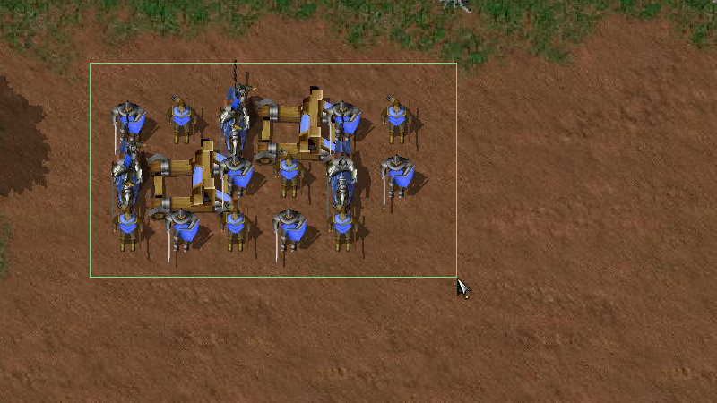
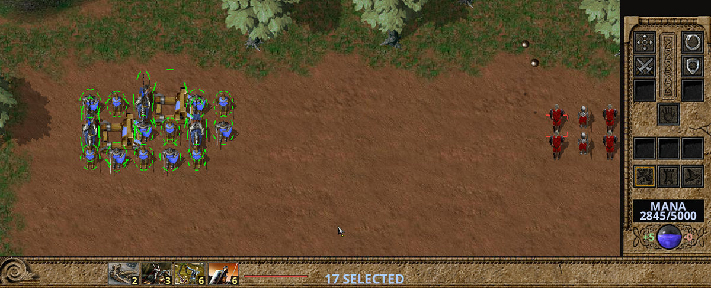
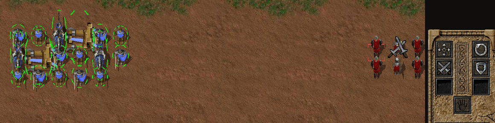
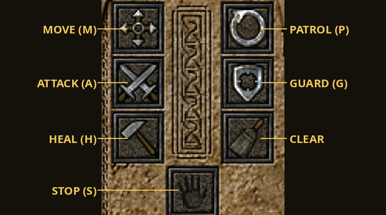
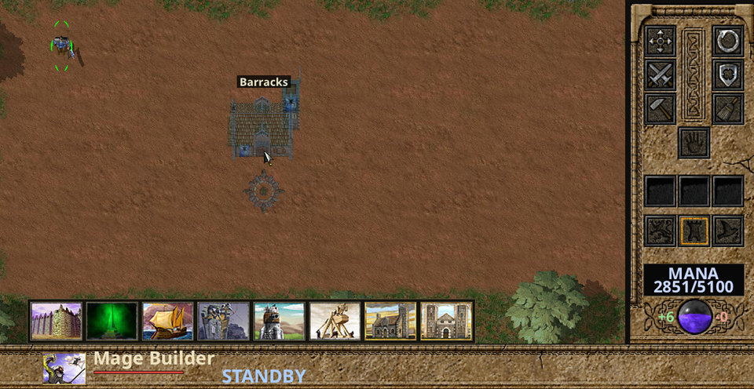
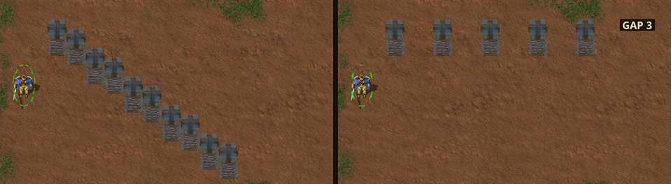
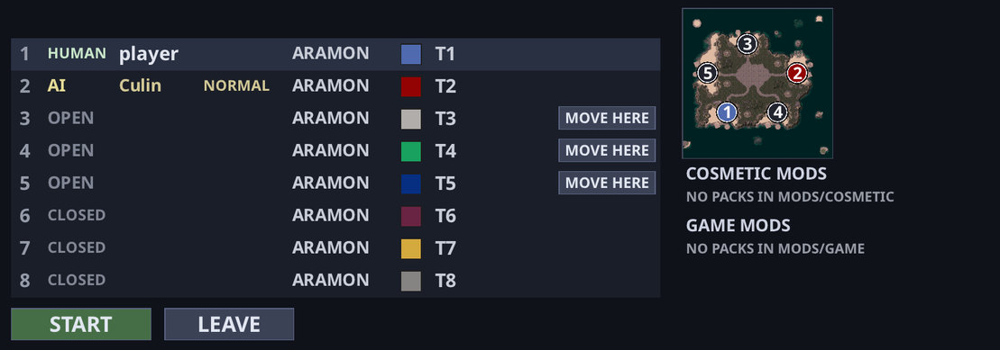

# Quick start: controls reference

[User guide](user-guide.md) · [Back to the README](../README.md)

**Start a skirmish.** On the main menu click the **Single-Player** door, pick a
map and click **CREATE**. In the room, click an **OPEN** slot's type to make it
an **AI** (click again for CLOSED; right-click steps back), and click its
difficulty, side, colour or team to change them. Click **START**. The game opens
on your Monarch: select it, build a lodestone on a mana spot, then a production
building. Losing your Monarch loses the game unless *Monarch Expendable* is on.

These are the default keys. Order, selection, view, emote, push-to-talk and poster keys
can be changed in **CONTROLS** (the main menu's lower-right Settings button, or
**Esc → CONTROLS** in a game): click a row and press a key; right-click a row to
unbind it. The number keys, Esc, Enter, Pause, **+**/**−**, F9 and the arrow keys
are fixed.

**UI Font** (**Options → Interface**): *Modern* (the default, a clean bold
sans-serif, as in these pictures) or *Classic* (the engine's old lettering).

## Mouse

| Input | Does |
| --- | --- |
| Left-click a unit | Select it. |
| Left-drag | Box-select your units. If the box holds any armed mobile units, builders and buildings in it are left out. |
| Shift + click or drag | Add to the selection. |
| Ctrl + click or drag | Remove from the selection. |
| Right-click | The order for what is under the pointer (see below). |
| Shift + right-click | Queue that order after the current ones. |
| Right-drag (a reclaiming builder selected) | Reclaim every tree, rock and wreck in the box. The box must be at least about 32 pixels each way; anything smaller is a normal right-click where you pressed. |
| Pan or zoom during a drag | A selection, reclaim or lodestone box stays on the ground where you pressed. |
| Middle-drag | Scroll the map. |
| Pointer at a screen edge | Scroll the map (Options → Edge Scrolling). |
| Mouse wheel | Zoom in and out, towards the pointer. During a Shift-drag build line it sets the line's gap instead. |
| Minimap: left-click or drag | Move the camera there. With an order armed, give that order there instead. |
| Minimap: right-click | Move the selection there (Shift queues). |
| Portrait in the info bar (several types selected) | Left-click: keep only that type. Shift + left-click: drop that type. |

There is no double-click select; use **Ctrl+Z** (same type) or **Ctrl+X** (same
type on screen).

*Left-drag draws the selection box.*

*After the drag: one portrait per unit type with its count, **17 SELECTED**, and
the orders for the selection on the right-hand panel.*

### What a right-click does

| Right-click on | With | Order |
| --- | --- | --- |
| Open ground | any units | Move. |
| An enemy | any units | Attack it. Units that can move walk into range. A selected production building sends its new units after it. |
| Your own or an allied unit | armed units | Guard it. |
| A damaged friendly unit | a mobile builder | Repair it. |
| An unfinished building | a builder that can build it | Help build it. |
| Your transport | units it can carry | Board it. |
| Any point | a transport carrying units | Go there and unload. |
| A tree, rock or wreck | a reclaiming builder | Reclaim it for mana. |

*Over an enemy the pointer becomes the attack cursor (shown here at Cursor Size
2×).*

## Orders

An order key **arms** the order; then left-click a target on the map or the
minimap. Hold **Shift** to queue it and keep it armed for more clicks; release
Shift to disarm. **Esc** disarms. The command panel buttons do the same.

| Key | Order |
| --- | --- |
| **M** | Move. |
| **A** | Attack: click an enemy, or the ground to attack-move there. |
| **F** | Fight-move: move, fighting whatever is met on the way. |
| **P** | Patrol (Shift-click more points to make a loop). |
| **G** | Guard a friendly unit. |
| **H** | Heal / repair a damaged friendly unit, or help finish a building (builders). |
| **L** | Load: with a transport selected, click the unit to pick up. |
| **U** | Unload: with a transport selected, click where to drop its cargo. |
| **S** | Stop: cancel all orders at once. |
| **C** | Clear orders (same as Stop). |
| **W** | Next weapon, for units with more than one. |
| **K** | Cloak on / off. |
| **O** | Open / close selected gates. With nothing selected in a campaign mission: show the objectives. |
| **Ctrl+Shift+D** | Self-destruct in 5 seconds (press again to cancel). |

*The command panel of a builder. **CLEAR** arms reclaim: click a tree, rock or
wreck. Armed units can also have stance buttons (Offensive, Defensive, Passive),
and cloakers a cloak button; units with several weapons get weapon buttons.*

## Building and training

| Action | How |
| --- | --- |
| Open the build menu | Select **one** builder (or one production building). Its icons appear along the bottom. |
| Place a building | Click an icon, then left-click the map. The ghost shows the building where it would go. |
| Cancel placement | Right-click or **Esc**. |
| Queue several / a line | Hold **Shift**: Shift-click sites one by one, or Shift-drag a line of them. A line packs the buildings edge to edge (corner to corner on a diagonal). While dragging, turn the mouse wheel: up widens the gap one cell per notch (0–12, shown as **GAP** by the pointer), down tightens it. The gap stays for the rest of the game. Release Shift to stop placing. |
| Lodestones on many mana spots | Pick the lodestone, then drag a box (at least about 32 pixels each way; smaller places one lodestone): the builder takes every free mana spot in it. |
| Train at a production building | Left-click an icon: +1. Shift: +5. Ctrl+Shift: +10. Right-click (same modifiers) removes. |
| Endless production | Ctrl + left-click an icon (again to stop). |
| Rally point | With the building selected, right-click the ground or press **M** / **P** and click. |

*A builder's build menu along the bottom, and the Barracks ghost under the
pointer.*

*Shift-drag lines: tight by default (left, a diagonal packs corner to corner);
three wheel notches later, **GAP 3** (right).*

## Selecting

| Key | Selects |
| --- | --- |
| **Ctrl+A** | All your units. |
| **Ctrl+Z** | All your units of the selected types. |
| **Ctrl+X** | Units on screen of the first selected unit's type. |
| **Ctrl+U** | All your units on screen. |
| **Ctrl+M** | Your Monarch (and follow it). |
| **Ctrl+B** / **Ctrl+F** | Builders / production buildings. |
| **Ctrl+E** / **Ctrl+G** | Melee units / spellcasters. |
| **Ctrl+R** / **Ctrl+Y** / **Ctrl+N** | Ballistic weapons / flyers / ships. |
| **Ctrl+T** / **Ctrl+W** | Armed troops (no ships or Monarch) / everything armed but the Monarch. |
| **N** | Next unit (and centre on it). |

## Groups and formations

| Key | Does |
| --- | --- |
| **Ctrl+1** … **Ctrl+0** | Make the selection group 1–10. |
| **Alt+1** … **Alt+0** | Make it a formation (moves together, at the slowest member's pace). |
| add **Shift** to either | Add the selection to that group or formation. |
| **1** … **0** | Select the group (its builders are left out). Press again to centre and follow it. |
| **Ctrl+Esc** | Take the selection out of its group or formation. |

## Camera and game

| Key | Does |
| --- | --- |
| **Arrow keys** | Scroll. |
| **T** | Follow the selection (again to stop). |
| **Shift+Z** | Back to the original game's 1:1 zoom. |
| **Tab** | Full-screen map (again to close). |
| **F1** | Unit information for the selected unit. |
| **F4** | Scoreboard: players, kills, losses, score. |
| **F9** | YouTube streaming panel. |
| **D** | Diplomacy: give units, share mana, chat and voice recipients. |
| **Pause** | Pause / resume, for every player. |
| **+** / **−** | Game speed. Host only, and only with *Allow Speed Change* on. |
| **Enter** | Chat: Enter sends, Esc cancels. With *Power Codes* on, also where you type a [power code](#power-codes). |
| **Print Screen** | Save a picture of the whole map to the *screenshots* folder. Only with *Power Codes* on. |
| **Space** (hold) | Push to talk, in a multiplayer game with voice chat on. |
| **Shift+D** / **Shift+H** | Emotes: disco / headbang. |
| **Esc** | In order: close Unit Info, cancel placement or an armed order, clear the selection, open the game menu (Resume, Options, Controls, Voice Chat, Quit…). |

**Chat Scale** (50–300%, default 100%) and **Chat Position** (*Left* or
*Centered*, the default) set the chat box's size and place: **Options →
Interface**.

**Print Screen** has no other use: there is no ordinary screenshot key. If your
desktop takes Print Screen for itself, or your keyboard has none (Mac), set
another key for *MAKE POSTER* in *Controls*.

### Power codes

Only in a game created with **Power Codes** on (single player or multiplayer;
never in campaigns or Crusades). Press **Enter**, type the code, press
**Enter**; capitals do not matter. Every player sees the code typed.

| Code | Does |
| --- | --- |
| **+ATM** | Fill your mana pool to its storage. |
| **+ManaMe** | Fill your selected units' own mana. |
| **+DoubleShot** / **+HalfShot** | All damage in the game ×2 / ×½ (again: normal). |
| **+LOS** | Your line of sight off / on (**+LOS Off**, **+LOS On** set it). |
| **+Mapping** | Reveal the map / hide it again (forgetting what was explored). |
| **+NowISee** | Line of sight and map both off: you see everything. |
| **+Radar** | Every unit on your minimap (again: off). |
| **+MakePoster** | Whole-map picture, **BIGSHOTnnnn.png** in *screenshots* (same as Print Screen). |

More in the user guide's [Power codes](user-guide.md#power-codes).

## Lobby

| Control | Does |
| --- | --- |
| Left-click a setting | Next choice. Right-click: previous choice. |
| A slot's type (host) | OPEN → AI → CLOSED. |
| **MOVE HERE** | Take that open slot, keeping your side, colour and team; your old slot opens. With *Start Locations: By Slot*, slot N starts at position N. |
| **READY** (multiplayer) | Mark yourself ready; the host can START when everyone is. |

*A single-player room: **MOVE HERE** on each open slot.*

For everything else (economy, sides, Legion pathfinding, multiplayer, voice
chat), see the [user guide](user-guide.md).
