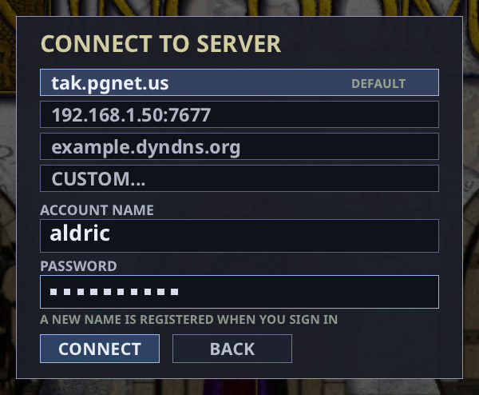

# Quick start

[User guide](user-guide.md) · [Back to the README](../README.md)

This page gets you from download to your first game, then lists the controls.
The [user guide](user-guide.md) explains everything in full.

- [Install and first launch](#install-and-first-launch)
- [Your first skirmish](#your-first-skirmish)
- [Play online](#play-online)
- [Play a campaign](#play-a-campaign)
- [Watch a replay, talk to other players](#watch-a-replay-talk-to-other-players)
- Controls: [Mouse](#mouse) · [Orders](#orders) ·
  [Building and training](#building-and-training) · [Selecting](#selecting) ·
  [Groups and formations](#groups-and-formations) ·
  [Camera and game](#camera-and-game) · [Power codes](#power-codes) ·
  [Lobby](#lobby)

## Install and first launch

You need your own copy of *Total Annihilation: Kingdoms*; the *Iron Plague*
expansion adds the Creon side and its campaign.

1. Download the package for your system from the
   [README's download list](../README.md#download) and install it
   ([Installing](user-guide.md#installing) has the steps for each system).
2. Start **Total Annihilation: Kingdoms** (on Windows the shortcut is
   **Total Annihilation - Kingdoms**).
3. The game asks for your *Kingdoms* install folder. Choose the folder that
   holds `data.hpi`, `terrain.hpi`, `sections.hpi` and `maps.hpi`. (On Linux the
   folder picker needs `kdialog` or `zenity`.)
4. The game checks the folder and remembers it. If something is missing, it says
   what and asks again.
5. The main menu opens. You can change the folder later in **Settings →
   Options → Data folder** ([Game data](user-guide.md#game-data)).

## Your first skirmish

*The main menu. The doors open Single-Player, Multiplayer and Campaign.*

1. Click the **Single-Player** door.
2. Pick a map. The preview shows its start positions and how many players it
   takes. The default match rules are fine for a first game.
3. Click **CREATE**.
4. In the room, click an **OPEN** slot's type to make it an **AI** (click again
   for CLOSED; right-click steps back). Click its difficulty, side, colour or
   team to change them. **Easy** is a good first opponent.
5. Click **START**.
6. The game opens on your Monarch. Select it (**Ctrl+M**), build a lodestone on
   a mana spot, then a production building, and train a builder and some troops.
   Zhon has no production buildings: its Monarch conjures a Beast Handler
   instead.
7. Keep your Monarch alive: losing it loses the game, unless *Monarch
   Expendable* is on.

[Your first skirmish](user-guide.md#your-first-skirmish) in the user guide goes
further.

## Play online

1. Click the **Multiplayer** door.
2. Pick a server from the list (the official TAK Engine server, `tak.pgnet.us`,
   is first, marked **DEFAULT**), or **CUSTOM...** to type an address.
3. Type an account name and a password, then click **CONNECT**. A name the
   server has not seen before is registered as you sign in.
4. In the game list, click a game to join it, or click **CREATE** to make one.
   For a game marked **LOCK**, type its password in the field at the bottom
   first. A running game shows **WATCH** instead, to spectate it.
5. In the room, pick your side, colour and team and click **READY**. The host
   starts the game when everyone is ready.

Missing maps and the host's game mods download by themselves. You need no open
ports; only the server does. More in [Multiplayer](user-guide.md#multiplayer).

## Play a campaign

1. Click the **Campaign** door.
2. Pick the *Book of Darien* or *Iron Plague* tab, then a chapter (the page
   arrows or **Left**/**Right**).
3. Press **Enter**. The intro movie and briefing play; click or press **Enter**
   to start. In the mission, **O** with nothing selected shows the objectives.

More in [Campaigns](user-guide.md#campaigns).

## Watch a replay, talk to other players

- **Replays.** Every game you play or watch is recorded. Open **Settings → Load
  Replay** on the main menu and pick one; **Pause** and **+**/**−** control
  playback ([Replays](user-guide.md#replays)).
- **Voice chat** is off until you turn it on in **Settings → Voice Chat**. Then
  hold **Space** to talk in a multiplayer room or game
  ([Voice chat](user-guide.md#voice-chat)).

---

## Controls

These are the default keys. Order, selection, view, emote, push-to-talk and poster keys
can be changed in **CONTROLS** (the main menu's lower-right Settings button, or
**Esc → CONTROLS** in a game): click a row and press a key; right-click a row to
unbind it. The number keys, Esc, Enter, Pause, **+**/**−**, F9 and the arrow keys
are fixed.

**UI Font** (**Options → Interface**): *Modern* (the default, a clean bold
sans-serif, as in these pictures) or *Classic* (the engine's old lettering).

### Mouse

| Input | Does |
| --- | --- |
| Left-click a unit | Select it. |
| Left-drag | Box-select your units. If the box holds any armed mobile units, builders and buildings in it are left out. |
| Shift + click or drag | Add to the selection. |
| Ctrl + click or drag | Remove from the selection. |
| Right-click | The order for what is under the pointer (see below). |
| Shift + right-click | Queue that order after the current ones. |
| Right-drag (a reclaiming builder selected) | Reclaim every tree, rock and wreck in the box. The box must be at least about 32 pixels each way; anything smaller is a normal right-click where you pressed. Shift queues the sweep. |
| Pan or zoom during a drag | A selection, reclaim or lodestone box stays on the ground where you pressed. |
| Middle-drag | Scroll the map. |
| Pointer at a screen edge | Scroll the map (Options → Edge Scrolling). |
| Mouse wheel | Zoom in and out, towards the pointer. During a Shift-drag build line it sets the line's gap instead. |
| Minimap: left-click or drag | Move the camera there. With an order armed, give that order there instead. |
| Minimap: right-click | Move the selection there (Shift queues). |
| Portrait in the info bar (several types selected) | Left-click: keep only that type. Shift + left-click: drop that type. |
| Right-click a setting in a menu | Previous choice (left-click is the next). |

**Double-click** one of your units to select every unit of that type on the screen
(**Shift** + double-click adds them to the selection, **Ctrl** + double-click
removes them). **Ctrl+Z** selects the same
type everywhere; **Ctrl+X** the same type on screen.

*Left-drag draws the selection box.*

*After the drag: one portrait per unit type with its count, **17 SELECTED**, and
the orders for the selection on the right-hand panel.*

#### What a right-click does

| Right-click on | With | Order |
| --- | --- | --- |
| Open ground | any units | Move. |
| An enemy | any units | Attack it. Units that can move walk into range. A selected production building sends its new units after it. |
| Your own or an allied unit | armed units | Guard it. |
| A damaged friendly unit | a mobile builder | Repair it. |
| An unfinished unit or building of yours | a mobile builder | Help build it, also a unit a factory or Zhon builder is still producing. |
| Your transport | units it can carry | Board it. |
| Any point | a transport carrying units | Go there and unload. |
| A tree, rock or wreck | a reclaiming builder | Reclaim (clear) it. It gives no mana. |

*Over an enemy the pointer becomes the attack cursor (shown here at Cursor Size
2×).*

### Orders

An order key **arms** the order; then left-click a target on the map or the
minimap. Hold **Shift** to queue it and keep it armed for more clicks; release
Shift to disarm. **Esc** disarms. The command panel buttons do the same. An
armed order shows as its cursor and its pressed button, with no text prompt.
Patrols queued with Shift loop back to where the patrol started.

| Key | Order |
| --- | --- |
| **M** | Move. |
| **A** | Attack: click an enemy, or the ground to attack-move there. |
| **F** | Fight-move: move, fighting whatever is met on the way. |
| **P** | Patrol (Shift-click more points to make a loop). |
| **G** | Guard a friendly unit. A guarding builder repairs it and helps with what it builds; a guarding flyer circles it. |
| **H** | Heal / repair a damaged friendly unit, or help finish an unfinished unit or building of yours (builders). |
| **L** | Load: with a transport selected, click the unit to pick up. |
| **U** | Unload: with a transport selected, click where to drop its cargo. |
| **S** | Stop: cancel all orders at once. |
| **C** | Clear orders (same as Stop). |
| **W** | Next weapon, for units with more than one. |
| **K** | Cloak on / off. |
| **O** | Open / close selected gates. With nothing selected in a campaign mission: show the objectives. |
| **Ctrl+Shift+D** | Self-destruct in 5 seconds (press again to cancel). |

*The command panel of a builder. **CLEAR** arms reclaim: click a tree, rock or
wreck. Armed units can also have stance buttons (Offensive, Defensive, Passive),
and cloakers a cloak button; units with several weapons get weapon buttons.*

### Building and training

| Action | How |
| --- | --- |
| Open the build menu | Select **one** builder (or one production building). Its icons appear along the bottom; a menu too long for one row wraps into more rows. |
| Place a building | Click an icon, then left-click the map. The ghost shows the building where it would go. |
| Cancel placement | Right-click or **Esc**. |
| Queue several / a line | Hold **Shift**: Shift-click sites one by one, or Shift-drag a line of them. A line packs the buildings edge to edge (corner to corner on a diagonal). While dragging, turn the mouse wheel: up widens the gap one cell per notch (0–12, shown as **GAP** by the pointer), down tightens it. The gap stays for the rest of the game. Release Shift to stop placing. |
| Lodestones on many mana spots | Pick the lodestone, then drag a box (at least about 32 pixels each way; smaller places one lodestone): the builder takes every free mana spot in it. Shift queues the job; **Stop** cancels it. |
| Upgrade a lodestone | Place your side's divine lodestone on one of your finished basic lodestones. |
| Train at a production building | Left-click an icon: +1. Shift: +5. Ctrl+Shift: +10. Right-click (same modifiers) removes. |
| Endless production | Ctrl + left-click an icon (again to stop). |
| Rally point | With the building selected, right-click the ground, or press **M**, **P**, **A** or **F** and click (right-click an enemy for an attack rally). Shift adds rally steps; **Stop** clears them. A mobile builder in endless production takes the same rally orders; **Stop** ends its production. |

*A builder's build menu along the bottom, and the Barracks ghost under the
pointer.*

*Shift-drag lines: tight by default (left, a diagonal packs corner to corner);
three wheel notches later, **GAP 3** (right).*

### Selecting

These replace the current selection with your own units of that kind.

| Key | Selects |
| --- | --- |
| **Ctrl+A** | All your units. |
| **Ctrl+Z** | All your units of the selected types. |
| **Ctrl+X** | Units on screen of the first selected unit's type. |
| **Ctrl+U** | All your units on screen. |
| **Ctrl+M** | Your Monarch (and follow it). |
| **Ctrl+B** / **Ctrl+F** | Builders / production buildings. |
| **Ctrl+E** / **Ctrl+G** | Melee units / spellcasters. |
| **Ctrl+R** / **Ctrl+Y** / **Ctrl+N** | Ballistic weapons / flyers / ships. |
| **Ctrl+T** / **Ctrl+W** | Armed troops (no ships or Monarch) / everything armed but the Monarch. |
| **N** | Next unit (and centre on it). Needs a selection to start from. |

### Groups and formations

| Key | Does |
| --- | --- |
| **Ctrl+1** … **Ctrl+0** | Make the selection group 1–10. |
| **Alt+1** … **Alt+0** | Make it a formation (moves together, at the slowest member's pace). |
| add **Shift** to either | Add the selection to that group or formation. |
| **1** … **0** | Select the group (its builders are left out). Press again to centre and follow it. |
| **Ctrl+Esc** | Take the selection out of its group or formation. |

A unit is in one group or formation at a time. Units that a group's builders
produce join the group.

### Camera and game

| Key | Does |
| --- | --- |
| **Arrow keys** | Scroll. |
| **T** | Follow the selection (again to stop). |
| **Shift+Z** | Back to the original game's 1:1 zoom. |
| **Tab** | Full-screen map (again to close). |
| **F1** | Unit information for the selected unit. |
| **F4** | Scoreboard: players, kills, losses, score. When a team has two or more players, it shows teams and groups the rows by team. |
| **F9** | YouTube streaming panel. |
| **D** | Diplomacy: give units, share mana, chat and voice recipients. |
| **Pause** | Pause / resume, for every player. |
| **+** / **−** | Game speed, one level per press from −9 (0.1×) to +10 (2×). Host only, and only with *Allow Speed Change* on; always in a campaign mission. |
| **Enter** | Chat: Enter sends, Esc cancels. With *Power Codes* on, also where you type a [power code](#power-codes). There is no chat in replays. |
| **Print Screen** | Save a picture of the whole map to the *screenshots* folder. Only with *Power Codes* on. |
| **Space** (hold) | Push to talk, in a multiplayer game with voice chat on. |
| **Shift+D** / **Shift+H** | Emotes: disco / headbang. |
| **Esc** | In order: close Unit Info, cancel placement or an armed order, clear the selection, open the game menu (Resume, Options, Controls, Voice Chat, Quit…). |

**Chat Scale** (50–300%, default 100%) and **Chat Position** (*Left* or
*Centered*, the default) set the chat box's size and place: **Options →
Interface**.

**Print Screen** has no other use: there is no ordinary screenshot key. If your
desktop takes Print Screen for itself, or your keyboard has none (Mac), set
another key for *MAKE POSTER* in *Controls*.

#### Power codes

Only in a game created with **Power Codes** on (single player or multiplayer;
never in campaigns). Press **Enter**, type the code, press
**Enter**; capitals do not matter. Every player sees the code typed.

| Code | Does |
| --- | --- |
| **+ATM** | Fill your mana pool to its storage. |
| **+ManaMe** | Fill your selected units' own mana. |
| **+DoubleShot** / **+HalfShot** | All damage in the game ×2 / ×½ (again: normal). |
| **+LOS** | Your line of sight off / on (**+LOS Off**, **+LOS On** set it). |
| **+Mapping** | Reveal the map / hide it again (forgetting what was explored). |
| **+NowISee** | Line of sight and map both off: you see everything. |
| **+Radar** | Every unit on your minimap (again: off). |
| **+MakePoster** | Whole-map picture, **BIGSHOTnnnn.png** in *screenshots* (same as Print Screen). |

More in the user guide's [Power codes](user-guide.md#power-codes).

### Lobby

| Control | Does |
| --- | --- |
| Left-click a setting | Next choice. Right-click: previous choice. |
| A slot's type (host) | OPEN → AI → CLOSED. |
| **MOVE HERE** | Take that open slot, keeping your side, colour and team; your old slot opens. With *Start Locations: By Slot*, slot N starts at position N. |
| **READY** (multiplayer) | Mark yourself ready; the host can START when everyone is. |

*A single-player room: **MOVE HERE** on each open slot.*

For everything else (economy, sides, Legion pathfinding, multiplayer, voice
chat), see the [user guide](user-guide.md).
