# TAK Engine user guide

[Back to the README](../README.md) · [Cartographer (map editor) guide](cartographer-guide.md) · [Build and development guide](development.md)

This guide covers **TAK Engine 0.8.7** (network protocol **284**, replay format
**13**). It is written for three kinds of reader:

- people who have never played *Total Annihilation: Kingdoms* and want to learn
  the game;
- returning players who want to know what this engine does differently from the
  original;
- people who want to host games or run a server.

If you only want to get going, read [Installing](#installing), [Game data](#game-data)
and [Your first skirmish](#your-first-skirmish), then come back to the rest.
For the controls, hotkeys and mouse actions on one page, with pictures, see the
[quick-start controls reference](quick-start.md).

## Contents

1. [What TAK Engine is](#what-tak-engine-is)
2. [Installing](#installing)
3. [Game data](#game-data)
4. [The main menu](#the-main-menu)
5. [Your first skirmish](#your-first-skirmish)
6. [Playing](#playing): the economy, building, armies and combat
7. [The five sides](#the-five-sides)
8. [Controls](#controls)
9. [Queueing orders with Shift](#queueing-orders-with-shift)
10. [Pathfinding: Retail and Legion](#pathfinding-retail-and-legion)
11. [Options](#options)
12. [Multiplayer](#multiplayer)
13. [Voice chat](#voice-chat)
14. [Campaigns](#campaigns)
15. [Replays](#replays)
16. [Mods](#mods)
17. [Map editor](#map-editor)
18. [Running a server](#running-a-server)
19. [Benchmark](#benchmark)
20. [Troubleshooting and FAQ](#troubleshooting-and-faq)
21. [Differences from the original game](#differences-from-the-original-game)

---

## What TAK Engine is

*Total Annihilation: Kingdoms* (TA:K) is a real-time strategy game released by
Cavedog Entertainment in 1999, followed by the *Iron Plague* expansion. TAK Engine
is a modern, open re-implementation of that game's engine. It runs on current
Windows, macOS and Linux systems, at modern resolutions, with a rebuilt network
layer for multiplayer.

TAK Engine is a **clean-room** project. Its behaviour was worked out by studying
how the original game behaves, not by copying it. That has two consequences you
need to know about:

- **You must own the original game.** TAK Engine contains no game art, sound,
  music, maps, units or campaign data. It reads all of that directly from your
  own retail installation. Without one, it cannot run.
- **The aim is accuracy.** Where the original game had a rule, TAK Engine tries
  to follow it exactly, including its quirks. Where this engine deliberately does
  something different, this guide says so. See
  [Differences from the original game](#differences-from-the-original-game).

What you can play:

- **Skirmish** against up to seven computer opponents, on the shipped maps,
  downloaded maps or a built-in random map generator.
- **Multiplayer** for up to eight players and teams, through a server, with
  spectators, reconnecting and automatic map sharing.
- **The campaigns**: the base game's *Book of Darien* and the *Iron Plague*
  campaign, including its alternate ending.
- **Replays** of your finished games.
- **Cartographer**, a map and scenario editor, with its own
  [user guide](cartographer-guide.md).

---

## Installing

Download TAK Engine from the
[releases page](https://github.com/pocketgeek/tak-engine/releases/latest) and pick
the package for your system:

| System | Package |
| --- | --- |
| Windows x64 | the `windows-x64-setup.exe` installer, or the portable ZIP |
| Windows 11 on ARM | the `windows-arm64.zip` portable package |
| macOS 14 or later, Apple Silicon | `macos-arm64.dmg` |
| macOS 14 or later, Intel | `macos-x64.dmg` |
| Ubuntu 22.04 / 24.04 / 26.04, Debian 12 / 13 | the matching `.deb` |
| Fedora 44 | the `.rpm` |
| Arch Linux | the `.pkg.tar.zst` |

Release filenames include the project name and version. Linux ARM64, openSUSE and
Slackware packages are also available; the [README](../README.md#download) lists
them.

**Windows.** Run the installer, or unpack the ZIP anywhere and run
**Total Annihilation - Kingdoms**. The installer adds Start menu shortcuts.

**macOS.** Open the DMG and drag **Total Annihilation - Kingdoms** to
Applications. The app and the DMG are signed and notarized by Apple, so the game
opens on the first launch like any other app.

**Linux.** Install the package with your package manager, for example
`sudo apt install ./tak-engine-….deb` or `sudo dnf install ./tak-engine-….rpm`.
The game appears in your application menu as **Total Annihilation: Kingdoms**.

Every package contains the game client, the Cartographer map editor and the
dedicated server. Libraries the game needs are bundled; your system only has to
provide graphics, sound and windowing.

---

## Game data

TAK Engine reads your **retail installation folder** directly. There is nothing
to extract or convert.

### Pointing the game at your install

The first time you start the game, it asks you to choose your *Total
Annihilation: Kingdoms* install folder. Choose the folder that contains
`data.hpi`, `terrain.hpi` and the `Maps` folder. The game checks the folder,
remembers it, and does not ask again.

- If you choose the wrong folder, the game tells you what is missing and asks
  again.
- If you later move or change the installation, the game notices and asks again.
- On Linux, the folder picker needs `kdialog` or `zenity`. Without either one,
  start the game with `--data` instead (see [Command line](#command-line)).

To use a different install later, open **Settings → Options** on the main menu
and click **Change** beside **Data folder** (see
[Game data folder](#game-data-folder)). The map editor uses the same setting.

You can also give the folder on the command line:

```sh
takclient --data /path/to/your/kingdoms/install
```

### What the folder must contain

| Files | Needed for |
| --- | --- |
| `data.hpi`, `terrain.hpi`, `sections.hpi`, `maps.hpi` | **Required.** The base game. |
| `english.hpi`, `missions.hpi` | Base-game text and the *Book of Darien* campaign. |
| `IPData.hpi`, `IPEnglish.hpi`, `IPMissions.hpi`, `IPSections.hpi` | The *Iron Plague* expansion: the **Creon** side, its units and its campaign. |
| `meta.hpi`, `boneyards.hpi`, `boneyards2.hpi`, `jersey.hpi`, `v2rocket.hpi`, `v3rocket.hpi` | Official patches and map/unit packs, if you have them. |
| `Maps/` | Extra maps you downloaded (`.kmp` files). |
| `Music/` | The soundtrack (`track*.wav`). |
| `mods/` | Optional content packs, in `mods/cosmetic/` and `mods/game/`; see [Mods](#mods). |

The door videos on the main menu are read from the install's movie files. If
they are missing, the menu shows still door art instead.

Only the official archives listed above are loaded from the install folder. Any
other `.hpi` file dropped into that folder, and any loose file there, is ignored.
Put custom content in a pack folder under `mods/` instead.

**Install Iron Plague if you can.** Without it, you have the four original sides
and the base campaign. The Creon side and the Iron Plague campaign need the
`IP*.hpi` archives.

### How files are layered

Advanced users mixing patches and packs may want to know which copy of a file
wins:

- Inside one layer, loose files beat archive entries. Between archives, the
  entry with the newest stored date wins, as in the original game.
- Ticked cosmetic packs beat the always-on cosmetic archives, which beat ticked
  game packs. All of them beat installed maps, which beat the official archives.
- A map shared for the current match beats all of these for that match.

The `hpitool where <install> <path>` command, built with the engine, shows which
archive supplies a given file.

---

## The main menu

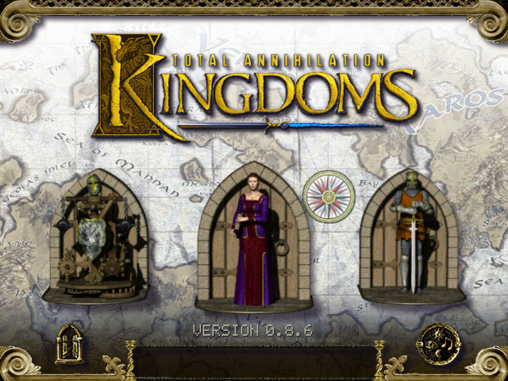

*The title menu. The doors open Single-Player, Multiplayer and Campaign; the version is shown at the bottom.*

The front end is the original game's three-door menu:

| Door | What it opens |
| --- | --- |
| **Single-Player** | A skirmish against computer opponents, or a spectator match between AIs. |
| **Multiplayer** | Server selection, sign-in and the online game browser. |
| **Campaign** | The campaign book. |

The **Settings** button opens:

| Entry | What it does |
| --- | --- |
| **Options** | Audio, display, graphics, interface and camera settings. See [Options](#options). |
| **Controls** | Rebind command, selection, view, emote and push-to-talk keys. |
| **Voice Chat** | Turn voice chat on and choose the microphone, voice output and volumes. See [Voice chat](#voice-chat). |
| **Benchmark** | A repeatable performance test. See [Benchmark](#benchmark). |
| **Load Replay** | Watch a recorded game. See [Replays](#replays). |
| **YouTube Streaming** | Stream your game. See [streaming](streaming.md). |

The streaming panel forgets your stream key when you exit, unless you tick
**Remember Key** under the key field. The key is then kept in your system password
store (Windows Credential Manager, the macOS Keychain, or KWallet, GNOME Keyring or
another Secret Service on Linux) and filled in, masked, next time. It is never
written to the settings file. Unticking the box, or clearing the key with **Ctrl+A**
while it is ticked, deletes the stored key. If your system has no password store,
the box is greyed out with **NO SYSTEM PASSWORD STORE**.
[Remembering the key](streaming.md#remembering-the-key) has the details.

The version number is shown on the title screen.

In a game, **Esc** opens the game menu: **Resume**, **YouTube Streaming**,
**Options**, **Controls**, **Voice Chat**, **Main Menu** (or **Campaign**) and
**Quit**.

---

## Your first skirmish

1. Click the **Single-Player** door.
2. In the game setup screen, pick a **map**. The preview shows its layout, its
   numbered start positions and how many players it supports. You can also choose **Generate Random Map**.
3. Set the match rules (all explained in [Match options](#match-options)). The
   defaults are fine for a first game.
4. Click **Create**. In the lobby, choose your **side**, **colour** and **team**.
   The lobby's map numbers each start position and colours it for the player who
   starts there. With **Random** start locations the markers stay dark, because
   nobody knows who starts where until the game begins.
   To start somewhere else, click **Move here** on an open slot: you take that
   slot with your side, colour and team, and your old slot opens. With **By slot**
   start locations slot N starts at position N, so this picks your start; with
   **Fixed** it changes your place in the order.
5. Set each other slot to an AI, choose its side and **difficulty**, or close
   the slot. **Easy** is a good first opponent.
6. Click **Start**.

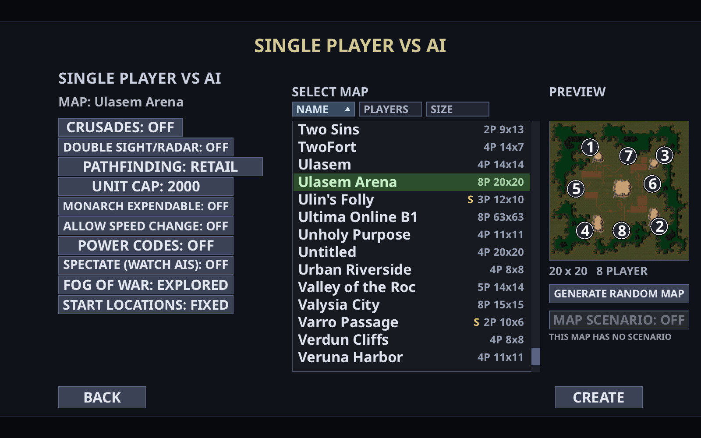

*The game setup screen: pick a map, check its preview and player count, and set the match rules.*

The game opens centred on your **Monarch**. Your first steps:

1. **Select your Monarch** (click it, or press **Ctrl+M**).
2. **Build a lodestone** on a nearby mana spot. Lodestones are your main income.
3. **Build a production building** from the Monarch's build menu (Zhon is
   different; see [Zhon](#zhon)).
4. Train a **builder** to expand, and fighting units to defend.
5. Keep your Monarch safe. By default, **losing your Monarch loses the game.**

### Match options

These are chosen on the game setup screen. The lobby shows them, but only the
creator can change them. **Allow spectators** is the one the host can still
change in the room, until the game starts.

| Option | What it does |
| --- | --- |
| **Map** | A shipped, downloaded or generated map. |
| **Crusades** | **Off** uses the standard unit balance. **On** uses the alternative *Crusades* balance from the final retail patch. Unit costs, stats and some build menus differ. |
| **Double Sight/Radar** | Doubles every unit's sight and radar range. Weapon range is unchanged. |
| **Monarch Expendable** | **Off** (the original rule): losing your Monarch loses the game. **On**: the Monarch is an ordinary unit and you lose only when everything is gone. |
| **Fog of war** | **Not Explored**: the map starts hidden. **Explored**: the map starts revealed but enemies are hidden outside your sight. **Full Vision**: no fog. Terrain you have seen stays visible after your units leave. |
| **Start locations** | **Fixed** gives the occupied slots the map's start positions in order, top slot first. Empty slots are skipped, as in the original game: a player in slot 1 and an AI in slot 8 start at positions 1 and 2. **Random** shuffles them. **By slot** always starts slot N at the map's position N, empty slots or not: slots 1 and 8 start at positions 1 and 8. It is not in the original game. In the room, a player picks a slot, and so a start, with **Move here** (0.8.7). A room normally opens one slot per position; a slot without a position of its own takes the lowest position that no occupied slot has by number, or a spot near the map centre, and the room shows which under the player's name. |
| **Unit cap** | The most units each player may have alive: 250, 500, 1,000 or 2,000 (the default). Production pauses at the cap. |
| **Allow speed change** | Lets the host change game speed during the match, from −9 (0.1×) to +10 (2×). |
| **Pathfinding** | **Retail** (the default) or **Legion**. See [Pathfinding](#pathfinding-retail-and-legion). |
| **Game mods** | Multiplayer only, default **Off**. When on, the host ticks game mod packs in the room and they are sent to every player. Single player always has them. See [Mods](#mods). |
| **Allow spectators** | Multiplayer only. **On** (the default): anyone in the browser can **Watch** the game once it starts. **Off**: the server turns every watcher away. Players, AIs and reconnecting players are not affected. The host can change it in the room by clicking it, until the game starts; then it is fixed. See [Spectating](#spectating). |
| **Spectate (Watch AIs)** | Single-player only: fill every slot with AIs and watch. |
| **Power codes** | **Off** (the default) or **On**. On lets every player in the game type the original game's cheat codes in the chat box, such as **+ATM** and **+NowISee**. See [Power codes](#power-codes). Not offered in campaigns. It cannot be changed in the room. |
| **Map scenario** | Play the map's own scenario (its placed armies, trigger rules and Use Only unit list) instead of a skirmish. The button is under the map preview; maps marked with a gold **S** in the list have a scenario. It is greyed, with the reason, for maps without a playable one, including maps whose scenario gives you, player 1, nothing to command (*PLAYER 1 GETS NO ARMY*: many downloaded maps place only scenery or wildlife). A map that needs a unit type your install lacks is offered when game mods are available (always in single player, with **Game mods: On** in multiplayer), if you have a game mod pack, with the warning *PACK NEEDED:* and the unit, in case a selected pack supplies it. It starts **Off** and turns off again when you pick another map, and the lines under it say what turning it on changes. While it is on, **Start locations** are fixed and **Monarch expendable** does not apply. It cannot be changed in the room. In the original game's multiplayer room the same option, **Use map script**, was ticked automatically for scenario maps; here it starts off, and single player can use it too. See [Scenario games](#scenario-games). |

Your choices are remembered for next time, except passwords, Spectate and Map
scenario.

### AI difficulty

| Difficulty | What to expect |
| --- | --- |
| **Defensive** | Keeps building as fast as its mana income allows, with no limit of its own on how many factories, builders, towers or troops it makes; only the room's unit cap and the game's rules stop it. Builds at home; the base spreads outward as it grows, but stays on its own side of the map, and its builders claim mana deposits farther out. Sends its army to meet attackers near its base, then pulls it back, including attackers it cannot see that shoot its units from out of sight. Its melee troops go first for the unit hitting them, and keep chasing a target while it stays near, instead of all walking at one enemy. Does not build where enemy troops are about. Never raids. |
| **Easy** | Builds slowly. First attack after about four minutes, then small waves of at most eight units, at least two minutes apart. |
| **Normal** | Sends small raiding parties to probe and scout while it builds up a main army sized to its income. |
| **Hard** | Keeps expanding its income and production, raids, and commits larger armies. |
| **Absurd** | Plays like Hard, with **double mana income**. |
| **Absurdly Defensive** | Plays like Defensive, with Absurd's **double mana income**. |

At every difficulty, the AI's Monarch fights back when it is attacked, or when
an armed enemy comes within its reach, instead of carrying on with a build.

Defensive, Easy and Normal also build another lodestone whenever they run short
of mana (less than 30% of their storage left while spending faster than they
earn), one at a time, on a free deposit near their own base, as the original
game's AI does.

On a team, an AI leaves the free mana deposits around an ally's start to that
ally until they have gone unclaimed for two minutes. After that, of the other
allies, only the one whose start is nearest may build there, so no AI crosses
the map into an ally's base; if that nearest ally never expands, the deposits
stay free. An AI also stops treating a deposit as taken once the builder headed
for it, its own or an ally's, has got no nearer for a minute, and sends its own
stuck builders to other work.

Normal starts with its Monarch and one builder and adds builders as its income
grows, up to the Monarch and four; Easy keeps two. Defensive and Absurdly
Defensive add one per 50 income with no ceiling. No other AI builds more of one
builder type than the original game's AI file allows. Zhon has no factory
buildings, so its AI counts its Beast Handlers, Tamers, Lords and Shamans as
both producers and builders. An AI whose mana store is nearly full keeps its
builders building income rather than leaving them idle.

The AI runs on the game server, never in your client. In single-player, the game
starts a private server on your own computer for you.

### Random maps

**Generate Random Map** opens the generator:

- **Map type**: Mainland, Lakes or Islands, or a themed layout per world:
  Aramon Riverlands, Taros Maze, Veruna Ports, Zhon Clearings or Creon Highlands.
- **World**: the look of the map (Aramon, Taros, Veruna, Zhon or Creon terrain).
- **Size** and **player count**. Larger player counts need bigger maps.
- **Water**, **highland**, **forest** and **rock** amounts.
- **Extra Mana Spots**: 0 to 6 extra spots per player, added fairly.
- **Scattered Mana**: a second slider, separate from the per-player extra spots,
  with five notches: None, Minimum, Medium, High or Max. Neutral spots spread
  over open ground away from the bases. It is a density, so a bigger map gets
  more of them: Max is as dense as a home with six spots, and each step down
  halves it.
- **Map seed**: the same seed and settings give the same map. **Re-roll seed**
  picks a new one.
- **Map name**: optional; the generated map is saved under this name.

Every player gets a flat base area, clear routes for armies and three home mana
spots. Scattered spots are always reachable from some start, never
inside a base, and are spread evenly but not mirrored. Islands maps need ships
or flyers to reach other players. The preview updates when you release a slider
and counts the scattered spots in its MANA total, with a separate SCATTERED
line for the neutral ones; in the game room the map settings list the Scattered
Mana level beside the map seed. When the game starts, the map is saved on
every player's computer and on the server, so it appears in the map list later.
See [random map generation](random-map-generation.md) for the rules it follows.


*The random map settings in the single-player lobby, with Scattered Mana at
High. Size and Players share a row.*

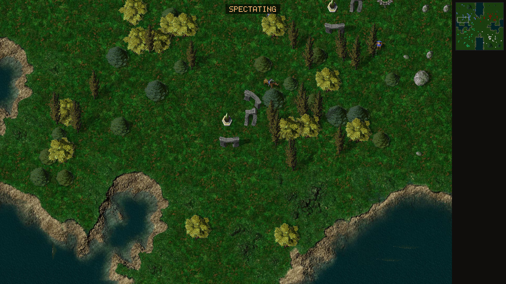

*Part of a generated Aramon Riverlands map with Scattered Mana at Medium. The
lodestone in the clearing stands on a neutral scattered spot that an AI has
claimed.*

---

## Playing

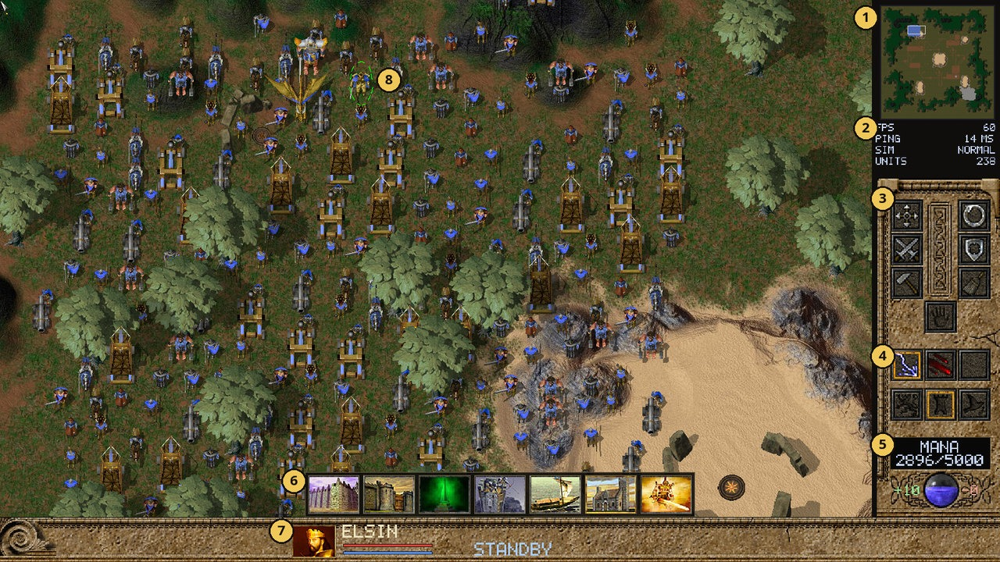

*The in-game screen with Aramon's Monarch, Elsin, selected.*

1. **Minimap.** Click or drag to move the camera.
2. **Stats panel** (optional; see [Interface](#interface)).
3. **Orders** for the selected units, such as move, attack, patrol, guard and stop.
4. **Weapons and stances** for the selected units.
5. **Mana**: your current mana and storage, with income and spending beside the orb.
6. **Build menu** of the selected builder or production building.
7. **Information bar**: the selected unit's portrait, name, health and what it is doing.
   With several units selected it shows the total selected instead, the health
   and mana of the whole selection, and one portrait per unit type, running left
   from the first, each with how many of that type are selected (see
   [Selection](#selection)). It shows only what applies: with nothing selected
   the bar is empty, the mana bar appears only for units that have mana, and the
   bar on the right appears only while the unit is building or conjuring something.
8. **The selected unit**, here the Monarch.

### The goal

In a normal skirmish, each player starts with **only their Monarch**. You build
an economy and an army from nothing. A player is out when they lose their Monarch
(unless **Monarch Expendable** is on) or when they have no units left. The last
team standing wins.

#### Scenario games

A game created with **Map scenario** on plays the map's own scenario instead.
The map's placed units replace the starting Monarchs (a scenario with rules but
no placed units keeps them), and only the unit types on its Use Only list, if it
has one, can be built. The scenario's own Victory and Defeat rules decide who
wins: losing your Monarch or every unit does not knock you out. A scenario
without such rules never ends by itself; the create screen warns *NO VICTORY
RULES: ENDLESS*, and the game ends when the players leave. Every seat the
scenario gives units or rules to must be filled before the game can start.


*King of the Hill with **Map scenario** turned on.*

Some things to know before you play one:

- **You are player 1.** The player who creates the game always takes seat 1,
  and players who join take the lowest open seat. If the scenario gives seat 1
  nothing to command, the option is greyed. Close the seats the scenario does
  not need before others join, so that they land in seats that have units.
- **Computer players do not read the scenario.** They ignore its regions and
  objectives and play with the units they are given; a computer player in a
  seat with no units does nothing. The room warns about such a seat in amber
  (*NO PLACED UNITS: PLAYER N*).
- Maps made for the original game sometimes list units in their Use Only list
  that no install has; those names are ignored.

### Mana: the only resource

TA:K has a single resource, **mana**. Your current mana and storage are shown at
the top of the screen.

Mana comes from:

| Source | Income |
| --- | --- |
| **Your Monarch** | 10 mana per second, plus 5,000 storage. |
| **Lodestones** (Creon: Mana Refinery) built on mana spots | 10 mana per second each, plus storage. |
| **Divine lodestones** (Creon: Mana Amplifier) | 20 mana per second each, plus more storage. |
| **Builders and some priests** | A small trickle each. |
| **Reclaiming** trees, rocks and wrecks | A lump of mana per object. |

Mana spots are marked on the map. A lodestone must be built on one. Better spots
yield more.

**Upgrading lodestones.** A builder that offers your side's divine lodestone can
build it on top of one of your finished basic lodestones. The old one dissolves
during the first half of construction and the new one forms during the second.
The upgrade costs the full price of the divine lodestone, and the basic lodestone
is not refunded if you cancel.

**Spending.** Everything you build draws mana while it is being built. If income
cannot keep up, all construction slows down together. Storage lets you bank mana
for later.

**Personal mana.** Spellcasters, priests and the Monarch also have their **own**
mana pool, shown on the unit. Their spells and special abilities draw from it,
and it recharges over time.

**Allies.** Teammates can share surplus mana automatically. See
[Teams, allies and diplomacy](#teams-allies-and-diplomacy).

### Building

Select a builder and its build menu appears along the bottom of the screen.

- **Structures**: click an icon, then click the map to place it. Placement shows
  whether the spot is valid. Right-click or **Esc** cancels.
- **Lines and queues**: hold **Shift** while placing to queue several sites, or
  Shift-drag to lay a line of walls or towers.
- **Lodestone areas**: choose a lodestone, then **drag a box** over the map. The
  builder visits every free mana spot in the box, closest first: after each spot
  it moves on to the nearest one left, scouting unexplored spots on the way and
  preferring spots it can walk to. A Shift-queued area starts from where the
  previous order ends. Builders given overlapping areas split the spots between
  them instead of heading for the same one.
- **Assisting**: right-click an unfinished building with another builder to help
  build it.
- **Clearing the site**: a builder that can reclaim automatically clears trees
  and rocks from a valid building site before it starts.
- **Blocked sites**: when the builder arrives and units stand on the site, it
  waits where it is (a flying builder hovers) and tries again three times a
  second; if the site is still blocked after about ten seconds, it gives up and
  moves on to its next order. A site blocked by anything else, such as a
  building, a rock it cannot reclaim, unsuitable ground or the unit cap, is
  given up at once.

**Training units at a building.** Select a production building and click its
build icons:

| Click | Effect |
| --- | --- |
| Left-click | queue one more |
| Shift + left-click | queue five more |
| Ctrl + Shift + left-click | queue ten more |
| Right-click (with the same modifiers) | remove one, five or ten |
| Ctrl + left-click | start or stop **infinite production** |

Each icon shows how many are queued. A new unit is started on the building's pad
only when there is room for its whole body there; if the last unit has not
cleared the pad yet, the building waits a moment and tries again, as in the
original game. Give the building a **move** or **patrol**
order to set a **rally point** for new units; Shift adds more rally steps.

**Mobile production.** Some builders conjure units in the field (Zhon's Beast
Handler, for example). They place what they build like a structure. A mobile
builder running infinite production treats **Move** and **Patrol** as rally
orders for its output. **Stop** ends production.

The build menu only appears when exactly one builder or production building is
selected.

### Reclaiming

A builder that can reclaim turns trees, rocks and wrecks into mana.

- Right-click a single object to reclaim it.
- **Right-drag a box** to reclaim a whole area. The builder works through it
  closest first, picking the nearest remaining object again after each one, as
  the original game does. Mana spots are left alone.

### Repairing and healing

Press **H** (or use the heal button) and click a damaged friendly unit or
building. Repair costs mana. Builders on **patrol** automatically repair damaged
friendly units and buildings near their route, then carry on patrolling.

Damaged units and buildings also repair themselves slowly, for free, at the rate
the original game's data sets: most mobile units are back to full health in
about four minutes, and many buildings in about eight. Unfinished units and
buildings do not repair themselves.

### Your army

**Stances.** Every unit has a stance, set from the command panel:

| Stance | Behaviour |
| --- | --- |
| **Offensive** | Attacks enemies in range and chases them within limits. |
| **Defensive** | Fires at enemies in range but does not chase. |
| **Passive** | Does not attack on its own. |

New units take their type's default stance. Direct attack orders always work,
whatever the stance.

**Firing on the move.** As in the original game, units shoot at enemies in range
while they carry out a move or a patrol, without stopping or turning to aim:
only hovering attack flyers, and the few ground units that must turn in place
to aim, face their target first. A unit standing with no orders turns towards
what it shoots. Units pick targets among the enemies their player can see.

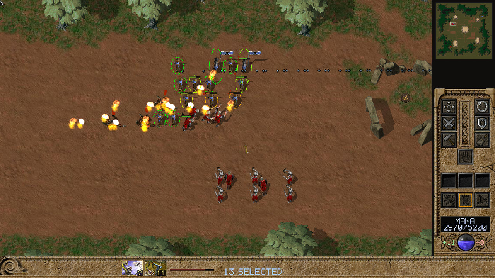

*Archers and Mage Builders on a plain move order (Shift is held, so the dotted
move line shows) keep walking while they shoot the Zombies that have caught the
back of the column. (A development scene.)*

**Builders defend themselves.** An armed builder fires at enemies it passes on
the way to a building site. While it is placing, building, repairing,
reclaiming or resurrecting, its weapons stay quiet, as in the original; they
start again when the job is done. An attack order also takes over the weapons
for as long as it lasts.

**Hitting back.** An idle or patrolling unit that is hit attacks its attacker
if it can reach it:

| Stance | When hit while idle or on patrol |
| --- | --- |
| **Offensive** | Chases the attacker, but no further than its leash from where it was hit, then walks back and carries on with what it was doing. |
| **Defensive** | Fires back from where it stands, if the attacker is in range. On patrol it chases within its leash, like Offensive, and then returns to the patrol. |
| **Passive** | Does not respond. |

**Units that are never auto-targeted.** As in the original, your units do not
pick a few special objects as targets on their own, such as Creon Gates. Attack
them with an explicit attack order.

**Weapons.** Units with several weapons may switch between them. Press **W** to
cycle the active weapon. Computer players switch their units' weapons
themselves, by the original game's rules: for example a splash weapon when
enemies are bunched together and their own units are not.

**Veterancy.** Units gain experience by destroying enemies and grow stronger as
they rank up. Some units, such as Monarchs, never gain ranks.

**Status effects.** Some weapons and spells **petrify**, **freeze** or
**paralyse** their targets. Affected units cannot act until the effect wears off.

**Cloaking.** Units that can cloak turn invisible with **K**. Cloaking drains
mana while active.

**Gates.** Your gates open and close with **O**. Your own units can pass an open
gate.

**Self-destruct.** **Ctrl+Shift+D** starts a five-second self-destruct on the
selected units. Press it again to cancel.

### Air units

Flyers ignore terrain and walls, and set down on the ground when they land. A
landed flyer can be attacked by ground units and blocks ground movement. In **Legion** mode, flyers never land on top
of other flyers or ground units; in **Retail** mode they follow the original
game's rules, which sometimes let them overlap.

Flyers that cannot hover to attack, such as the Gryphon and the Dirigible,
attack ground targets in **attack runs**, as in the original game: they fly in,
fire as they pass, fly on past the target, turn and come back. Their shots land along the flight path, so some miss. Blast
damage is measured in three dimensions, so a shell bursting on the ground does
not hurt a flyer high above it, and a blast never hurts the unit that fired it.

Flyers are much faster than most ground units. When you put flyers and ground
units in the same group or formation:

- In **Legion** mode, flyers in a formation hold their places in rows over the
  front of the ground units, keep to the army's pace, follow the front when the
  army turns, and land in a line just in front of the ground units when they
  arrive.
- In **Retail** mode, as in the original game, they are never slowed to the
  army's pace. A flyer that gets far out of place is sent back to the group,
  and a flyer that gets ahead of the group a second time has a one-in-four
  chance to drop all its orders and stop where it is.

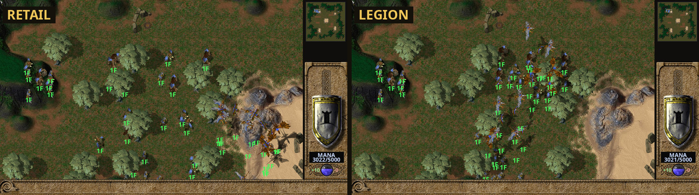

*The same formation of ground units and flyers 22 seconds after one move order. Left, Retail: the flyers have gone ahead. Right, Legion: they ride over the leading ground units. (A development scene.)*

### Ships and transports

Ships and hovercraft move on water; some hovercraft also cross land. Several
sides have **transports** (for example Aramon's Ark and Veruna's Transport Ship).

- **L** then click a transport loads the selected units into it.
- **U** then click a destination unloads them there. A flying transport with no
  further orders lands where it let its passengers go.

### Gods

Each side has a god: an enormous unit that can decide a battle. It appears in
your **Monarch's build menu**, costs 360,000 mana and is limited to one at a
time.

In the original game, roughly one multiplayer game in ten was a "god game", in
which gods appeared on their own 30–60 minutes in. **TAK Engine does not make
gods appear by themselves in skirmish or multiplayer.** A god turning up
unannounced decided games for reasons neither player chose, so this was removed
on purpose. You can still conjure one if you can afford it.

The five dragons (one per side) and the Creon Aerial Juggernaut are also limited
to one at a time.

### Scoring

Destroying an enemy unit adds that unit's experience value to your score, as in
the original game. Building units and gathering mana do not score. The **F4**
panel shows each player's kills, losses and score.

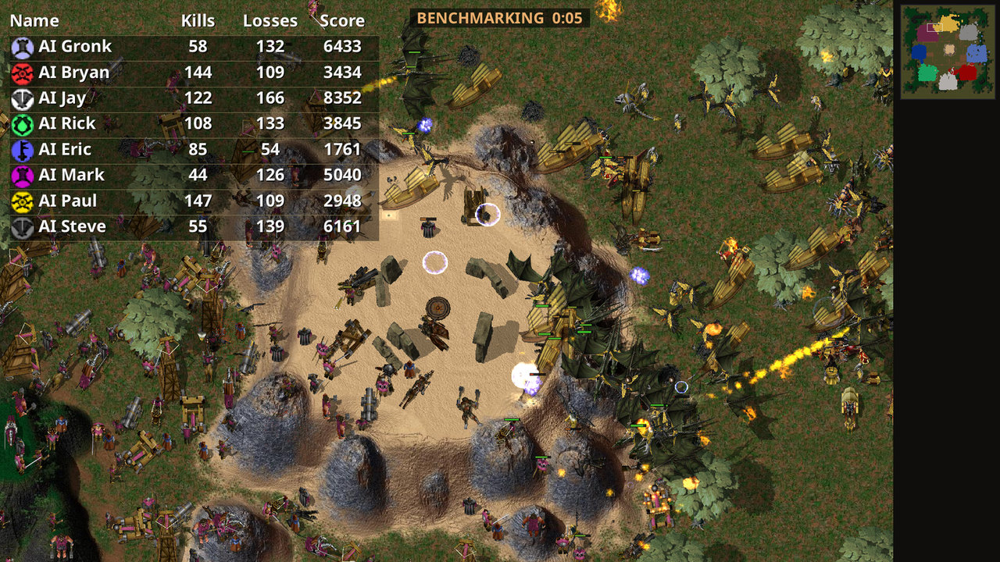

*The F4 scorecard during an eight-player benchmark battle.*

---

## The five sides

The original game has four kingdoms, and *Iron Plague* adds a fifth. Every side
follows the same basic plan (Monarch, lodestones, production, army), but each
plays very differently. The unit lists below come from the shipped game data and
are a selection, not a complete roster.

| Side | Monarch | Main production | Identity |
| --- | --- | --- | --- |
| **Aramon** | Elsin | Keep, Barracks | Knights, archers and siege engines |
| **Taros** | Lokken | Cabal, Abyss, Temple | Dark magic, demons and the undead |
| **Veruna** | Kirenna | Citadel, Enclave, Sea Fort | Gunpowder, crossbows and the strongest navy |
| **Zhon** | Thirsha | none: mobile conjurers | Beasts and wild magic |
| **Creon** | Sage | Smithy, Academy, Navy Yard | Engineering and machines (*Iron Plague*) |

All five Monarchs produce 10 mana per second and carry 5,000 mana storage.
Every side has a basic lodestone (10 mana/s) and a divine lodestone (20 mana/s),
and a senior builder (a priest, shaman or engineer) who builds the divine
lodestone and the side's most powerful units. Every side except Zhon also builds
walls and a gate.

### Aramon

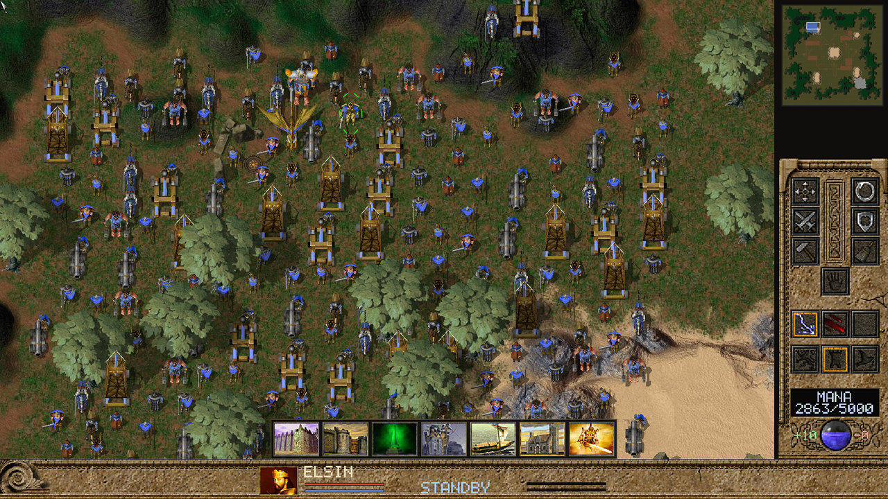

*Aramon: Elsin selected, with her build menu. The army is a test start, not a normal opening.*

The kingdom of knights and stone castles. Aramon fields solid infantry,
cavalry and powerful siege weapons.

- **Monarch: Elsin.** A sturdy fighter on foot. Builds the Barracks, lodestones,
  walls, gates, the Watch Tower and the Ark transport.
- **Economy and building.** The **Barracks** trains Swordsmen, Archers,
  Horsemen, Catapults, Spyhawk scouts and the **Mage Builder**. The Mage Builder
  (and the Flying Builder) raise the **Keep**, Stronghold, Trebuchet and the War
  Galley. The Keep trains the heavy units. The **Acolyte** builds the Divine
  Lodestone, the Grenadier, the Flying Builder and the Gold Dragon.
- **Notable units.** Knight, Mage Archer, Cannoneer, Titan, the Rolling Tower
  siege engine, the Assassin (can cloak), the Gold Dragon.
- **God: the Avatar of Anu.**

### Taros

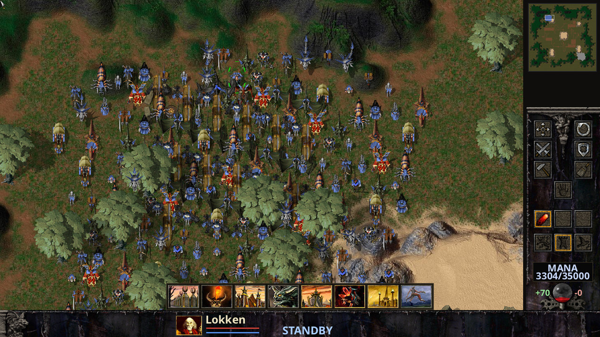

*Taros: Lokken and the Taros interface.*

A kingdom of necromancy, fire and demons, led by the sorcerer Lokken.

- **Monarch: Lokken.** A sorcerer who can cloak. Builds the Cabal, Abyss and
  Temple, lodestones, walls, a gate and the Caged Demon.
- **Economy and building.** The **Cabal** trains Zombies, Executioners, Black
  Knights, Gargoyles, Ghost Ships and the **Dark Mason** builder. The **Abyss**
  trains Skeleton Archers, Fire Demons, Iron Beaks, the Rictus, the Dark Hand and
  the Weather Witch. The **Temple** trains Blade Demons, Liches, Fire and Mind
  Mages, Sky Knights, Kamikaze Rats, Fire Spouts and the **Dark Priest**. The
  Dark Priest, which flies, builds the Divine Lodestone, the Fallen Angel and the
  Black Dragon.
- **Notable units.** Zombie (cheap and plentiful), Lich, Mind Mage, Kamikaze
  Rat (can cloak), Fallen Angel, Black Dragon.
- **God: the Spawn of Belial.**

### Veruna

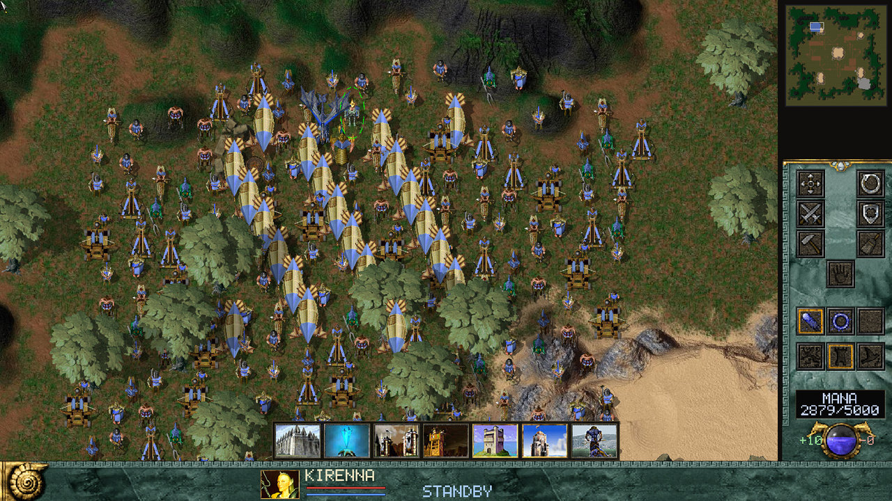

*Veruna: Kirenna, with Dirigibles over the army.*

A seafaring kingdom of gunpowder, crossbows and warships, ruled by the sorceress
Kirenna.

- **Monarch: Kirenna.** A hovering Monarch who crosses water. Builds the Enclave,
  Sea Fort, Guard Tower, lodestones, walls and a gate.
- **Economy and building.** The **Enclave** trains Warriors, Crossbowmen,
  Catapults, Parrots, Mer Warriors and the **Priestess** builder. The Priestess
  builds the **Citadel**, Sea Fort, Bastion, Lighthouse, Mortar and more. The
  Citadel trains Musketeers, Crusaders, Berserkers, Centaurs, Amazon Knights,
  Dirigibles and the **Priest of Lihr**, who builds the Divine Lodestone, the
  Ballista, the Pillar of Light and the Sea Dragon. The **Sea Fort** builds the
  navy: Skiffs, Harpoon Ships, the Man of War, the Trebuchet Ship, the Transport
  Ship and the **Flagship**, a ship that can build.
- **Notable units.** Musketeer, Amazon Knight, Man of War, Trebuchet Ship, the
  Sea Dragon.
- **God: the Angel of Lihr.**

### Zhon

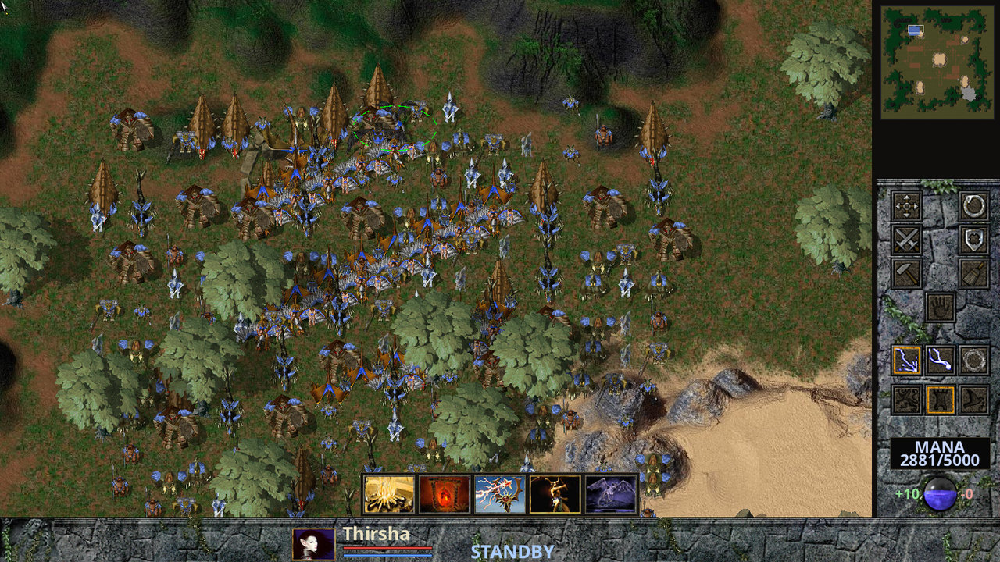

*Zhon: Thirsha. Her build menu holds conjurers and field structures, not production buildings.*

A wild kingdom of beasts and nature spirits, led by the huntress Thirsha.

Zhon has **no fixed production buildings**. Everything is conjured in the field
by mobile builders, so a Zhon base is wherever its conjurers stand.

- **Monarch: Thirsha.** She flies. Builds the Beast Handler, lodestones, the
  Sacred Fire and the Death Totem.
- **Economy and building.** The **Beast Handler** conjures Goblins, Trolls,
  Hunters, Bats, Swamp Beasts, lodestones and the **Beast Tamer**. The Beast
  Tamer conjures Spirit Wolves, Basilisks, Gryphons, Harpies, the Kraken and the
  **Beast Lord**. The Beast Lord conjures Jungle Orcs, Stone Giants, Rocs,
  Drakes, Wisps and the **Shaman**, who conjures the Divine Lodestone, the Giant
  Orm, the Giant Barracuda and the Ancient Dragon.
- **Notable units.** Troll, Basilisk (its gaze turns enemies to stone), Stone
  Giant, the Trapdoor Spider (can cloak), the Ancient Dragon.
- **God: the Wrath of Tammuz.**

### Creon

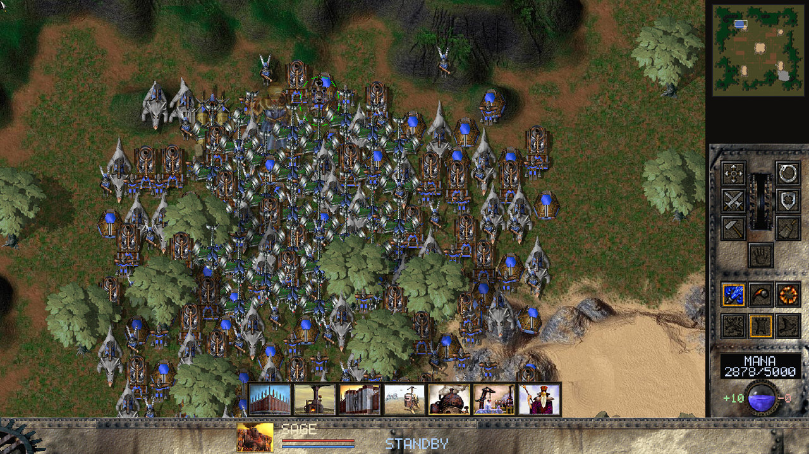

*Creon: the Sage and the Creon interface.*

The fifth side, added by *Iron Plague*: a nation of engineers and steam-driven
machines.

**Creon needs the Iron Plague archives** (`IPData.hpi` and its companions) in
your install folder. The engine finds them automatically; there is no setting to
enable. Without them the Creon side has no units, so a Creon player would start
with nothing. Do not pick Creon, or let a random AI side be chosen, if Iron
Plague is not installed.

- **Monarch: the Sage.** Builds the Smithy, Navy Yard, Mana Refinery, Gatling
  Crossbow, walls and a gate.
- **Economy and building.** Creon's lodestones are the **Mana Refinery** and the
  **Mana Amplifier**. The **Smithy** trains Automatons, Barnstormers, Fire
  Wagons, Tortoises and the **Mechanic** builder. The Mechanic builds the
  **Academy**, Bomb Sprinkler, Prismatic Mirror and more. The Academy trains
  Beast Riders, Shock Troopers, Neo Dragons and the **Chief Engineer**, who
  builds the Mana Amplifier and the **Aerial Juggernaut**. The **Navy Yard**
  builds the Iron Clad, Stern Wheeler and Submersible.
- **Notable units.** Shock Trooper, Fire Wagon, Iron Clad, Submersible, the
  Aerial Juggernaut (one at a time).
- **God: the Ghost of Garacaius.**

Creon is fully playable in skirmish and multiplayer, and the AI can play it. It
appears in the side picker and in the random map generator's world choices. The
Crusades balance includes its own Creon unit definitions but leaves Creon's
build menus unchanged.

---

## Controls

These are the default bindings. Command, selection, view, emote,
push-to-talk and poster (**MAKE POSTER**) keys can be changed in **Settings → Controls** (or **Esc →
Controls** in a game): click a row and press the new key;
right-click a row to unbind it. Number-key squads, **Esc**, chat, pause and game
speed keys are fixed.

### Mouse

| Input | Action |
| --- | --- |
| **Left-click** | Select a unit. |
| **Left-drag** | Box-select your own units. If the box catches any armed mobile units, the builders and buildings in it are left out. |
| **Shift** + select | Add to the selection. |
| **Ctrl** + select | Remove from the selection. |
| **Right-click** | The natural order for what is under the cursor: move, attack, guard, repair, load, reclaim and so on. |
| **Right-click an enemy** | Attack it. As in the original, the pointer shows the attack cursor whenever a selected unit's active weapon can hurt that enemy; a unit that can move walks into range, however far away the enemy is. The "too far" cursor means no selected unit can attack it from where it is: the active weapon cannot hurt that enemy (it does no damage to it, the unit is never allowed to target that kind of unit, it is an anti-air weapon and the enemy is on the ground, a ground weapon and the enemy is flying, or a stoning or freezing weapon and the enemy is immune), or a tower or other building has the enemy out of range or inside its minimum range. A building still takes the order and fires once the enemy comes in range. A selected factory sends the units it builds after that enemy. |
| **Shift + right-click** | Queue that order after the current ones. |
| **Right-drag** with a reclaiming builder | Reclaim everything in the box. |
| **Middle-drag**, or the cursor at a screen edge | Scroll the map. |
| **Mouse wheel** | Zoom in and out, towards the cursor. Far out, **Options → Tactical Dots** can draw units as minimap-style dots. |
| **Minimap left-click / drag** | Move the camera. With an order armed, issue it there instead. |
| **Minimap right-click** | Move the selection there. Shift queues it. |
| **Right-click a cycling setting** | Go back one choice (left-click goes forward). Works in menus and options. |

### Orders

Orders that need a target are **armed** by their key or button, then issued with
a left-click on the map or minimap. **Esc** disarms.

| Key | Order |
| --- | --- |
| **M** | Move. |
| **A** | Attack. Click an enemy, or click the ground to fight-move there. |
| **F** | Fight-move: move, attacking enemies met on the way. |
| **P** | Patrol. |
| **G** | Guard a unit or building. |
| **H** | Heal or repair a friendly unit or building. |
| **L** / **U** | With a transport selected: click a unit to pick it up / click where to unload. (A unit boards by right-clicking your transport.) |
| **S** | Stop: cancel all orders. |
| **C** | Clear orders (the same as **S**). The command panel's **Clear** button is different: it arms reclaim. |
| **W** | Cycle the active weapon. |
| **K** | Toggle cloak. |
| **O** | Open or close selected gates. With nothing selected, show campaign objectives. |
| **D** | Diplomacy: give units, share mana, choose chat and voice recipients. |
| **Ctrl+Shift+D** | Self-destruct (again to cancel). |

#### Blocked shots

If a unit's shots keep hitting something it cannot destroy
before they reach its target (a hill, water, a rock or other indestructible
scenery), it walks a short way to a spot with a clear shot and then attacks
again. This happens after three blocked shots in a row. Shots that hit a tree or
anything else that can be destroyed do not count, because they wear it down. A
unit tries at most three new spots before it lands a hit on that target (each
hit gives it three more). If it finds no spot within about twelve cells, it
stays where it is and keeps firing, as in the original game, and looks again
after three more blocked shots, in case the target has moved. Units on **Hold Position**, buildings, flyers and melee units never move
for this. A unit that is not under an attack order stops firing at that target
and picks another one. This is new behaviour; the original game had no such
check, and its units fire into the hill or rock until their orders change.

One rough edge: a unit standing still and choosing its own targets (no attack
order) can keep ignoring an enemy it once found blocked, even after that enemy
walks into the open. Give it an attack order, or move it, and it fires again.

### Selection

| Key | Selects |
| --- | --- |
| **Ctrl+A** | All your units. |
| **Ctrl+Z** | All your units of the types already selected. |
| **Ctrl+U** | All your units on screen. |
| **Ctrl+X** | On-screen units of the first selected unit's type. |
| **Ctrl+M** | Your Monarch, and follow it with the camera. |
| **Ctrl+B** | Builders. |
| **Ctrl+F** | Production buildings. |
| **Ctrl+E** | Melee units. |
| **Ctrl+G** | Spellcasters with their own mana. |
| **Ctrl+N** | Ships and water units. |
| **Ctrl+R** | Units with ballistic weapons. |
| **Ctrl+T** | Armed troops (not ships or Monarchs). |
| **Ctrl+W** | All armed units except Monarchs. |
| **Ctrl+Y** | Flyers. |
| **N** | Next unit. |

With more than one unit selected, the information bar shows **N SELECTED** and a
portrait for each unit type in the selection. The first selected unit's type comes
first, at the right end of the row where the single portrait sits; the other
types run to its left, most numerous first. All the portraits are the same size.
The number on each portrait is how many of that type are selected. Hold the
pointer over a portrait to see the unit's name.

The bars show the whole selection. The health bar is the total health of the
selected units out of their total maximum. The mana bar counts only the units that
have mana, such as priests, and is hidden if none do. No unit name is shown. If
the selection is exactly one group or formation, its name (for example **GROUP 3**
or **FORMATION 2**) is shown where the unit name would be. Exactly means all of
its units, or all of them except its builders, which is what pressing its number
selects. Part of a group, a group plus other units, or a group with only some of
its builders shows no name. A unit's rank, and what it is building, show only when it is
selected alone.

| On a portrait | Does |
| --- | --- |
| Left-click | Select only the units of that type. |
| Shift + left-click | Remove that type from the selection. |

The portraits stay full size all the way to the left edge of the screen. Only
when there are too many types to fit there at full size do they all shrink
together, the first one included, then fold into two rows (the first type at the
top right). If they still do not fit, the last tile shows **+K**: K more types
are selected but not shown.

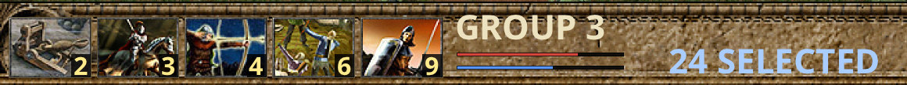

*Group 3 selected: nine Swordsmen in the usual portrait spot, then Archers,
Mage Archers, Horsemen and Catapults to the left, most numerous first, all at
full size and out over the end-cap scroll. The bars
are the group's total health and mana. (A development scene, with UI Scale at
150%.)*

The unit's status (**STANDBY**, **MOVING**, or **N SELECTED** for a group) is
shown in the gap between the selection's bars and the bars of what it is
building or conjuring.

### Groups and formations

| Key | Action |
| --- | --- |
| **Ctrl+1** … **Ctrl+0** | Make the selection a **group**. |
| **Alt+1** … **Alt+0** | Make the selection a **formation**. |
| **Ctrl+Shift+number** / **Alt+Shift+number** | Add the selection to a group or formation. |
| **1** … **0** | Select that group or formation (builders in it are left out). Press again to centre the camera on it and follow it. |
| **Ctrl+Esc** | Remove the selected units from their group or formation. |

A unit belongs to one group or formation at a time. Each unit shows its number
under it in green: `3` for group 3, `3F` for formation 3. With the whole group or formation
selected, the information bar shows its name, such as **GROUP 3**.

- A **group** is a saved selection.
- A **formation** also travels together: it moves at the pace of its slowest
  member, and members that fall far behind rejoin once the formation has stopped.

Recalling a group skips its builders, but units those builders produce join the
group automatically.

### Camera and information

| Key | Action |
| --- | --- |
| **Arrow keys** | Scroll the map. |
| **T** | Follow the selection with the camera. |
| **Tab** | Full-screen map. Press again to return. |
| **Shift+Z** | Return to the original game's 1:1 zoom. |
| **F1** | Unit information for the selected unit. |
| **F4** | Player names, kills, losses and score. |
| **F9** | YouTube streaming setup. |
| **Pause** | Pause or resume. This pauses the game for every player. |
| **+** / **−** | Game speed, as in the original: one level per press from −9 (0.1×) through NORMAL (1×) to +10 (2×), 0.1× per level. A banner shows the new level, for example **GAME SPEED NORMAL** or **GAME SPEED +5**. Only the host can change it, and only if **Allow speed change** was on. |
| **Enter** | Open chat; **Enter** sends, **Esc** cancels. Also where you type [power codes](#power-codes). |
| **Print Screen** | Make a poster: save a picture of the whole map. Only in a game with **Power codes** on. If your desktop takes the key for its own screenshots, or your keyboard has none (Mac), set another key for **MAKE POSTER** in **CONTROLS**. See [Power codes](#power-codes). |
| **Space** (hold) | Push to talk, in multiplayer, when [voice chat](#voice-chat) is on with **Talk mode** Push to Talk. Never while you are typing in a text box. |
| **Esc** | Close a dialog, cancel placement or an armed order, clear the selection, then open the game menu. |

### Emotes

| Key | Action |
| --- | --- |
| **Shift+D** | Disco: the selected units (or your Monarch) dance for ten seconds. |
| **Shift+H** | Headbang: the selected units (or your Monarch) headbang for ten seconds. |

Everyone in the game sees and hears emotes.

### Power codes

Power codes are the original game's cheat codes. They work only in a game
created with **Power codes: On** (see [Match options](#match-options)), in
single player or multiplayer. They never work in a campaign or a Crusades
battle, and not while you watch a game or a replay.

To use one, press **Enter**, type the code and press **Enter**. Capital letters
do not matter (**+atm**, **+ATM** and **+Atm** are the same), and spaces around
the code are ignored. As in the original game, a code line is also sent as chat
to every player, whoever your chat is set to reach, so everyone sees what you
typed. With power codes off a code line is ordinary chat: it goes only to the
players your chat reaches and does nothing else. Anything else that starts with
**+** is ordinary chat.

| Code | What it does |
| --- | --- |
| **+ATM** | Fills your mana pool up to your storage. |
| **+ManaMe** | Fills the personal mana of your selected units, such as spellcasters. Units without mana of their own are not changed. |
| **+DoubleShot** | Doubles all damage in the game, by every player's units. Type it again to turn it off. It turns **+HalfShot** off. |
| **+HalfShot** | Halves all damage in the game. Type it again to turn it off. It turns **+DoubleShot** off. |
| **+LOS** | Turns line of sight off or on for you. With it off, you see every unit on ground you have explored, and your units can attack them there. **+LOS Off** and **+LOS On** set it instead of switching it. |
| **+Mapping** | Turns the map on or off for you. With **Fog of war: Not Explored**, the first time reveals the whole map. The next time hides it again, and the ground you had explored is forgotten; your units explore it again as they see it. With **Explored** or **Full Vision** the map starts revealed, so the first **+Mapping** hides it. |
| **+NowISee** | Turns line of sight and the map off for you: you see the whole map and every unit. Typing it again changes nothing; use **+LOS** and **+Mapping** to bring the fog back. |
| **+Radar** | Your minimap shows every unit on the map. Type it again to turn it off. |
| **+MakePoster** | Saves a picture of the whole map at full size, as **BIGSHOT0001.png**, **BIGSHOT0002.png** and so on, in a **screenshots** folder inside your game data folder. If that folder cannot be written, it uses the folder your settings are kept in. A chat line says when it starts and where the file was saved. **Print Screen** does the same. You can change that key in **CONTROLS** (**MAKE POSTER**). |

**+MakePoster** shows the map as you see it, including your fog of war. Type
**+NowISee** first to put everything in the picture. Selection rings, health
bars, squad numbers, building outlines and other markers are left out. The game keeps running
while the picture is made. A big map takes a few seconds to save and needs a lot
of memory; Ulasem Arena makes a 10,240 × 10,240 picture of about 100 MB.

With **Fog of war: Full Vision** you already see the whole map and every unit,
so **+LOS**, **+Mapping** and **+NowISee** change nothing on your screen. They
still change which units your units can see and attack.

**Print Screen** reaches the game only if nothing else takes it first. Some
desktops use it for their own screenshot tool (KDE's Spectacle, or Windows 11
with *Use the Print screen key to open screen capture* on), and Mac keyboards
have no Print Screen key. Then set another key for **MAKE POSTER** in
**CONTROLS**, or type **+MakePoster**.

**+ATM**, **+ManaMe**, **+LOS**, **+Mapping** and **+NowISee** affect only the
player who types them. **+DoubleShot** and **+HalfShot** affect the whole game.
**+Radar** and **+MakePoster** change only your own screen. Every code starts off
in each new game. Codes are recorded in replays, so a replay plays back as the
game was played.

These differ from the original game:

- In the original, every code changed the game on the computer of the player who
  typed it. In single player that meant **+LOS**, **+Mapping** and **+NowISee**
  also lifted the fog for the computer players. Here they lift it for you only,
  in single player and multiplayer alike. **+DoubleShot** and **+HalfShot**
  change everyone's damage, as in the original single player.
- The original saved posters as BMP files and froze the game while it made one.
  Without the word **all** (**+MakePoster all**) it pictured 3,200 × 2,400 pixels
  around your view and hid the fog. Here a poster is always the whole map, as you
  see it, saved as PNG, and the game keeps running.
- The original kept **+DoubleShot**, **+HalfShot** and **+Radar** on from one
  game to the next. Here every game starts with them off.
- The original said nothing when a poster was saved. Here a chat line says where
  it is.
- The original sent every line that starts with **+** to every player, even with
  power codes off. Here only a code line in a game with power codes on goes to
  everyone; otherwise the line goes to the players your chat reaches.
- Only these nine codes are available. The original's other console commands,
  such as **+View**, are not.

---

## Queueing orders with Shift

Hold **Shift** to add an order to the end of a unit's list instead of replacing
it. This works for **every** order: move, attack, fight-move, patrol, guard,
repair, reclaim, area reclaim, load, unload and building.

- **Right-click with Shift** queues the natural order.
- **Armed orders stay armed while you hold Shift.** Press **M**, **F**, **P**
  and so on, then Shift-click as many points as you like. Releasing Shift
  disarms the order.
- Units carry out their list in order. A finished order hands over to the next
  one straight away.
- **Hold Shift to see the plan.** The selected units show a dotted line through
  their queued orders, including building sites and area jobs.
- **Queued buildings show as see-through outlines** on their sites until a
  builder starts them. A building that is under construction is drawn as itself,
  in its proper place under any flyer above it, with no outline laid over it.
- **Stop** (**S**) clears the whole list.

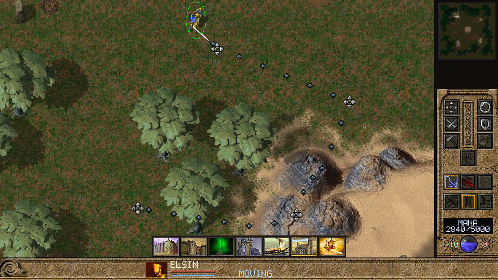

*Holding Shift shows the queued route: one move, then three Shift-queued moves.*

**Patrols loop.** Patrol points keep cycling; other orders run once.

| You issue | The unit does |
| --- | --- |
| Shift-patrol B, then Shift-patrol C, from standing still | Patrols start → B → C → start, forever. |
| Move to A, then Shift-patrol B | Walks to A, then patrols A ↔ B. |
| Patrol B, then Shift-patrol C | Adds C to the existing patrol loop. |
| Move A, Shift-move B, Shift-move C | Visits A, B and C once each, then stops. |

**Production buildings** take Shift-queued rally orders the same way.

In **Legion** mode, a group's queued moves are planned for the group as a whole,
just like its first move.

---

## Pathfinding: Retail and Legion

The game creator chooses how units find their way, in **Pathfinding** on the
game setup screen. Everyone in the match uses the same choice. Campaigns always
use Retail.

### Retail (the default)

Retail reproduces the original game's movement as exactly as possible: how units
search for routes, how they bump and wait, how groups pace themselves, and how
flyers take off and land. Its behaviour has been checked routine by routine
against the original game.

Choose Retail if you want the game as it was, including its well-known quirks:
long single-file columns, units jostling at chokepoints, and units occasionally
circling when stuck.

In Retail, groups and formations keep together the original way: members move at
the slowest member's speed, a member that falls far behind slows the group
instead of sprinting, and members far from the group walk back or wait.

### Legion

Legion is a movement system written for TAK Engine. It is designed for big
armies:

- **Groups plan together.** A group's order is planned once for the whole group,
  and the group heads for the destination as a body, not as a column of
  individuals.
- **One order per click.** A right-click is one order however big the
  selection is: the whole army gets one destination area and one formation,
  and the order reaches every unit in the same game tick, even for 10,000
  units (before 0.8.4 a big selection arrived in parts over several seconds).
  A second order to the same spot, while the first army is still gathering
  there, joins its destination area.
- **Groups share out narrow passages.** A narrow passage, such as a bridge or a
  door, keeps count of the units queueing for it. A group picks its way by
  travel time plus that queue, a big group can split to use two passages, and
  your own and allied units take turns through a narrow one, one direction at a
  time. A long bridge counts as one passage, so two armies meeting at it no
  longer both walk on and jam in the middle: one is let across while the other
  waits at its end (0.8.6). Groups entering one room by different doors each
  fill it from their own door.
- **Arrivals settle.** Units take up places around the destination point, and
  once they are close they stop. Large groups do not keep shuffling forever:
  the last units of a group, pressed against the group's own crowd with no way
  further in, stop where they stand and are free for their next order, instead
  of edging round the crowd for minutes. At a wall or in a dead end the
  destination area follows the wall or the corridor.
- **Wheeling round walls.** When a large group (16 or more) goes round the end of
  a wall, it swings round in several ranks instead of narrowing to single file.
  It drops to single file only when the gap really is too narrow. A single tree
  or rock (or a small clump) is not a wall end: the group walks past it. A wood
  too dense to walk through still is. Since 0.8.7 units keep their places side by side
  through a turn instead of crossing over each other's lanes, and a crowd
  squeezing round a corner merges faster: units walking past one that has
  waited a while move over a lane to let it in, instead of filing past it.
- **Groups take gaps several abreast.** A large group (16 or more) sent through
  a short gap in a wall or a doorway that is wide enough for two or three units
  now splits across the gap and goes through two or three abreast, each unit
  taking the place with the fewest friends queued before it, instead of
  queueing into one file. Through a short passage, each unit keeps its place
  from side to side until it is out the far end, so the group does not cross
  over inside it; since 0.8.6 that also holds for a formation of about 100
  going through a wide gap (about 20 cells). A gap that fits only one unit is
  still taken in single file.
- **Rooms fill from the back.** When the way into the destination narrows just
  before it, as through a doorway, the units that come through first take the
  places furthest in, so they do not settle in the doorway and shut the others
  out.
- **Long routes.** A unit sent along a very long winding route walks it instead
  of standing still as if trapped.
- **Columns meeting head on keep right.** Two large groups (16 or more) walking
  towards each other along the same route now narrow a little before they meet
  and each passes on its own right, instead of ploughing into one another.
  Groups that are on a fight, attack, guard or patrol order do not do this. The
  narrowing is slight and only starts when the two groups are about to meet.
  Since 0.8.6 it also works when the groups meet close to their destinations,
  for example two squads sent to each other's places.
- **Going round obstacles.** Groups route round parked crowds of units and round
  landed flyers instead of pushing into them. Your own and your allies' idle
  units step aside to let a group through, so a group can leave a place where
  another army has just arrived. Formation units flow round a rock, a wall end
  or a block of idle units at their travel speed instead of creeping sideways
  (0.8.6).
- **Unreachable orders end where the unit stops.** Ordered to a place it cannot
  reach, a unit walks to the nearest spot it can reach, and its order ends there,
  so it is free for the next one at once. Units queued behind their own army end
  their orders where they stand. (A unit sealed in where nothing at all can be
  reached still waits up to five minutes for a way to open.)
- **Builders do not wait for ever.** A builder held in front of another
  player's unit that does not move stops as close as it can get, then builds
  if the site is within reach, or gives up the order and moves on.
- **Crossing groups take the longer route.** When two groups' ways cross, the
  later one does not stand and wait for the other to pass: it plans round,
  behind the other stream's tail, even if that is a long way. Only when no way
  round exists at all does it go straight across, as before. Groups that meet
  head on still keep to the right, and units stuck in a clot no longer block
  the routes of other groups planned past them.
- **Attackers surround their target.** A group ordered to attack one unit or
  building spreads round it and fires from a ring of places at weapon reach,
  instead of queueing behind the first few: a unit that is firing stands still
  and the ones behind walk round it to the next free place. A group sent
  across the battlefield plans round a crowd that is standing and firing, and
  a crowd that parks across a group's way after it has planned (20 cells or
  more of it) makes the group plan again once. Since 0.8.6 the ring fills all
  the way round instead of only the near side, a unit waiting just short of
  reach steps in until it can fire, a target in a walled-off place is still
  surrounded from outside its walls, and a group walking past another group's
  firing ring splits round both sides of it. Units chasing a moving target
  follow it without planning again at every step. Since 0.8.7 units round a target that
  is standing still no longer creep along the ring, and a target walled in on
  every side is now fired on from the nearest spots against its walls. A ring
  along a wall is deeper: units that find no place at the front wait just
  behind it instead of standing back, and step in when they can fire. Units
  on a fight or guard order also stop creeping round a target that stands
  still, and walk round their friends at full speed. After 0.8.7, units
  waiting just outside reach of a ring along a wall step on into the ground
  behind it that the wall hides from the target, and stay there until they can
  fire; units on a fight-move that come upon a target standing still surround
  it as an attack order does, instead of queueing on the near side; and a unit
  stopped right at the edge of its weapon's reach counts as in reach, as it
  does when firing. Units attacking through a narrow gate, such as the corridor
  round a gatehouse, now fill the corridor from its far end, as in Retail:
  the first units walk on past the first place they could fire from instead
  of stopping in the gate and shutting it, so at least as many units fire at once
  as in Retail (before, under three quarters as many).
- **Narrow crossings take turns.** At a bridge or other narrow crossing, the
  time each group is let through grows with the length of the crossing, and a
  small group waits its turn instead of pushing in among a big one. Two armies
  of about 100 meeting head on at a bridge no longer jam in tests (0.8.7).
- **Dead-end corridors.** Groups sent into a corridor one unit wide are let in
  one at a time and settle along it instead of jamming at its mouth (0.8.7).
- **Buildings do not hold a formation.** A building or an unfinished unit in an
  Alt+number formation no longer slows the formation to a standstill.
- **No spinning.** A unit that is truly trapped stops and waits, instead of
  circling on the spot. Units are not caught on jagged terrain unless they really
  are boxed in.
- **No walking on the spot.** A unit that gets nowhere stands still instead of
  playing its walk on the spot. One that keeps stepping back and forth, or
  turning left and right, is held for a moment so it tries another way round.
- **Followers keep pace.** Units following others in a stream match their speed
  instead of stop-starting, and a slowed unit's walk animation plays at the
  speed it really moves.
- **Flyers land cleanly.** Flyers never land on top of other flyers or ground
  units.
- **Flyers stay with the army.** Flyers in a formation or a Ctrl+number group
  with ground units hold places in rows over the front of the ground units of
  the same order and keep to their pace, instead of racing ahead and waiting at
  the destination. On arrival they land just in front of the ground units. Over
  a single unit or a narrow column they gather in a block, not a long file.
  When the ground stops, for instance at a wall or in a dead end, the flyers
  go on to land at their destination instead of hovering for minutes.
- **Flyers do not trap walkers.** A flyer that has lifted to let an army pass
  comes back down after at most a minute, and it fights while it is up. Ground
  units no longer walk in under a flyer that is coming down to land.

Legion handles ground units, ships and hovercraft for moves, fight-moves,
patrols, attacks, guarding, building, repairing, reclaiming and transport
orders. Flyers in flight use the original game's movement, except that flyers
in a formation or Ctrl+number group with ground units keep station over them.

**Known limits of Legion:**

- A crowd that parks **after** a group has already planned its route is
  avoided only if it fills 20 cells or more of the group's way (the group then
  plans again, at most once every ten seconds); a smaller one is walked round
  when the group reaches it.
- Units guarding a friend in a narrow place keep shuffling for a while, up to
  about a minute, until the crowd round it has packed.
- A group walking through a ring of units that stand and fire arrives a
  little later than it would past the same units in the original game.
- Legion units stand and wait in a crowd more than units in Retail do,
  although they usually arrive sooner. In a few test layouts a group still
  arrives a little later (under 5%) than in Retail.
- Two large groups meeting head-on at a narrow, tapering bridge can still jam
  in its mouth and take much longer to cross than in Retail.
- When a group goes round a parked crowd, it can still pass by one side in a
  narrow file.
- Idle units of **enemy** players do not step aside for you, nor do units
  with orders of their own.
- Units in a large group swap places with each other more often than in Retail
  at corners, in long narrow passages and where two streams cross after a
  turn.
- Units attacking next to a wall, or queued at a blocked doorway, brush against
  the wall about twice as often as in Retail.
- From some starting positions, a single unit queued at a blocked doorway, or
  one crossing another group, never finishes its order.
- A flyer that lifts off to let an army pass can detour further than in Retail
  (about five cells instead of two).
- Two separate clicks of one kind given in the same moment share one set of flyer stations.
- With thousands of units, Legion uses more processor time than Retail.
- With about 10,000 units moving at once, crowds can still stand at corners,
  at the mouths of narrow passages where two armies meet head on, and in the
  queue for routes when many groups head for many different places. The
  [Legion 10,000 report](legion-10000-report.md) has the measurements.

### Which should I choose?

| If you want | Choose |
| --- | --- |
| The original game's movement, exactly | **Retail** |
| Large armies that move and arrive cleanly | **Legion** |
| A campaign | Retail is always used |

---

## Options

Open **Options** from **Settings** on the main menu, or **Esc → Options** in a
game. Changes apply immediately; **Save** keeps them. **Defaults** puts the
options back to their defaults; it leaves your player name, data folder, key
bindings and voice chat settings alone. It also sets UI Scale and Cursor Size
back to their defaults, undoing the one-time enlargement made by Ignore Windows
Display Scaling or Native Retina Resolution, so raise them again on a scaled
or Retina display.

0.8.5 changed some defaults: Tactical Dots is now on at a zoom of 0%, Smooth GUI
Art and Smooth Movies are on, Texture Filtering is Everything, and the new
Screen Shake is off. A settings file you already have keeps the values saved in
it; press **Defaults** to take the new ones.

### Player

| Option | Default | What it does |
| --- | --- | --- |
| **Player name** | blank | Your name in local and unauthenticated games. Signed-in multiplayer uses your account name. |

### Game data folder

| Option | Default | What it does |
| --- | --- | --- |
| **Data folder** | The folder chosen at first start | The *Total Annihilation: Kingdoms* install the game reads. **Change** opens a folder picker. |

The row shows the folder in use; hover over it for the full path. The folder you
choose is checked first: if it is not an install, the game says what is missing
and keeps the current one. A good folder is saved at once, then the game offers
**Restart now** (or **Later**) to load it, because everything the game has
loaded comes from that folder. Restarting saves any Options changes you have
not saved yet.

You can change the folder only from **Options** on the main menu. During a game,
in a lobby or while watching a replay the row is greyed out. It is also greyed
out when the game was started with `--data` or from inside an install folder,
because those always win over the setting. **Defaults** never changes the data
folder. The map editor shares this setting: a folder chosen in either program
is the one both use next time.

### Audio

| Option | Default | What it does |
| --- | --- | --- |
| **Sound device** | System default | The output device. You can switch while playing. |
| **Master volume** | 100% | Overall volume. |
| **Music volume** | 50% | Soundtrack volume. |
| **Sound effects** | 100% | Unit, world and interface sounds. |
| **Speaker** sliders | 100% | One per speaker channel on your device, for surround setups. |
| **Voice chat** | Off | Opens the **Voice Chat** page; the row says whether voice chat is on (**ON - OPEN** or **OFF - OPEN**). Voice chat has its own devices, volumes and **Defaults**; see [Voice chat](#voice-chat). |

World sounds are full volume on screen and fade with distance off screen.

A dying unit's cry is the one the game itself chose, as in the original, so every
player, spectator and replay of a game hears the same cry for the same death. As
in the original, you hear your own units wherever your sight reaches, and a
unit of yours that dies still counts as seeing its spot for two seconds, so its
cry and anything it plays as it dies (a Creon bomb's fuse, for example) are
heard even when nothing else of yours is watching. Another player's units are
heard only where you can see them, and never while they are cloaked or carried
in a transport. A few units are silent by design: the Automaton makes no sound
when an explosive weapon kills it, as its original script says, and the
original data has no sound for two death cries (`cregatldie1` and
`zonbardie1`). After a rejoin, or when
you start spectating a game in progress, the deaths of the part of the game you
missed are silent while the game catches up.

### Display


*Options, Display and Graphics sections, at the default settings. Max FPS is greyed out because VSync is on. The picture was taken in a window, so Fullscreen shows Off.*

| Option | Default | What it does |
| --- | --- | --- |
| **Fullscreen** | On | Borderless fullscreen. |
| **VSync** | On | Match the frame rate to the display. While it is on, the game also waits for each display refresh itself if the graphics driver does not. |
| **Max FPS** | 60 | Frame-rate cap when VSync is off (30–240). Greyed out while VSync is on, because the display then sets the frame rate. |

### Graphics

| Option | Default | What it does |
| --- | --- | --- |
| **Renderer** | Auto | Which graphics backend draws the game. Takes effect after a restart; see [Renderer](#renderer). |
| **Ignore Windows Display Scaling** | On | Windows only. Stops Windows from enlarging the game window to match your display scaling (for example 150%), which made everything blurry. The game draws at the real screen resolution instead. Takes effect after a restart. The first time it runs, UI Scale and Cursor Size are raised to your Windows scale so the interface stays the same size, now sharp; adjust them afterwards if you like. |
| **Native Retina Resolution** | On | macOS only; the same row as Ignore Windows Display Scaling. Draws at the full resolution of a Retina display (normally twice the window's size in points) instead of letting macOS double a half-size image, which made everything soft. Takes effect after a restart. The first time it runs on a Retina display, UI Scale and Cursor Size are doubled so the interface stays the same size, now sharp; adjust them afterwards if you like. The window can move between a Retina and an ordinary display: the picture and the pointer follow the display it is on, but UI Scale is not changed again, so the interface looks bigger on an ordinary display. |
| **Texture Filtering** | Everything | How the game area is smoothed when you zoom in. **Off**: nothing is smoothed, as in the original. **Units**: the original game's Bilinear Filtering option; smooths unit textures and unit shadows only. **Everything**: Units, plus terrain, trees, rocks and other scenery, and effects, once you zoom in past 150%. Not in the original game. The interface, cursor and movies are never affected; see below. |
| **Shadows** | On | Unit, scenery and projectile shadows. The biggest single graphics cost in a crowded battle. |
| **Smooth GUI Art** | On | Sharpens the low-resolution interface art, menus, fonts, cursors and build-menu portraits with an edge-aware upscale. Applies at once. No cost per frame; uses more video memory. |
| **Smooth Movies** | On | Removes the blocky compression artefacts from the game's movies. |
| **Trees Sway in Wind** | On | Animated trees and their shadows. |
| **Tactical Dots** | On | Zoomed far out, every unit is drawn as a dot in its player's colour, like the minimap, instead of its model. Not in the original game. See below. |
| **Tactical Dots Zoom** | 0% | How far out you must zoom before dots replace models. Greyed out while Tactical Dots is off. See below. |
| **Screen Shake** | Off | Shakes the camera on heavy impacts (weapons that shake the screen in the original game) and on mission earthquakes. Applies at once. |
| **Hardware Cursor** | On | The operating system draws the cursor, so it stays smooth even if the game stutters. |
| **Smooth Motion** | On | Units glide between the game's 30 updates per second instead of stepping. Adds about 33 ms of visual delay. |
| **GPU Memory Limit** | 1.25 GB | The most video memory the game's own textures may use: 512 MB, 768 MB, 1 GB, 1.25 GB (the default), 1.5 GB, 2 GB, 3 GB, 4 GB or Unlimited. Applies at once. See below. |

**Texture Filtering** applies at once. At **Off** every texture is drawn with
sharp square pixels, which is how the original game looked: it had no camera
zoom, so its art was never magnified. **Units** is the original game's own
Bilinear Filtering option and smooths only unit textures and unit shadows.
**Everything** also smooths the terrain, the scenery (trees, rocks and other
map features and their shadows) and effects (explosions, fire, smoke and
projectiles), so zooming in shows soft, natural ground instead of large
blocks. It only switches on past 150% zoom: at the normal 125% view a texture
pixel is one or two screen pixels, so smoothing would only blur the picture.
It switches back off below 140%, so a wheel notch either side of the line does
not flicker. Units are smoothed at every zoom, as with Units. None of the
levels costs any measurable speed or video memory. The interface, cursor and
movies have their own settings (Smooth GUI Art, Smooth Movies). Saved settings
from an older version keep their look: Bilinear Filtering off becomes Off, on
becomes Units.

**GPU Memory Limit** is a safety net, not a quality setting. At the default 1.25
GB a typical game uses 0.4–0.7 GB of it and even a huge map with a big battle
stays under about 0.75 GB, so on most machines it never comes into play. Each
part of the game (terrain, building shading, shadows) also has its own fixed
allowance, so **raising** the limit or picking **Unlimited** changes nothing
unless the game actually needs more. **Lowering** it takes effect immediately:
the game drops the terrain it keeps ready off-screen and stops caching extra
building shading and shadows. You may see the map look blurry for a moment more
often after you pan or click the minimap before it sharpens, and very large
battles may draw a little more slowly with slightly flatter building shading.
Units are never hidden by the limit. The count only covers the game's own
textures, not the screen itself or what the graphics driver adds, so real video
memory use is higher. If the graphics driver reports that it has run out of
memory (this can happen with Direct3D on Windows and Metal on macOS), the game
lowers its limit for a while, shows **LOWERED FOR NOW** next to the option, and
returns to your choice after a minute without another error (longer if it keeps
happening, up to eight minutes). The help text shown while the pointer is over
the option says how much is in use right now.

**Tactical Dots Zoom** sets when dots take over; it is greyed out and cannot be
changed while Tactical Dots is off. It is a position along your zoom-out range:
at **0%** dots appear only when you are zoomed all the way out;
at **100%** they appear from normal size (100% zoom) outwards; **20%** means
the most zoomed-out fifth of that range. The range is measured in
mouse-wheel notches, so each notch moves the same share of it. It is relative
because how far you can zoom out depends on your window and the map: the view
stops where the map fills the window, which on a very wide screen is close to
normal size. Once dots are showing, the models come back only after you zoom
in a little more than one wheel notch past the setting, so the view never
flickers between the two at the boundary. Dots follow the
minimap's rules exactly: enemies show only where you can currently see them.
Buildings are bigger squares than soldiers, flyers sit at their flying height,
and selected units get a white outline. Click and box selection work on the
dots. Health bars, production bars and unit shadows are hidden while dots are
showing, and so are the battle's effects: fire, smoke, particles, explosions,
spell glows, beams and lightning, wandering storms and every projectile, which at that zoom
would be drawn far bigger than the dots and bury them. They come back, already
under way, as soon as you zoom in to models; sounds are not affected. Trees,
terrain and the art of burning or burnt scenery are still drawn. Dots
are much cheaper to draw than models, so a huge zoomed-out battle also runs
faster.


*The same moment of an eight-AI Benchmark battle on Ulasem Arena, zoomed far out
in a 1920 × 1080 window, at the default Tactical Dots Zoom of 0%. Left, Tactical
Dots off; right, on. Trees and terrain are drawn either way; the battle's
effects only without dots.*

#### Renderer

**Auto** lets the game pick the graphics backend, as every earlier version did:
OpenGL on Linux, Direct3D on Windows and Metal on macOS. The list also shows
every other backend your copy of the game can use, such as **OpenGL ES 2**,
**OpenGL ES**, **Direct3D 11**, **Direct3D 12** or **Software**; only the ones
available on your system appear.

- Leave it on **Auto** unless something is wrong. Try another backend if the
  game draws incorrectly, crashes in the graphics driver, or runs badly on your
  graphics card; on Windows, Direct3D 11 or OpenGL are the usual alternatives.
- **Software** draws everything on the processor without the graphics card. It
  is a last resort for a machine with no working graphics driver: it is very
  slow at high resolutions (a few frames per second at 1920x1080 in a big
  battle), and Texture Filtering has no effect on units with it.
- The change takes effect the next time the game starts. Until then the row
  says **RESTART REQUIRED**.
- If the chosen backend is missing or fails to start, the game uses **Auto** for
  that session and says so at the top of the main menu (and the row says
  **UNAVAILABLE**). Your choice stays saved, so it is tried again next time;
  pick **Auto** to stop the message.
- The Benchmark results and the Stats panel show the backend in use.

### Interface

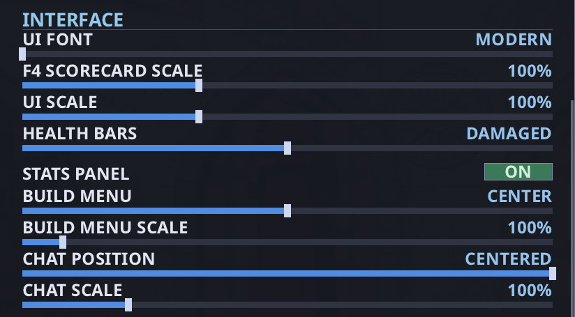

| Option | Default | What it does |
| --- | --- | --- |
| **UI Font** | Modern | The lettering of the interface's text. **Modern** is a clean bold sans-serif (the chat box's), sharp at every UI Scale; **Classic** is the look this engine had before: its blocky pixel font in the menus, rooms and Options, and the game's original serif faces in the HUD, scoreboard, briefings and Unit Info. The original decorative lettering (big messages, PAUSED, briefing headings, Unit Info labels, the title doors) is the same with either. Takes effect at once. |
| **F4 Scorecard Scale** | 100% | Size of the F4 player panel (50–200%). |
| **UI Scale** | 100% | Size of the in-game interface (50–200%). |
| **Health Bars** | Damaged | Off, only on damaged units, or always. |
| **Stats Panel** | On | Live statistics in the space under the minimap. |
| **Build Menu** | Center | Where the build icons sit: left, centre or right. |
| **Build Menu Scale** | 100% | Extra size for the build icons (75–400%). |
| **Chat Position** | Centered | Where the in-game chat box sits: left, or centred over the battlefield. |
| **Chat Scale** | 100% | Size of the in-game chat box, on top of UI Scale (50–300%, in 10% steps). |

The **stats panel** shows your units, kills and score, the clock, real time,
game time, the speed the game is actually running at (as a game-speed level: NORMAL,
+5, -3), client and server processor use and GPU use. It drops rows when there
is not enough room.

The **chat box** shows multiplayer chat during a game, just above the information
bar; in single player it shows what you type, such as [power codes](#power-codes).
Each message starts with the sender's name in their player colour (notices
from your own game, such as a cosmetic mod left out, are gold; power code and
poster lines are gold with no name) and wraps onto further lines instead of running off the screen.
The text is a clean bold sans-serif drawn at your screen's real resolution, so it
stays sharp at every Chat Scale and UI Scale (and on a Mac Retina display), and it
sits on a dark panel so it reads over bright sand and dark forest alike. Accented
Latin letters (é, ñ, ß, ...) show as typed; characters outside that set, such as
emoji or Chinese, show as **?**.
New messages appear at the bottom; each stays for 12 seconds and then fades out
over 2 seconds. While you type (**Enter**), the last eight messages stay up and
your line is shown under them after **SAY:**. The box never goes under the
command panel, and when a builder's build icons are in the way it moves up above
them. **Chat Scale** multiplies UI Scale, so 200% UI Scale with 150% Chat Scale
gives three times the 100% size; on a small window a very large box is shrunk
until it fits, and a long line you are typing scrolls so its end stays in view. Both options take effect at once, also during a game. They are
saved as `chatScale` and `chatAlign` (0 left, 1 centred) in `settings.ini`.

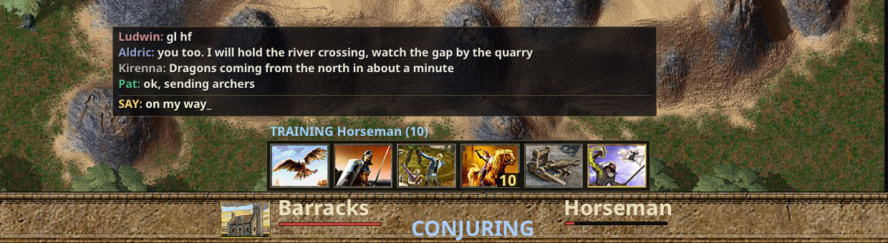

**UI Font** is saved as `uiFont = modern` or `uiFont = classic` in `settings.ini`; a
file without it uses Modern. With Modern, names keep their own capitals (players, maps,
mod packs, units), while labels such as **START** stay in capitals.

### Camera

| Option | Default | What it does |
| --- | --- | --- |
| **Mouse Zoom Speed** | 1× | Wheel zoom speed. |
| **Edge Scrolling** | On | Scroll when the cursor touches a screen edge. |
| **Edge Scroll Speed** | 1× | Edge scrolling speed. |
| **Cursor Size** | 1× | Cursor size, 1× (the original size) to 8×. |

Key bindings are under **Settings → Controls**.

---

## Multiplayer

Multiplayer uses a **server**. Every player connects out to the server, so
players do not need to open ports or set up their routers. The server runs the
game alongside the players, hosts the computer opponents and checks that every
player's game stays in step.

### Joining a game

1. Click the **Multiplayer** door.
2. Choose a server, or enter its address.
3. Enter an **account name** and **password**. A name the server has not seen
   before is registered the first time you sign in.
4. In the game browser, **create** a game or **join** one. Password-protected
   games ask for the password.
5. In the room, choose your side, colour and team, then click **Ready**. The host
   starts the game when everyone is ready. To take a different seat, click
   **Move here** on any open slot (see [Start locations](#match-options)).

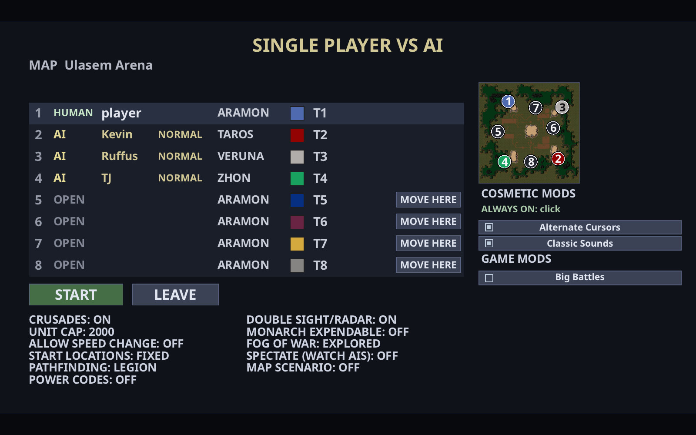

*A game room, here for a single-player game: player and AI slots, **Move here** on the open slots, the map with each start marked in the colour of the player who starts there, mod packs and the read-only match rules.*

The host can open and close empty slots, add AIs and kick players (a slot with a player in it cannot be turned into an AI or closed; kick the player first). Any seated player, the host included, can move to an open slot with **Move here** until the game starts; closed, AI and taken slots cannot be moved to, and campaign missions and Crusades battles keep their seats. Match options are
set when the game is created, except **Allow spectators**, which the host can
click in the room's rules to turn on or off until the game starts. It lights up
under the host's pointer; for everyone else it is read-only. See
[Match options](#match-options).

Under the rules, the room says whether the game plays the map's scenario
(**MAP SCENARIO: ON**) and, if so, what it changes and which seats it needs.
Each empty seat it needs is tagged **NEEDED BY SCENARIO**, and **Start** stays
greyed until they are all filled. A seated player whom the scenario gives no
units is named in amber (*NO PLACED UNITS: PLAYER N*). If the server still
refuses to start the game, the reason appears in red under the buttons.

### Maps and content

If you do not have the selected map, it is **downloaded automatically** before
the game starts. Downloaded and generated maps stay in your map list. See
[map sharing](map-transfer.md).

Everyone must have the **same base game data**. The server compares the game's
unit, weapon and build definitions when you join and turns away a mismatched
install.

### Teams, allies and diplomacy

Up to eight players can play, on up to eight teams. Allies share vision
automatically.

Press **D** for the **Diplomacy** screen:

- **Give units**: hand your selected units to an ally.
- **Share mana**: choose which teammates receive your surplus mana. Surplus goes
  first to the ally whose storage is least full. Sharing starts on for
  teammates.
- **Chat recipients**: choose who receives your chat messages.
- **Voice**: choose who hears you on [voice chat](#voice-chat).
- **Volume**: how loud each other player's voice plays for you.

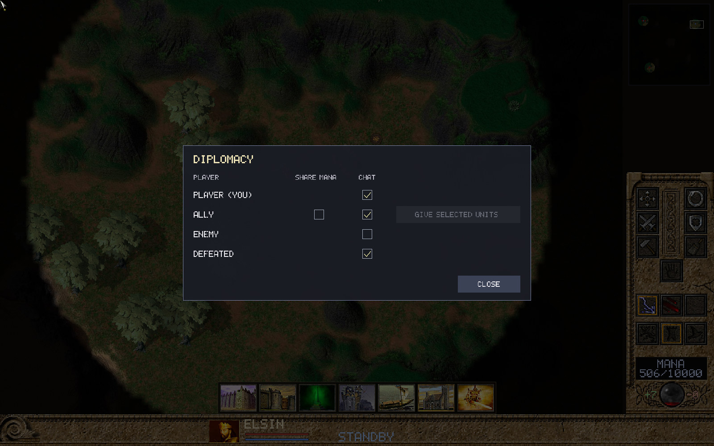

*The Diplomacy screen (**D**), from the engine's built-in input test, with voice chat on. The computer player (ENEMY) has no Volume slider.*

See [unit gifting](unit-gifting.md) for which units can be given.

### Spectating

Click **Watch** on a running game in the browser to watch it live. Spectators
see the whole map without fog, including every side's health bars, and cannot
give orders.

The host decides whether a game can be watched with **Allow spectators** (on by
default). When it is off, the browser shows a red **No watch** button instead of
**Watch**, and the server refuses any request to watch the game, including from a
player who left it or whose connection dropped. Clicking **No watch** shows the
reason under the game list: **Cannot join: spectators are not allowed in this
game**. A player who drops out still gets their own slot back (see
[Disconnects](#disconnects)). The setting is fixed once the game starts, so
nobody who is already watching is removed.

| Allow spectators | Browser shows | Asking to watch |
| --- | --- | --- |
| On (default) | **Watch** | Allowed |
| Off | **No watch** (red) | Refused, with the reason |

In single-player, **Spectate (Watch AIs)** is separate and always available: it is
your own game.

### Disconnects

If you drop out of a game, your slot is held and the game pauses for up to five
minutes so you can reconnect and catch up. If you do not return, you forfeit.

### Versions

**Everyone must use the same network protocol**, client and server alike.
Version 0.8.7 uses network protocol **284**. It cannot play with 0.8.6 (protocol
281) or any earlier version: the server turns away a client whose protocol
differs from its own, so a server and all of its players must update to 0.8.7
together.

If players' games ever fall out of step (a "desync"), the server detects it.
This should not happen between matching versions with matching game data; if it
does, please report it with the replay.

### Network use

The game sends orders, not unit positions, so it needs very little bandwidth:
about 0.5 KB/s per player plus a few bytes per order. Low latency and low packet
loss matter more than raw speed. Voice chat adds about 3 KB/s for each player
talking, and always gives way to the game (see [What is sent](#what-is-sent)).
The [README](../README.md#multiplayer-and-replays) has the details.

---

## Voice chat

Voice chat lets the people in a multiplayer room or game talk to each other,
while they hold a key (push to talk, the default) or whenever they speak (voice
activation). It is **off by default**. It works only in multiplayer:
single-player and campaign games, replays and the Benchmark have nobody to talk
to, so they never send or receive voice (the Voice Chat page can still be
opened there to test the microphone).

### Turning it on

1. Open the **Voice Chat** page: **Settings → Voice Chat** on the main menu,
   **Esc → Voice Chat** in a game, or the **Voice chat** row in the Audio section
   of **Options** (its **Back** then returns to Options).
2. Turn **Voice chat** on.
3. Speak, and check that the **Mic level** meter moves.
4. Click **Save**.

Changes apply at once, also in the middle of a game; **Save** keeps them for
next time. Everyone who wants to talk or listen needs voice chat turned on: a
player with it off cannot talk and is sent no voice at all.

### The Voice Chat page

While **Voice chat** is off, every other row is greyed out and ignores clicks.

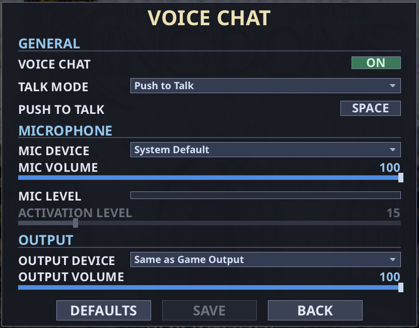

| Option | Default | What it does |
| --- | --- | --- |
| **Voice chat** | Off | Turns voice chat on or off. |
| **Talk mode** | Push to Talk | **Push to Talk** sends you while you hold the push-to-talk key. **Voice Activation** sends you by itself whenever the **Mic level** reaches the **Activation level**; no key is needed. |
| **Push to talk** | Space | The key you hold to talk. Click the row to open **Controls** and change it. Greyed out under **Voice Activation**. |
| **Mic device** | System Default | The microphone: **System Default**, or any input device by name. |
| **Mic volume** | 100 | How loud you are sent, 0 to 100. 100 sends the microphone as it is; lower values make you quieter. |
| **Mic level** | | A live meter of what the microphone hears, after **Mic volume**. Speak to test it. Under **Voice Activation** a white tick marks the **Activation level**. |
| **Activation level** | 15 | Under **Voice Activation**: you are sent while the **Mic level** reaches this, 0 to 100, on the meter's scale (the tick). Sending carries on for 0.4 seconds after you go quiet, so pauses between words are kept, and starts with the moment just before, so the first word is not cut. Raise it if background noise sets it off; lower it if your words are cut. 0 sends all the time. Greyed out under **Push to Talk**. |
| **Output device** | Same as Game Output | Where other players' voices play. **Same as Game Output** follows the game's own **Sound device**, also when you change it. You can instead choose **System Default** or any output device by name, for example a headset while the game plays on speakers. |
| **Output volume** | 100 | How loud voices play, 0 to 100: one value for every speaker, stereo or surround. It is separate from the game's own volumes. |

Device lists are sorted A to Z and read afresh each time you open one. A note
beside a device row says when something is wrong:

| Note | Meaning |
| --- | --- |
| **NOT FOUND - USING DEFAULT** | The chosen device is not plugged in. The system default is used meanwhile; the choice is kept, and the game goes back to the device when it returns. |
| **DEVICE LOST - USING DEFAULT** | The device went away while in use, so the system default took over. |
| **UNAVAILABLE** | No device could be opened at all. The game tries again every few seconds. |

**Defaults** resets only the voice chat settings: voice chat off, Push to Talk at
activation level 15, System Default microphone, Same as Game Output, and both volumes at 100. It does not change the
push-to-talk key (reset that in **Controls**), and the **Defaults** button in
**Options** does not change voice chat.

### Talking

Under **Push to Talk** (the default), hold **Space** to talk, in a multiplayer room before the game starts and during
the game. Release it to stop. Talking also stops at once if the game window loses
focus, if you start typing, or if you leave the room.

A key pressed while you are typing in a text box (the chat line, a lobby field,
your name) is typing, never talking, so a space in a chat message is just a
space.

Under **Voice Activation** no key is needed: you are sent whenever the **Mic
level** reaches the **Activation level**, also while you type or the window is
in the background, and the push-to-talk key does nothing.

To use another key, open **Settings → Controls** (**Esc → Controls** in a game,
or click **Push to talk** on the Voice Chat page). **PUSH TO TALK** is under
**VOICE**: click it and press the new key, or right-click it to unbind it.
**Enter**, the number keys and the arrow keys are refused, because the game uses
them for chat, squads and scrolling. If the key you choose already belongs to
another action, that action is left unbound.

While voice chat is on, the top-left corner of the screen shows who is talking:
**YOU** while you are sending, then the name of each player heard a moment ago,
in their colour, with a small speaker. Spectators are shown in grey.

### Who hears you

Before the game starts, everyone in the room who has voice chat on hears you.

In the game, the **Diplomacy** screen (**D**) chooses, like chat:

- The **Voice** column says who hears you. Everyone is ticked at the start of
  each game. Your own box cannot be changed: you never hear yourself.
  Spectators hear you only while every player is ticked.
- The **Volume** column sets how loud each other player's voice plays for you,
  0 to 100% (click or drag along the slider). Each game starts with every slider
  at 100%. Only other human players have one; computer players have no voice.
  The sliders are greyed out while voice chat is off, and they change only what
  you hear: nobody else is told.

Spectators cannot open the Diplomacy screen, so a spectator always talks to
everyone, as their chat does.

### What is sent

- The microphone is opened only while voice chat is on, and then only in a
  multiplayer room or game, or while the Voice Chat page is open for its level
  meter. Under **Push to Talk**, sound is recorded only while you hold the
  push-to-talk key, or while that page is showing the meter, and voice is sent
  **only while you hold the key**. Under **Voice Activation** the microphone
  listens the whole time you are in a multiplayer room or game, and voice is
  sent only while the **Mic level** reaches the **Activation level** (and for
  0.4 seconds after).
- Your voice goes to the game server, which passes it straight on to the
  players you chose. It travels on the same connection as the game, so it is
  encrypted when the server uses a secure (TLS) connection, as public servers do.
- Voice is never saved: not by the server, not in replays. It has no effect on
  the game itself.
- Each talker uses about 3 KB/s (Opus, 48 kHz mono). The game always comes
  first: if a player's connection cannot carry voice as well as the game, the
  server stops sending them voice for a few seconds (longer if it keeps
  happening) instead of slowing the game, and it starts again on its own. A
  talker whose own upload is too slow is paused the same way.

### When voice chat does not work

- **Space does nothing.** Voice chat must be on with **Talk mode** at **Push to
  Talk** (under Voice Activation the key does nothing), and you must be in a
  multiplayer room or game; check that no text box has the keyboard and that
  **Push to talk** shows the key you expect.
- **Voice activation sends noise, or cuts my words.** Watch the **Mic level**
  meter against its tick: raise **Activation level** above the level your
  room's background noise reaches, or lower it if your quiet words stay under
  it.
- **Nobody hears me.** Speak on the Voice Chat page: if **Mic level** stays
  still, the game is getting no sound from the microphone. Check **Mic device**
  and **Mic volume**, that the microphone is not muted in your system's sound
  settings, and that the system allows the game to use it (below). If the meter
  moves, check the **Voice** column in Diplomacy, and that the other players
  have voice chat on.
- **I hear nobody.** Check **Output device** and **Output volume**, and that
  player's **Volume** slider in Diplomacy.
- **UNAVAILABLE** or **NOT FOUND - USING DEFAULT** beside a device: plug the
  device in, or choose another one.
- **macOS.** The first time the microphone opens, macOS asks whether *Total
  Annihilation: Kingdoms* may use it. If you said no, the game records only
  silence: allow it under **System Settings → Privacy & Security → Microphone**,
  then restart the game. If you start the bare `takclient` program from
  Terminal instead of the app, macOS asks for Terminal.
- **Windows.** Under **Settings → Privacy & security → Microphone**, turn on
  **Microphone access** and **Let desktop apps access your microphone**.
  Sending voice needs Windows 10 version 1703 or later.
- **Voice cuts out for a while, then comes back.** Your connection or the other
  player's could not carry voice and the game together, so voice was paused to
  keep the game smooth.

---

## Campaigns

Click the **Campaign** door to open the campaign book. Two campaigns are
available if your install has their data:

| Campaign | Missions | Needs |
| --- | --- | --- |
| **The Book of Darien** | 48 | the base game (`missions.hpi`) |
| **The Iron Plague** | 25, with an alternate ending | *Iron Plague* (`IPMissions.hpi`) |

In the book:

- Choose a campaign tab, then use the page arrows, **Left/Right** or
  **Page Up/Page Down** to browse chapters.
- **Home/End** jumps to the first or last chapter. **Tab** switches campaigns.
- **Enter** plays the selected chapter. **Escape** returns to the menu.
- Every chapter can be selected, including the *Iron Plague* alternate ending.

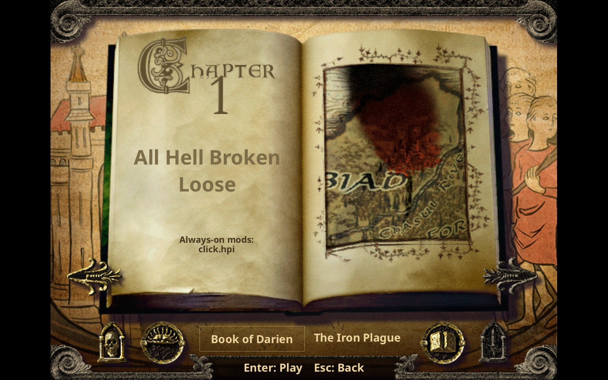

*The campaign book, with tabs for both campaigns at the bottom.*

Each mission plays its intro movie, then shows the briefing over the paused
battlefield. **Enter**, **Space**, **Escape** or a left click starts the
mission. The mouse wheel and **Up/Down** scroll long briefings. During play,
**O** (with nothing selected) shows the objectives.

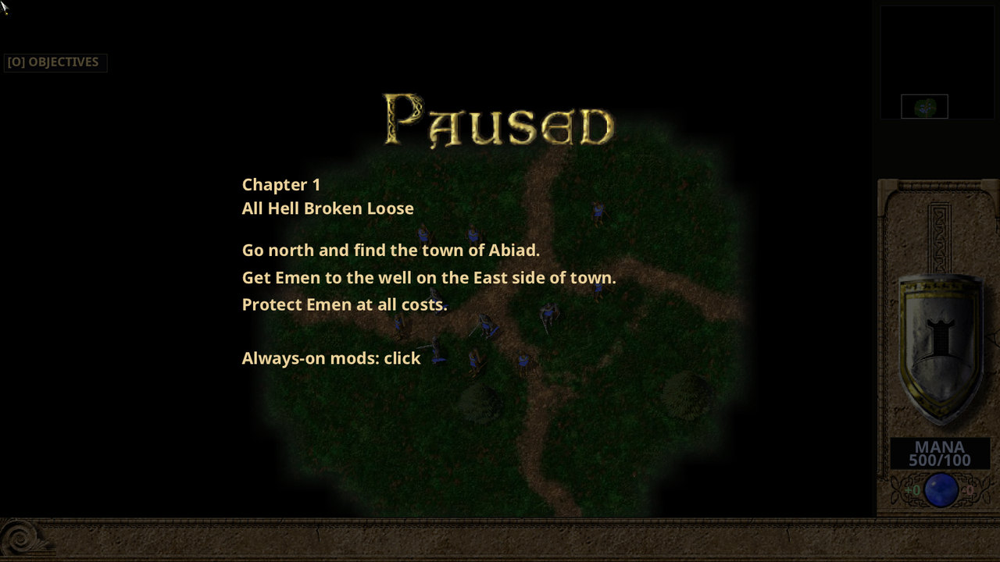

*The briefing for *Book of Darien* chapter 1, over the paused battlefield.*

When you win, **Next** goes to the next chapter and **Retry** replays this one.
Campaigns always use Retail pathfinding.

Mission scripting is reproduced from the original game, but individual missions
may still have problems. See the [campaign notes](campaign-design.md).

---

## Replays

Every game you play or watch is **recorded automatically**, including campaign
missions and games where you only spectate the AI (the Benchmark is not
recorded). Replays of games you
watched carry no checkpoint hashes, since a spectator does not report them.

The replay is written to disk while you play, so it is kept however the game
ends: a win or a loss, quitting, returning to the menu, a lost connection, the
computer shutting down, or the game being killed or crashing. It runs to the
moment you left, including anything played or watched after the result. If the
game was killed or crashed, the recording is finished the next time TAK Engine
starts and loses at most about the last second (after a power cut, up to about
the last ten seconds). If the disk fills up or the
replay folder cannot be written for a while, the game keeps the recording in
memory and writes it as soon as it can.

To watch one, open **Settings → Load Replay** on the main menu and choose a
recording. During playback:

- **Pause** pauses and resumes.
- **+** / **−** change playback speed.
- The time bar shows elapsed and total time.

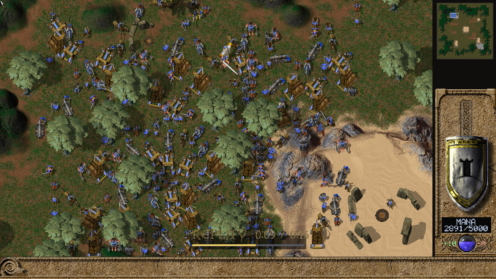

*Replay playback, with the time bar near the bottom.*

A replay stores the match setup and every order, not the game art, so it is
small. Playback needs:

- **a version of TAK Engine with the same network protocol** as the one that
  recorded it (0.8.7 plays protocol-284 recordings only, so replays recorded by
  0.8.6 or earlier need the version that recorded them);
- the same game data and map.

Older recordings need the engine version that made them. Keep an old copy of the
engine if you want to keep watching old replays.

Replays are saved beside your settings file; see
[Where files are kept](#where-files-are-kept). A server can also keep finished
games, if its operator turns that on.

---

## Mods

Mods replace game files. There are two kinds, each in its own folder inside
`mods/` in your install folder:

| Folder | Kind | What it may change |
| --- | --- | --- |
| `mods/cosmetic/` | **Cosmetic mods** | Textures, sprites, sounds, music, fonts and interface art. Never units, rules or anything else that changes the game. |
| `mods/game/` | **Game mods** | Everything, including units, weapons, build menus, maps, scripts and models. |

Put each pack in its own folder, for example
`mods/cosmetic/New Sounds/sounds/click.wav` or `mods/game/Big Units/units/...`.
A pack can hold loose files or `.hpi`, `.ufo` and `.kmp` archives. **Files
placed directly in `mods/` or `mods/game/` are never loaded.**

**Always-on cosmetic mods.** A `.hpi` archive placed directly in
`mods/cosmetic/`, for example `mods/cosmetic/click.hpi`, is always loaded, in
every game: skirmish, multiplayer, campaigns, map scenarios and replays. It is
filtered like any cosmetic mod, so it can only change what you see and hear. It
is not listed for ticking; the game room, the campaign screen and the mission
briefing name them instead (**ALWAYS ON**). To turn one off, move it out of the
folder. Only `.hpi` files count: other files directly in `mods/cosmetic/` are
ignored.

A cosmetic mod never stops a game. If an always-on archive or a ticked cosmetic
pack cannot be loaded (a damaged archive, or more than 256 MB of mods), or its
animation art would change game timing (for example the frame timing of a
storm effect), it is left out of that game and the game's chat says so.

In the game room you tick the packs you want (up to 64 of each kind). Packs of
one kind load in alphabetical order of their folder names; later names win when
they change the same file. Game packs load first, then the always-on archives,
then ticked cosmetic packs.

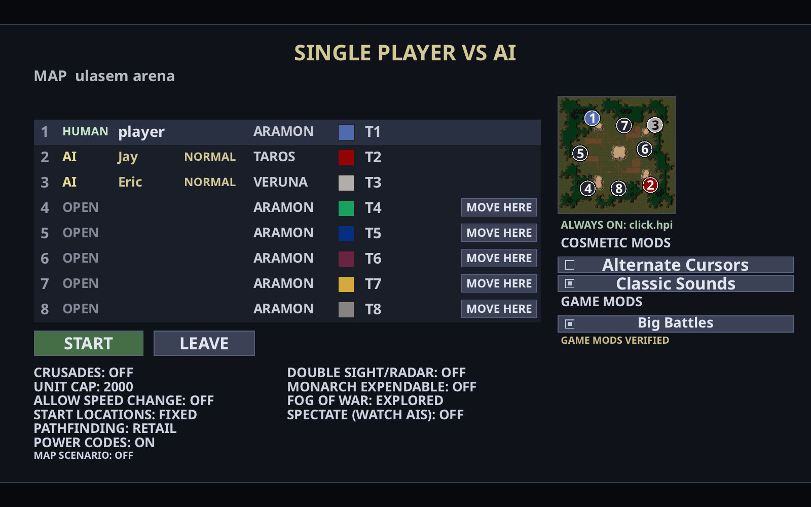

- **Cosmetic packs** are each player's own choice, in single player and in
  multiplayer, host or not. They change only what that player sees and hears,
  are never sent to the server or to other players, and players in one game may
  use different ones.
- **Game packs** in single player are always available: tick them in the room.
- **Game packs** in multiplayer need **Game mods: On** on the setup screen. Only
  the host ticks them; they are sent to the server and to every player
  automatically, and everyone checks they have the same package before the game
  starts. Transfers are limited to 256 MB.
- **Campaigns** use the original game data plus your always-on cosmetic
  archives only: no game packs and no ticked cosmetic packs.

The old `overrides/` folder is no longer read. Nothing in it is moved or
changed; move your packs into `mods/cosmetic/` or `mods/game/` yourself.

---

## Map editor

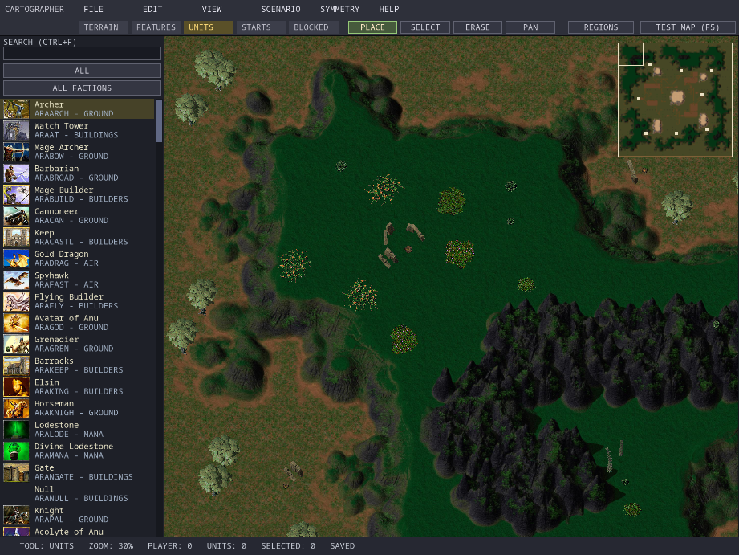

*Cartographer's Units browser, map canvas and minimap.*

**Cartographer** is TAK Engine's map and scenario editor. Launch it from its
application shortcut (**TAK Cartographer** on Windows and macOS, **Cartographer**
on Linux). It uses the same data folder as the game, and changing the folder in
either program changes it for both.

> **The [Cartographer user guide](cartographer-guide.md) covers the editor in
> full**, with pictures: a walkthrough for a first 2-player map, every tool,
> symmetry, random maps, scenarios and trigger rules, Check Map, Test Map,
> saving and sharing, preferences, and a complete keyboard reference. This
> section is a short overview.

### Basics

- A plain start opens the **New Map** dialog: choose a name, a size and a world
  and click **Create**, or **Random** for a generated map. **Ctrl+O** opens an
  existing map.
- **Ctrl+S** saves a playable `.kmp` map, by default in your install's `Maps`
  folder, where the game finds it the next time it starts; **Ctrl+Shift+S** is
  Save As. Saving keeps the previous version as a `.bak` file, and unsaved work
  gets recovery copies every minute.
- The five tools, **Terrain**, **Features**, **Units**, **Starts** and
  **Blocked** (impassable ground), each have a searchable browser on the left.
  The modes **Place**, **Select**, **Erase** and **Pan** decide what a left
  click does. Right-drag pans, the mouse wheel zooms, and the minimap at the
  top right moves the view.
- Terrain is built from the original game's sections, which bring their own
  heights. The terrain browser groups them by kind and by their original
  folders; numbered variants of a piece share one thumbnail, and clicking the
  selected piece again steps to its next variant.

  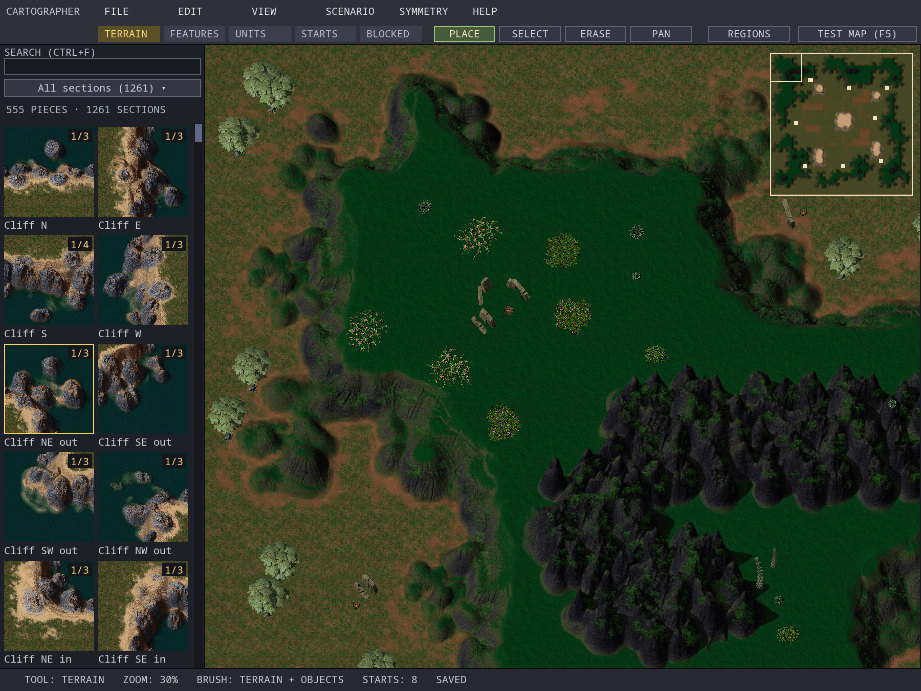

  *The grouped terrain browser on Ulasem Arena. The badge on each piece shows
  which of its variants is chosen and how many it has.*
- **Ctrl+Z** / **Ctrl+Y** undo and redo. **F6** previews a unit's 3D model.
- **View → Preferences** sets borderless fullscreen (**F11**), edge scrolling,
  the UI scale and the game data folder.
- With nothing left to cancel, **Esc** closes the editor (asking first only if
  there are unsaved changes).

### Symmetry and terrain copy

The **Symmetry** menu mirrors edits live across a chosen axis (**M**) or copies
one half, triangle or quadrant onto the rest of the map (**Shift+M**). Terrain
is never flipped; each section is replaced by its mirror-image twin. In the
Terrain tool's **Select** mode, **Ctrl+C** copies a rectangle of terrain with its
objects and **Ctrl+V** turns it into a brush. See
[Symmetry](cartographer-guide.md#symmetry) and
[Copying and pasting terrain](cartographer-guide.md#copying-and-pasting-terrain).

### Scenarios

Cartographer can add placed units, named **regions**, trigger **rules**
(**T**, with ready-made objective templates) and a **Use Only** unit list to a
map. **Scenario content runs in a test game** (Test Map, the game's
`--play-map` option, or the test copy that a test leaves in the map list) **and
in any game created with [Map scenario](#match-options) on**; with that option
off your saved map plays as a normal skirmish map.
**Scenario → Check map** (**C**) lists problems such as cut-off
starts, missing mana and wrong rule values. See
[Scenario maps](cartographer-guide.md#scenario-maps) and the
[scenario reference](crt-triggers.md).

### Testing a map

Press **F5** (**Test Map**) to open the current map, unsaved changes included,
in the game's private lobby. Seat the players your map needs and start; close
the game to return to the editor. A map with scenario content can start with
one player; an ordinary map needs two. The game can also open a Cartographer map
directly with `--play-map` (see [Command line](#command-line)). See
[Testing a map in the game](cartographer-guide.md#testing-a-map-in-the-game).

---

## Running a server

You only need your own server to host private online games; single-player starts
one for you automatically.

The Linux packages include the `takserver` dedicated server and a systemd
service with automatic Let's Encrypt certificates. The
[README's Linux server setup](../README.md#linux-server-setup) walks through
installing it step by step. In short:

- The server needs a copy of the **same retail game data** the players use.
- Players connect to TCP port **7677** by default. Port 80 is used briefly for
  certificate validation.
- Players sign in with accounts, which register themselves on first sign-in.
- `takserver --status` on the server machine prints how many games and players
  are active.

See [public server deployment](public-server.md) for manual certificates,
resource limits, upgrades and troubleshooting.

**Upgrade the server and players together.** A server only accepts clients of
the same protocol version (0.8.7 uses protocol 284; 0.8.6 uses 281).

---

## Benchmark

**Settings → Benchmark** runs a repeatable stress test: an eight-AI battle on
Ulasem Arena for 60 seconds of game time. Choose an **intensity**:

| Intensity | New units per side |
| --- | --- |
| Low | every second |
| Medium | every 0.5 s |
| High | every 0.25 s |
| Very High | every 0.125 s |
| Absurd | every 0.0625 s |
| Extra Absurd | every 0.03125 s |

The results screen shows, every ten seconds, frame rate, simulation speed (as
a game-speed level, like the stats panel), processor use, memory, GPU use and video memory, together with the display
settings used. Unit limits still apply, so the highest intensities may not
reach their requested unit counts. A slow machine can take longer than 60 real
seconds.

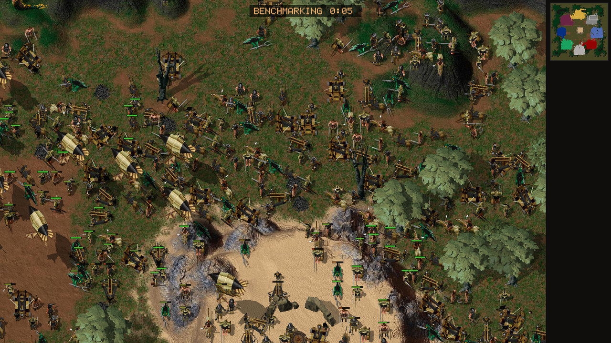

*A benchmark run at Absurd intensity, 55 seconds in. The badge at the top counts down the time remaining.*

---

## Troubleshooting and FAQ

### The game cannot find my game data

- Choose the folder that contains `data.hpi`, `terrain.hpi`, `sections.hpi` and
  `maps.hpi`, not a parent or child folder.
- To switch to another install, use **Data folder** in Options (or
  **View → Preferences** in the map editor) and restart when asked.
- If the game says core data is unreadable, the archives may be damaged; copy
  them again from your original installation.
- On Linux with no folder picker, install `kdialog` or `zenity`, or start the
  game with `--data /path/to/install`.

### Creon is missing or a Creon player starts with nothing

Creon needs the *Iron Plague* archives (`IPData.hpi` and the other `IP*.hpi`
files) in your install folder. See [Creon](#creon).

### The game is slow or stutters

- Leave **Smooth Motion** on; it makes movement look smooth at any frame rate.
- Turn **Shadows** off. It is the largest graphics cost in big battles.
- Leave **Hardware Cursor** on so the pointer stays responsive.
- Very large armies are expensive at high game speeds.
- In Legion mode, armies of several thousand units cost more processor time than
  in Retail.
- The **Benchmark** gives comparable numbers if you want to measure a change.

### The whole screen flickers on a large display

On very high resolutions, especially with KDE on Wayland, whole-screen flicker
usually means the graphics card has run out of video memory and the desktop
itself is being starved. TAK Engine caps and backs off its own video-memory use
to avoid this. If it still happens:

- close other programs that use the GPU heavily;
- set **Options → Graphics → GPU Memory Limit** to 768 MB or 512 MB;
- turn **Smooth GUI Art** off and **Shadows** off;
- use a lower resolution.

### The game will not start, or shows a black screen

If this started after you changed **Options → Graphics → Renderer**, set it back
to Auto by hand: close the game, open `settings.ini` (see
[Where files are kept](#where-files-are-kept)) in a text editor, and change the
line `renderer = ...` to

```
renderer = auto
```

(deleting the line works too). The game also falls back to Auto by itself when a
backend cannot start at all; editing the file is only needed when the backend
starts but then misbehaves.

### There is no sound, or sound comes from the wrong device

Choose the device under **Options → Audio → Sound device**. If a saved device is
unplugged, the game falls back to the system default.

### Voice chat does not work

See [When voice chat does not work](#when-voice-chat-does-not-work). Voice chat
is off by default, works only in multiplayer, and on macOS and Windows needs
the system's permission to use the microphone.

### I cannot join a multiplayer game

- Check that you and the server run the **same version**.
- Check that you have the same base game data as the server.
- Map downloads are automatic; wait for the map to verify in the lobby.

### My old replays will not play

Replays only play on an engine version with the same network protocol as the
one that recorded them (0.8.7 uses protocol 284, 0.8.6 uses 281). See
[Replays](#replays).

### Where files are kept

Settings, saved replays and downloaded content live in a per-user folder:

| System | Folder |
| --- | --- |
| Windows | `%APPDATA%\TAKengine\TAKingdoms\` |
| macOS | `~/Library/Application Support/TAKengine/TAKingdoms/` |
| Linux | `~/.local/share/TAKengine/TAKingdoms/` |

The settings file is `settings.ini`. Replays (`.takrep` files) are saved beside
it; a game still being recorded is a `.takrep.part` file, with a small
`.takrep.part.chk` beside it, until it ends. Cartographer keeps its preferences in a sibling `Cartographer` folder.

The game prints diagnostic messages to the terminal it was started from. On
Linux and macOS, start it from a terminal if you need them for a bug report.

### Command line

Released builds keep the command line deliberately small:

| Option | Effect |
| --- | --- |
| `--data <folder>` | Use this game-data folder. Optional: without it, the game uses the saved folder or asks. |
| `--play-map <map.kmp>` | Open a Cartographer map snapshot in a private game lobby. |
| `--version` | Print the version and exit. |

Everything else is set in the menus. Developer builds have many more options;
see the [development guide](development.md).

---

## Differences from the original game

TAK Engine follows the original game closely. These are the deliberate
differences:

- **Modern platforms**: any resolution, UI scaling, borderless fullscreen,
  hardware cursor and smooth motion between game updates.
- **Client-server multiplayer** with accounts, spectators, reconnecting,
  automatic map transfer, voice chat (push to talk or voice activation) and up
  to eight players.
- **Gods do not appear on their own** in skirmish or multiplayer. They can still
  be conjured.
- **Legion pathfinding** is available as an alternative; Retail remains the
  default and reproduces the original.
- **Units walk to a clear shot** when their shots keep stopping on a hill,
  water or indestructible scenery (see [Blocked shots](#blocked-shots)); the
  original fires on into it.
- **Builders clear their own building sites** of trees and rocks, and can build
  lodestones over a whole area at once.
- **Patrolling builders repair** nearby friendly units.
- **Area reclaim** with a right-drag box.
- **Mana sharing and unit gifting** between allies through the Diplomacy screen.
- **Sound fades with distance** from the camera instead of using one off-screen
  volume.
- **Boat shadows** and shadows on every lodestone.
- **A random map generator**, a modern map editor and **mod packs**.
- **Emotes** (Disco and Headbang).
- **Power codes** act for the player who types them, posters are PNG pictures of
  the whole map, and the game keeps running while one is made. See
  [Power codes](#power-codes).

Everything else, such as unit statistics, weapons, the economy, the AI's
choices and the campaign scripts, aims to behave as it did in 1999. If you find
a difference that is not listed here, it is probably a bug. Please report it.
